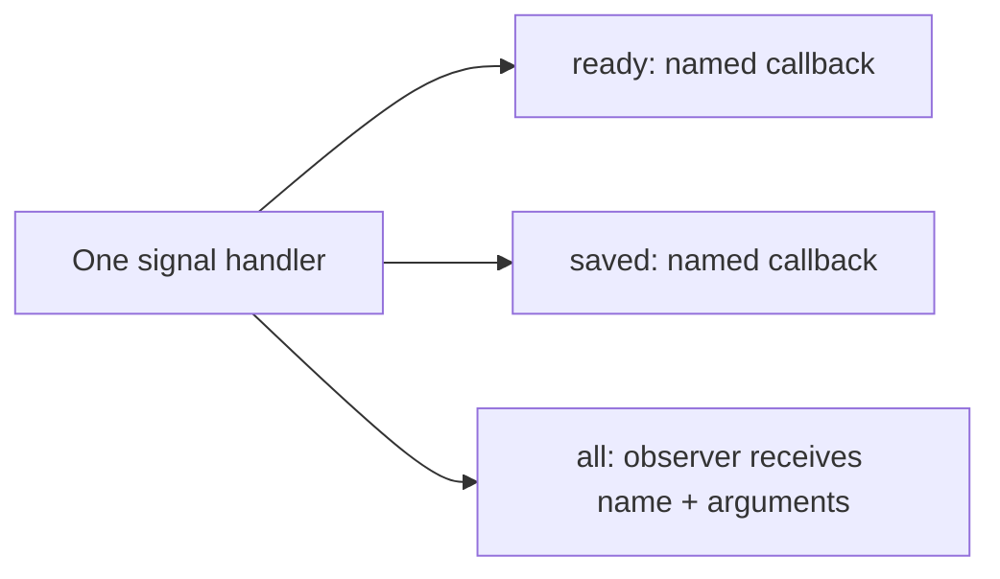

# Signals, observers and mutable arguments

[简体中文](SIGNALS.zh-CN.md) · [README](../README.md)

Use a signal handler (`hx_os_signal_handler`) when a component completes an action (such as loading configuration, saving records, or updating state) and needs to notify in-process subscribers. Callbacks execute **synchronously on the emitting thread** without spawning background workers or introducing a hidden process-wide event bus.

### Quick Start Example

Open [signal_observer.c](../examples/signal_observer.c) for a complete runnable program: it creates a signal handler, subscribes to all signal names via `hx_os_signal_connect_all()`, populates a calldata pack with `items = 42`, emits `ready` and `saved`, and closes the handler cleanly with `hx_os_signal_handler_close_until()`.

Follow the [example run instructions](../examples/README.md#run) to enable examples and build `hx_os_signal_observer` (no command-line arguments or input files are required):

```sh
cmake --build build --config Release --target hx_os_signal_observer
```

Expected output:

```text
ready: 42 items
saved: 42 items
```

Use a named subscription when you care about a single event name, or see the [complete volume example](../examples/signal_mutable.c) in Section 6 when callbacks need to modify parameters in place (for example, capping `volume` from `80` to `60`). You can also copy [signal_observer.c](../examples/signal_observer.c) as your starting `main.c` in the [minimal project](USAGE.md#c-project) setup.

## 1. Choose one name or every name

A signal handler belongs to your component instance:

| Need | C API | C++11 API |
| --- | --- | --- |
| Subscribe to one specific signal name | `hx_os_signal_connect` | `SignalHandler::connect` |
| Subscribe to every signal emitted by the handler | `hx_os_signal_connect_all` | `SignalHandler::connectAll` |
| Emit a notification | `hx_os_signal_emit` | `SignalHandler::notify` |
| Remove a subscription and wait for in-flight callbacks | `hx_os_signal_disconnect_until` | `SignalHandler::disconnectUntil` |
| Close the handler and wait for all callbacks | `hx_os_signal_handler_close_until` | `SignalHandler::closeUntil` |

- **All-signal observers (`connect_all`)**: A `connect_all` subscription receives every signal emitted on that handler, including signal names first emitted after registration, and consumes only a single connection slot.
- **Exact literal matching**: Subscribing by name to `"*"` matches only a signal whose name is literally `"*"`; it is not a wildcard.



Named callbacks and all-signal observers share a single registration order. Emitting `ready` invokes all `ready` callbacks and all-signal observers in registration order without invoking `saved` callbacks.

## 2. Run the C example

In [signal_observer.c](../examples/signal_observer.c), the observer callback receives the signal name and a borrowed read-only argument view (`const hx_os_signal_arguments *`):

```c
static hx_os_status HX_OS_CALL on_signal(const char *name,
	const hx_os_signal_arguments *arguments, void *user, hx_os_error *error)
{
	int64_t items;
	hx_os_status status;

	(void)user;
	status = hx_os_signal_arguments_get_i64(arguments, "items", &items,
		error);
	if (status == HX_OS_OK)
		printf("%s: %lld items\n", name, (long long)items);

	return status;
}
```

Build after configuring the project with examples enabled:

```sh
cmake --build build --config Release --target hx_os_signal_observer
```

Run `build/bin/Release/hx_os_signal_observer.exe` on Visual Studio or `./build/bin/hx_os_signal_observer` on single-config Linux generators. Expected output:

```text
ready: 42 items
saved: 42 items
```

Because `hx_os_signal_emit()` returns only after all matching callbacks finish, keep callbacks brief. If you want to offload work to a thread pool, copy the arguments inside the callback first using `copy()` (Section 3)—never pass the borrowed view pointer to an asynchronous task.

## 3. Read arguments or retain a copy

All-signal observers and general read-only observers receive `const hx_os_signal_arguments *` (legacy named callbacks continue to receive `const hx_os_calldata *` with an unchanged ABI):

| Function (prefixed with `hx_os_signal_arguments_`) | Behavior |
| --- | --- |
| `count()` | Returns the number of arguments (`0` for a NULL view) |
| `get_bool` / `i64` / `u64` / `double` / `string` / `bytes` / `pointer()` | Reads a field by exact type without implicit numeric or string conversion |
| `get()` | Reads a tagged `hx_os_param_value` for runtime type inspection |
| `at()` | Enumerates fields by `0..count-1` index (do not rely on persistent field ordering) |
| `copy()` | Deep-copies an independent owned `hx_os_params *`; free with `hx_os_params_destroy()` |

- **Status codes**: Missing fields return `HX_OS_NOT_FOUND`, wrong types return `HX_OS_TYPE_MISMATCH`, and out-of-range indices return `HX_OS_RANGE` (leaving output variables unchanged on failure). Reading from the view allocates no memory; string lengths preserve embedded NUL (`\0`) bytes while field names remain NUL-terminated UTF-8.
- **Borrowed lifetime vs. owned copy**: The view pointer, signal name, field names, and string slices are **valid only until the callback returns**. For deferred or asynchronous processing, call `hx_os_signal_arguments_copy(arguments, context, &owned, &error)` inside the callback: it copies all names, strings, and byte slices (raw `pointer` fields remain shallow borrowed pointers whose pointee lifetime belongs to the application). Copying requires `HX_OS_ENABLE_PARAMETERS` and honors the [parameter pack's limits](PARAMETERS.md).

## 4. C++11 call shape

Include `<hx/Signal.hpp>` to register exception-free lambdas or function objects:

```cpp
auto connected = handler.connectAll(
	[](hx::StringView name, hx::SignalArguments args) noexcept
		-> hx::Result<void> {
		auto count = args.integer("items");
		if (!count)
			return hx::Failure(count.error());

		std::printf("%.*s: %lld items\n", static_cast<int>(name.size()),
			name.data(), static_cast<long long>(count.value()));

		return hx::Result<void>();
	});
if (!connected)
	return connected.status();
```

- **Disconnecting and lifetime**: Save `connected.value()` if you want to remove that subscription later via `disconnectUntil()`; closing the `SignalHandler` also retires all of its subscriptions. Any application state captured by a callback must outlive in-flight executions.
- **Reading arguments**: `args.stringView()` borrows a slice, `args.string()` returns an owned `Result<hx::String>`, and `args.copy()` returns an owned `Result<Parameters>`; `unsignedInteger()` and `bytesView()` read `uint64_t` and binary byte slices.
- **Qt `emit` compatibility**: Prefer `handler.notify()` in C++ projects that include Qt headers; the `handler.emit()` alias is also preserved by temporarily shielding and immediately restoring any caller `emit` macro.

## 5. Ordering, errors, closing and cost

- **Per-emission snapshot**: Each emission snapshots matching subscriptions in registration order. Subscriptions added inside a callback take effect on the next emission, while a subscription disconnected before its turn is skipped.
- **First error retained while continuing dispatch**: If a read-only callback fails, the handler records the first error and continues invoking the remaining eligible callbacks; `called` reports how many callbacks were actually started.
- **Unlocked callback execution**: Callbacks execute outside the handler's internal mutex, so concurrent emitters on different threads can enter the same callback simultaneously—synchronize shared application state accordingly.
- **Safe disconnect and deadlock detection**: `hx_os_signal_disconnect_until()` prevents future starts and waits for in-flight executions of that connection to finish (preserving the handler and borrowed state for retry on timeout, and returning `HX_OS_DEADLOCK` if called from within the current or an ancestor callback).
- **Small-snapshot stack optimization**: Connection slots are preallocated when the handler is created. Emissions matching up to `16` subscriptions use a `128`-byte stack snapshot buffer with zero heap allocation; larger subscriber lists perform a single bounded allocation.

## 6. Change parameters during a notification

When subscribers need to validate, clamp, or enrich parameters in place during emission, subscribe with `hx_os_signal_connect_mutable()` (single name) or `hx_os_signal_connect_all_mutable()` (all names), and emit using `hx_os_signal_emit_params(handler, name, parameters, &called, &error)` with an owned `hx_os_params *`.

Build and run the [complete volume example](../examples/signal_mutable.c) (target `hx_os_signal_mutable`): the caller starts with `volume = 80`, a mutable callback caps it at `60`, and both the subsequent observer and the caller read the updated value:

```text
Observer: volume = 60
Caller: volume = 60
```

> [!IMPORTANT]
> **Mutable signal semantics: immediate in-place updates without automatic rollback**
> - **Updates are visible immediately**: If callback A changes `volume` from `80` to `60` and then returns an error, subsequent callbacks still run and observe `60`, and `emit_params` returns callback A's error at the end.
> - **Failure does not roll back earlier setters**: A single failing setter leaves that field unchanged, but previously applied setter calls are **not** undone. Inspect both the returned status and the resulting parameter state.
> - **Borrow protection during dispatch**: The handler borrows `parameters` for the duration of the synchronous `emit_params` call; attempting to destroy the pack with `hx_os_params_destroy()` inside a callback returns `HX_OS_BUSY`. Also remember that mutating a pack (directly or via a nested emission) invalidates any `string` or `bytes` views previously borrowed from that pack.

## 7. Keep existing callbacks compatible

A single handler can mix legacy fixed-calldata callbacks, general read-only observers, and mutable-parameter callbacks:

| Registered subscription | Emitting via `hx_os_signal_emit` (fixed `calldata`) | Emitting via `hx_os_signal_emit_params` (growable `params`) |
| --- | --- | --- |
| Existing fixed read-only callback | Borrows the caller's `hx_os_calldata` directly | Receives a temporary fixed projection whenever all fields are representable |
| `connect_observer` / `connect_all` | Borrows a read-only view | Borrows a read-only view supporting all seven parameter types |
| Mutable callback (`*_mutable`) | Skipped; records `HX_OS_TYPE_MISMATCH` | Borrows and mutates the caller's `hx_os_params` in place |

When `emit_params` carries `bytes` or `u64` fields (which fixed `calldata` cannot represent), legacy fixed callbacks are skipped and `HX_OS_UNREPRESENTABLE` is recorded; if field counts or string sizes exceed fixed `calldata` limits, `HX_OS_LIMIT` is recorded. Incompatible callbacks are not started (and are excluded from `called`), while compatible observers and mutable callbacks still run.

In C++11, use `observe(name, callback)`, `connectMutable(name, callback)`, `connectAllMutable(callback)`, and `notifyMutable(name, parameters)`:

```cpp
auto connected = handler.connectMutable("volume",
	[](hx::ParametersRef data) noexcept -> hx::Result<void> {
		auto volume = data.integer("volume");
		if (!volume)
			return hx::Failure(volume.error());

		return data.setInt("volume", volume.value() > 60
			? 60 : volume.value());
	});
if (!connected)
	return connected.status();

auto notified = handler.notifyMutable("volume", parameters);
if (!notified)
	return notified.status();
```

## 8. Call a named procedure with a growable result

Whereas a signal notifies zero or more subscribers, a named procedure (`hx_os_proc_handler`) invokes a single registered handler and publishes an owned result pack on success. Register with `hx_os_proc_add_params()` and invoke with `hx_os_proc_call_params(handler, name, input, &result, &error)`:
- **Private working copy and all-or-nothing result publication**: The library copies `input` (or creates an empty pack when `input` is `NULL`) using the handler's `context` and passes that private copy to the procedure callback. **Only when the callback returns `HX_OS_OK`** is the owned `result` published to the caller (destroy it with `hx_os_params_destroy()` when done); on any error, the partial copy is freed and `result` remains `NULL`. Cloning requires exclusive access to the source pack. Use separate inputs for concurrent calls. For `SignalHandler` and `ProcedureHandler`, `create()` uses the constructor context and `create(nullptr)` explicitly selects the default.
- **Shared namespace and type checking**: Fixed and growable procedures share one name table per handler; calling a procedure with the wrong parameter-pack API returns `HX_OS_TYPE_MISMATCH` without invoking the callback. In C++11, use `ProcedureHandler::addParams(name, callback)` and `callParams(name, input)` returning `Result<Parameters>` (see [parameter ownership](PARAMETERS.md) for pack lifetime rules).
