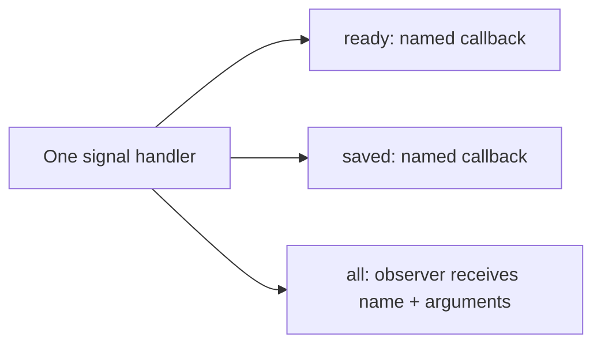

# Signals and observing every notification

[简体中文](SIGNALS.zh-CN.md) · [README](../README.md)

## 1. Choose one name or every name

A signal handler belongs to your component. It holds subscriptions and synchronously calls them when that component emits a signal. It does not create a worker, message queue, or process-wide event bus.

| Need | C | C++11 |
| --- | --- | --- |
| Receive one exact name | `hx_os_signal_connect` | `SignalHandler::connect` |
| Receive every name from one handler | `hx_os_signal_connect_all` | `SignalHandler::connectAll` |
| Send a notification | `hx_os_signal_emit` | `SignalHandler::notify` |
| Stop a subscription and wait for its callbacks | `hx_os_signal_disconnect_until` | `SignalHandler::disconnectUntil` |
| Stop the handler and wait for all callbacks | `hx_os_signal_handler_close_until` | `SignalHandler::closeUntil` |

An all-signal subscription also receives names first used after registration. It consumes one connection slot, not one slot per name. A named subscription to `"*"` still receives only the literal name `"*"`; it is not a wildcard.



All three callbacks share registration order. Emitting `ready` selects its named callbacks and all-signal observers; it does not run `saved` callbacks.

## 2. Run the C example

[signal_observer.c](../examples/signal_observer.c) is a complete program. It registers one observer, then sends `ready` and `saved`, each containing the integer `items = 42`. Its callback is:

```c
static hx_os_status HX_OS_CALL on_signal(const char *name,
	const hx_os_signal_arguments *arguments, void *user, hx_os_error *error)
{
	int64_t items;
	hx_os_status status;

	(void)user;
	status = hx_os_signal_arguments_get_i64(arguments, "items", &items,
		error);
	if (status == HX_OS_OK)
		printf("%s: %lld items\n", name, (long long)items);

	return status;
}
```

Build after configuring the normal project with examples enabled:

```sh
cmake --build build --config Release --target hx_os_signal_observer
```

Run `build/bin/Release/hx_os_signal_observer.exe` with a Visual Studio generator, or `./build/bin/hx_os_signal_observer` with a single-configuration Linux generator. Expected output:

```text
ready: 42 items
saved: 42 items
```

The emitting call returns only after the selected callbacks finish. Keep callbacks brief. Moving work to your own pool requires an owned argument copy and your usual bounded submission/error handling.

## 3. Read arguments or retain a copy

`hx_os_signal_arguments` is a borrowed, read-only view supplied to all-signal callbacks. Named callbacks retain their existing `const hx_os_calldata *` interface. The fixed calldata ABI is unchanged.

| Operation | Behavior |
| --- | --- |
| `count()` | Number of arguments; null view returns zero |
| `get_bool/i64/double/string/pointer()` | Exact type; no implicit numeric/string conversion |
| `get()` | Tagged `hx_os_param_value` for a type selected at runtime |
| `at()` | Zero-based enumeration; do not persist assumptions about field order |
| `copy()` | Independent owned `hx_os_params`; free using `hx_os_params_destroy` |

The C names above start with `hx_os_signal_arguments_`. Missing fields return `HX_OS_NOT_FOUND`, wrong types `HX_OS_TYPE_MISMATCH`, and an invalid index `HX_OS_RANGE`. Getters preserve outputs on failure. Views refer to the original values and require no allocation. String lengths preserve embedded NUL bytes; names remain NUL-terminated UTF-8.

The view object, signal name, field names, and string spans are valid only during that callback. Do not store the view address, destroy it, or cast it to a mutable pack. The emitter keeps input calldata alive and unchanged until emission finishes, including through allocator callbacks. Borrowed pointer values still require the application to keep the pointed-to objects alive and synchronized.

For deferred use, call `hx_os_signal_arguments_copy(arguments, context, &owned, &error)` inside the callback. It copies names and strings; raw pointer values remain borrowed. On failure, `owned` is null and partial storage is reclaimed. This entry requires `HX_OS_ENABLE_PARAMETERS` and uses the [parameter pack's default bounds](PARAMETERS.md). Reading and observing still work when that module is disabled. The current emitting API carries the five existing calldata types; a separate growable pack does not automatically extend that ABI.

## 4. C++11 call shape

Include `<hx/Signal.hpp>`. For an existing `hx::SignalHandler signals`, registration can be written as follows in a function returning `hx_os_status`:

```cpp
auto connected = signals.connectAll(
	[](hx::StringView name, hx::SignalArguments args) noexcept
		-> hx::Result<void> {
		auto count = args.integer("items");
		if (!count)
			return hx::Failure(count.error());

		std::printf("%.*s: %lld items\n", static_cast<int>(name.size()),
			name.data(), static_cast<long long>(count.value()));

		return hx::Result<void>();
	});
if (!connected)
	return connected.status();
```

Include `<cstdio>` for printing. Save `connected.value()` when you need to remove that subscription separately. The handler also retires its subscriptions during successful closing. Captured application objects must outlive in-flight callbacks; use the explicit deadline-based close contract already required by `SignalHandler`.

`args.stringView()` borrows; `args.string()` returns an owned string; `args.copy()` returns `Result<Parameters>` for an independent pack. `value()` and `at()` expose the same tagged values as C. Callbacks return `void`, `hx_os_status`, or `Result<void>` and follow the existing no-exception contract.

Use `notify()` in Qt code. The old `emit()` alias remains available for source compatibility; the header temporarily shields that declaration from the Qt macro and restores the caller's macro immediately. Neither spelling depends on Qt.

## 5. Ordering, errors, closing and cost

- One emission snapshots eligible connections in registration order. Connections added during a callback wait until the next emission. Disconnecting a callback before it starts skips it.
- Read-only callback failure retains the first error and continues notifying the other eligible subscriptions. The `called` output counts callbacks actually started.
- Concurrent emitters may enter the same callback at the same time. Callbacks run outside the handler's mutex; protect application state yourself. Recursive emission remains bounded by the existing depth limit.
- A successful disconnect prevents subsequent starts. `disconnect_until` also waits for in-flight execution and cleanup. Timeout leaves the handler and borrowed objects alive for retry. Waiting for the current or an ancestor callback returns `HX_OS_DEADLOCK`.
- Successful registration owns the optional cleanup action. Failed registration does not invoke it. Cleanup runs once after the connection retires; it must not unload code still needed by other in-flight calls.
- Handler creation preallocates bounded connection slots. C registration and argument reads add no allocation. A nonempty emission retains the existing one bounded snapshot allocation; the new view uses stack storage. C++ registration allocates capture storage, and explicit copying allocates owned values.

`HX_OS_ENABLE_SIGNALS=OFF` leaves explicit unsupported entry points. Named procedures still use their distinct single-callback/result-publication contract. This guide describes read-only observation; it does not promise mutable signal arguments.
