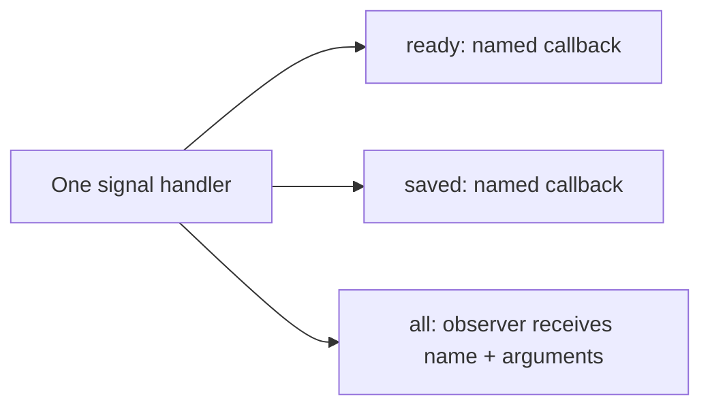

# Signals, observers and mutable arguments

[简体中文](SIGNALS.zh-CN.md) · [README](../README.md)

## 1. Choose one name or every name

A signal handler belongs to your component. It holds subscriptions and synchronously calls them when that component emits a signal. It does not create a worker, message queue, or process-wide event bus.

| Need | C | C++11 |
| --- | --- | --- |
| Receive one exact name | `hx_os_signal_connect` | `SignalHandler::connect` |
| Receive every name from one handler | `hx_os_signal_connect_all` | `SignalHandler::connectAll` |
| Send a notification | `hx_os_signal_emit` | `SignalHandler::notify` |
| Stop a subscription and wait for its callbacks | `hx_os_signal_disconnect_until` | `SignalHandler::disconnectUntil` |
| Stop the handler and wait for all callbacks | `hx_os_signal_handler_close_until` | `SignalHandler::closeUntil` |

An all-signal subscription also receives names first used after registration. It consumes one connection slot, not one slot per name. A named subscription to `"*"` still receives only the literal name `"*"`; it is not a wildcard.



All three callbacks share registration order. Emitting `ready` selects its named callbacks and all-signal observers; it does not run `saved` callbacks.

## 2. Run the C example

[signal_observer.c](../examples/signal_observer.c) is a complete program. It registers one observer, then sends `ready` and `saved`, each containing the integer `items = 42`. Its callback is:

```c
static hx_os_status HX_OS_CALL on_signal(const char *name,
	const hx_os_signal_arguments *arguments, void *user, hx_os_error *error)
{
	int64_t items;
	hx_os_status status;

	(void)user;
	status = hx_os_signal_arguments_get_i64(arguments, "items", &items,
		error);
	if (status == HX_OS_OK)
		printf("%s: %lld items\n", name, (long long)items);

	return status;
}
```

Build after configuring the normal project with examples enabled:

```sh
cmake --build build --config Release --target hx_os_signal_observer
```

Run `build/bin/Release/hx_os_signal_observer.exe` with a Visual Studio generator, or `./build/bin/hx_os_signal_observer` with a single-configuration Linux generator. Expected output:

```text
ready: 42 items
saved: 42 items
```

The emitting call returns only after the selected callbacks finish. Keep callbacks brief. Moving work to your own pool requires an owned argument copy and your usual bounded submission/error handling.

## 3. Read arguments or retain a copy

`hx_os_signal_arguments` is a borrowed, read-only view supplied to all-signal callbacks. Named callbacks retain their existing `const hx_os_calldata *` interface. The fixed calldata ABI is unchanged.

| Operation | Behavior |
| --- | --- |
| `count()` | Number of arguments; null view returns zero |
| `get_bool/i64/u64/double/string/bytes/pointer()` | Exact type; no implicit numeric/string conversion |
| `get()` | Tagged `hx_os_param_value` for a type selected at runtime |
| `at()` | Zero-based enumeration; do not persist assumptions about field order |
| `copy()` | Independent owned `hx_os_params`; free using `hx_os_params_destroy` |

The C names above start with `hx_os_signal_arguments_`. Missing fields return `HX_OS_NOT_FOUND`, wrong types `HX_OS_TYPE_MISMATCH`, and an invalid index `HX_OS_RANGE`. Getters preserve outputs on failure. Views refer to the original values and require no allocation. String lengths preserve embedded NUL bytes; names remain NUL-terminated UTF-8.

The view object, signal name, field names, and string spans are valid only during that callback. Do not store the view address, destroy it, or cast it to a mutable pack. The emitter keeps input calldata alive and unchanged until emission finishes, including through allocator callbacks. Borrowed pointer values still require the application to keep the pointed-to objects alive and synchronized.

For deferred use, call `hx_os_signal_arguments_copy(arguments, context, &owned, &error)` inside the callback. It copies names and strings; raw pointer values remain borrowed. On failure, `owned` is null and partial storage is reclaimed. This entry requires `HX_OS_ENABLE_PARAMETERS` and uses the [parameter pack's limits](PARAMETERS.md): fixed calldata selects defaults; growable input preserves its configured bounds. Reading and observing still work when that module is disabled. The original emitting API retains its fixed calldata ABI; `emit_params` carries all seven growable types.

## 4. C++11 call shape

Include `<hx/Signal.hpp>`. For an existing `hx::SignalHandler handler`, registration can be written as follows in a function returning `hx_os_status`:

```cpp
auto connected = handler.connectAll(
	[](hx::StringView name, hx::SignalArguments args) noexcept
		-> hx::Result<void> {
		auto count = args.integer("items");
		if (!count)
			return hx::Failure(count.error());

		std::printf("%.*s: %lld items\n", static_cast<int>(name.size()),
			name.data(), static_cast<long long>(count.value()));

		return hx::Result<void>();
	});
if (!connected)
	return connected.status();
```

Include `<cstdio>` for printing. Save `connected.value()` when you need to remove that subscription separately. The handler also retires its subscriptions during successful closing. Captured application objects must outlive in-flight callbacks; use the explicit deadline-based close contract already required by `SignalHandler`.

`args.stringView()` borrows; `args.string()` returns an owned string; `args.copy()` returns `Result<Parameters>` for an independent pack. `value()` and `at()` expose the same tagged values as C. Callbacks return `void`, `hx_os_status`, or `Result<void>` and follow the existing no-exception contract.

Use `notify()` in Qt code. The old `emit()` alias remains available for source compatibility; the header temporarily shields that declaration from the Qt macro and restores the caller's macro immediately. Neither spelling depends on Qt.

## 5. Ordering, errors, closing and cost

- One emission snapshots eligible connections in registration order. Connections added during a callback wait until the next emission. Disconnecting a callback before it starts skips it.
- Read-only callback failure retains the first error and continues notifying the other eligible subscriptions. The `called` output counts callbacks actually started.
- Concurrent emitters may enter the same callback at the same time. Callbacks run outside the handler's mutex; protect application state yourself. Recursive emission remains bounded by the existing depth limit.
- A successful disconnect prevents subsequent starts. `disconnect_until` also waits for in-flight execution and cleanup. Timeout leaves the handler and borrowed objects alive for retry. Waiting for the current or an ancestor callback returns `HX_OS_DEADLOCK`.
- Successful registration owns the optional cleanup action. Failed registration does not invoke it. Cleanup runs once after the connection retires; it must not unload code still needed by other in-flight calls.
- Handler creation preallocates bounded connection slots. C registration and argument reads add no allocation. A nonempty emission retains the existing one bounded snapshot allocation; the new view uses stack storage. C++ registration allocates capture storage, and explicit copying allocates owned values.

`HX_OS_ENABLE_SIGNALS=OFF` leaves explicit unsupported entry points. Named procedures still use their distinct single-callback/result-publication contract. Mutable dispatch additionally requires PARAMETERS, as described below.

## 6. Change parameters during a notification

Use `hx_os_signal_connect_mutable` for one name or `hx_os_signal_connect_all_mutable` for all names. Emit with `hx_os_signal_emit_params(handler, name, parameters, &called, &error)`, passing an owned `hx_os_params`. These subscriptions use the same handler, connection limit, registration order and close/disconnect rules as read-only observers. `hx_os_signal_connect_observer` filters the general read-only argument view to one name.

The [complete volume example](../examples/signal_mutable.c) starts at 80, runs a callback that caps it at 60, then prints it from an observer and the caller. Build `hx_os_signal_mutable` and run its executable as in section 2. Expected output:

```text
Observer: volume = 60
Caller: volume = 60
```

Changes take effect immediately. If a callback changes 80 to 60 and then returns an error, later eligible callbacks still see 60 and still run; emission returns the first error. If a later callback changes it again, the caller sees that final value. Each setter preserves its previous value on failure, but successful earlier setters are not undone. Check both the returned status and the resulting application state; failure is not rollback. An allocation failure before the first callback leaves the pack unchanged.

The library borrows the owner for the full synchronous call. Destroying it from a callback returns BUSY and preserves the pointer. Do not move/destroy its C++ owner during dispatch or retain callback references afterward. Use separate packs for simultaneous emissions; application state captured by callbacks also needs its own synchronization. Recursion is synchronous and depth-bounded. Reading a string/byte view and then mutating the pack, directly or through a nested emission, invalidates that view; read it again or copy it first. Signal names are copied before mutable dispatch so a name borrowed from a parameter can safely be replaced by a callback.

## 7. Keep existing callbacks compatible

| Subscription | Original `emit` with fixed calldata | New `emit_params` |
| --- | --- | --- |
| Existing fixed read-only callback | Original borrowed calldata | Complete temporary fixed projection when representable |
| `connect_observer` / `connect_all` | Borrowed read-only view | Borrowed read-only view with all seven types |
| Mutable callback | TYPE_MISMATCH; callback is not started | Borrowed in-place growable pack |

A fixed projection never drops fields or coerces types. Bytes/u64 are UNREPRESENTABLE; more fields or text than fixed calldata can hold produce LIMIT. The affected fixed callback is not started, the first error is retained, and other eligible callbacks continue. Use general observers when receiving large/binary packs. `called` excludes incompatible callbacks. A literal `"*"` remains an ordinary name.

The C++11 counterparts are `observe(name, callback)` for the general read-only view, `connectMutable(name, callback)` for `ParametersRef`, `connectAllMutable(callback)` for `(StringView, ParametersRef)`, and `notifyMutable(name, parameters)`. All support the existing no-exception callback/result model. For example, inside a function returning `hx_os_status`, with a created handler and parameter owner:

```cpp
auto connected = handler.connectMutable("volume",
	[](hx::ParametersRef data) noexcept -> hx::Result<void> {
		auto volume = data.integer("volume");
		if (!volume)
			return hx::Failure(volume.error());

		return data.setInt("volume", volume.value() > 60
			? 60 : volume.value());
	});
if (!connected)
	return connected.status();

auto notified = handler.notifyMutable("volume", parameters);
if (!notified)
	return notified.status();
```

A notification result retains the started-callback count even when status reports a callback error; check `hasValue()` before reading it. `SignalArguments::unsignedInteger` and `bytesView` expose the additional growable types.

## 8. Call a named procedure with a growable result

Register with `hx_os_proc_add_params`. Call `hx_os_proc_call_params(handler, name, input, &result, &error)`, then destroy the independent result with `hx_os_params_destroy`. Null input creates an empty pack. Input is copied with its limits using the handler's context, and the callback works on that private copy. Only OK publishes the owned result; any failure frees the partial copy and leaves result null. Keep the input alive and unchanged during the call. The output owner slot must not discard another live owner.

This differs deliberately from mutable signal notification: a named procedure returns one result on success, while notifications can make incremental shared changes across subscribers. Side effects on borrowed pointees, files or devices cannot be rolled back by either API.

Names remain unique across fixed and growable procedure registrations. Calling one with the other kind of parameter pack returns TYPE_MISMATCH without invoking user code. Creation, retirement, deadlines and first-party allocator reentry guards match existing procedures. The callback may use ordinary parameter setters but cannot destroy the borrowed copy while invoked.

C++11 uses `ProcedureHandler::addParams(name, callback)` with `ParametersRef`, and `callParams(name, input)` returning `Result<Parameters>`. The result stays valid after the handler closes. See [C/C++ contract tests](../tests/test_cpp_dispatch.cpp) for complete error-checked calls and [parameter ownership](PARAMETERS.md) for pack lifetime.
