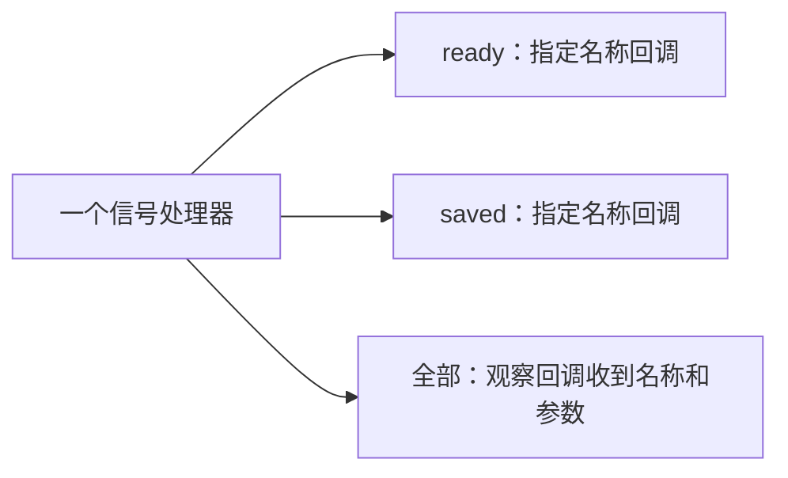

# 信号通知、观察与可写参数

[English](SIGNALS.md) · [README](../README.zh-CN.md)

当你的模块完成某个动作（如配置加载完毕、数据已保存或状态发生变化），需要向当前进程内的一个或多个订阅者广播通知时，可以使用信号处理器（`hx_os_signal_handler`）。所有订阅回调均在调用 `emit` 的线程上**同步执行**，不引入隐藏的后台线程或全局事件总线。

### 快速运行示例

完整示例位于 [signal_observer.c](../examples/signal_observer.c)：创建一个信号处理器，调用 `hx_os_signal_connect_all()` 订阅所有信号名称，构造包含 `items = 42` 的参数包，依次发出 `ready` 和 `saved` 两个信号，最后通过 `hx_os_signal_handler_close_until()` 安全关闭处理器。

按[示例运行方法](../examples/README.zh-CN.md#run)启用示例后，构建并运行 `hx_os_signal_observer`（无需命令行参数或输入文件）：

```sh
cmake --build build --config Release --target hx_os_signal_observer
```

预期输出：

```text
ready: 42 items
saved: 42 items
```

如果你只需要关注某一种特定事件，可改用按名称订阅；如果你希望回调在通知过程中原地修改参数（例如将 `volume` 从 `80` 限幅到 `60`），请参看第 6 节的 [完整音量示例](../examples/signal_mutable.c)。你也可以按[最小工程配置](USAGE.zh-CN.md#c-project)直接把完整示例作为自己的 `main.c`。

## 1. 订阅一个名称，或订阅全部名称

信号处理器隶属于你的业务组件实例：

| 常见需求 | C 接口 | C++11 接口 |
| --- | --- | --- |
| 订阅某个指定名称的信号 | `hx_os_signal_connect` | `SignalHandler::connect` |
| 订阅该处理器发出的全部信号 | `hx_os_signal_connect_all` | `SignalHandler::connectAll` |
| 发出信号通知 | `hx_os_signal_emit` | `SignalHandler::notify` |
| 取消单条订阅并等待其在途回调结束 | `hx_os_signal_disconnect_until` | `SignalHandler::disconnectUntil` |
| 关闭处理器并等待所有在途回调结束 | `hx_os_signal_handler_close_until` | `SignalHandler::closeUntil` |

- **全量观察（`connect_all`）**：调用 `connect_all` 后，即使某个信号名称在注册时尚未出现过，后续发出时也能收到。一次 `connect_all` 只占用 1 个连接槽位。
- **字面量名称匹配**：按名称订阅 `"*"` 只会接收名称恰好为字面量 `"*"` 的信号，不会作为通配符匹配所有信号。



指定名称回调与全量观察回调统一按注册先后顺序排列：当发出 `ready` 信号时，所有 `ready` 的指定名称回调与全量观察回调会按注册顺序依次执行，而 `saved` 的指定名称回调不会被触发。

## 2. 运行 C 示例

在完整的 [signal_observer.c](../examples/signal_observer.c) 中，全量观察回调接收信号名称与只读参数视图 `const hx_os_signal_arguments *`：

```c
static hx_os_status HX_OS_CALL on_signal(const char *name,
	const hx_os_signal_arguments *arguments, void *user, hx_os_error *error)
{
	int64_t items;
	hx_os_status status;

	(void)user;
	status = hx_os_signal_arguments_get_i64(arguments, "items", &items,
		error);
	if (status == HX_OS_OK)
		printf("%s: %lld items\n", name, (long long)items);

	return status;
}
```

配置工程并开启示例后构建：

```sh
cmake --build build --config Release --target hx_os_signal_observer
```

Visual Studio 生成器运行 `build/bin/Release/hx_os_signal_observer.exe`，Linux 单配置生成器运行 `./build/bin/hx_os_signal_observer`，输出为：

```text
ready: 42 items
saved: 42 items
```

由于 `hx_os_signal_emit()` 会在所有匹配的回调执行完毕后才返回，请保持回调函数简短。若需要将耗时工作转交线程池异步处理，请先在回调内调用第 3 节的 `copy()` 复制出独立的参数包，切勿直接将借用的参数视图指针传给后台线程。

## 3. 读取参数，或复制后继续使用

全量观察回调和通用只读观察回调接收 `const hx_os_signal_arguments *` 只读视图（原有的具名回调继续接收 `const hx_os_calldata *`，固定参数包 ABI 保持不变）：

| 函数（省去 `hx_os_signal_arguments_` 前缀） | 功能与行为 |
| --- | --- |
| `count()` | 返回参数个数（空视图返回 `0`） |
| `get_bool` / `i64` / `u64` / `double` / `string` / `bytes` / `pointer()` | 按精确类型读取字段，不做隐式数值或字符串转换 |
| `get()` | 读取带类型标签的 `hx_os_param_value`，适合运行期动态判断类型 |
| `at()` | 按 `0..count-1` 下标遍历字段（请勿假定字段顺序跨版本固定不变） |
| `copy()` | 深拷贝创建独立的 `hx_os_params *`，用完后通过 `hx_os_params_destroy()` 释放 |

- **错误码约定**：字段不存在返回 `HX_OS_NOT_FOUND`，字段类型不匹配返回 `HX_OS_TYPE_MISMATCH`，下标越界返回 `HX_OS_RANGE`（读取失败时保持输出变量原值不变）。读取视图不产生内存分配；字符串长度完整保留内嵌的 `\0`（NUL）字节，字段名仍为以 `\0` 结尾的 UTF-8 字符串。
- **借用生命周期与异步复制**：视图指针、信号名称、字段名及字符串切片**仅在当前这次回调执行期间有效**。如果需要把参数留到回调返回后异步处理，请在回调内部调用 `hx_os_signal_arguments_copy(arguments, context, &owned, &error)`：它会复制所有字段名、字符串和字节数组（注：原始指针字段 `pointer` 仍仅复制指针值，其指向对象的生命周期由应用层管理）。复制功能需要启用 `HX_OS_ENABLE_PARAMETERS` 并遵循[参数包的容量约定](PARAMETERS.zh-CN.md)。

## 4. C++11 写法

包含 `<hx/Signal.hpp>` 后，可以在无异常的 C++11 代码中直接注册 lambda 或函数对象：

```cpp
auto connected = handler.connectAll(
	[](hx::StringView name, hx::SignalArguments args) noexcept
		-> hx::Result<void> {
		auto count = args.integer("items");
		if (!count)
			return hx::Failure(count.error());

		std::printf("%.*s: %lld items\n", static_cast<int>(name.size()),
			name.data(), static_cast<long long>(count.value()));

		return hx::Result<void>();
	});
if (!connected)
	return connected.status();
```

- **取消订阅与生命周期**：若后续需要单独取消该条订阅，请保存 `connected.value()` 连接句柄并调用 `disconnectUntil()`；关闭整个 `SignalHandler` 时也会自动回收所有下属订阅。回调捕获的外部业务对象必须活过所有在途回调。
- **参数读取方法**：`args.stringView()` 返回借用视图，`args.string()` 返回独立拥有的 `Result<hx::String>`，`args.copy()` 返回独立拥有的 `Result<Parameters>`；`unsignedInteger()` 和 `bytesView()` 分别读取无符号 64 位整数与二进制字节切片。
- **与 Qt `emit` 宏无冲突**：建议在 C++ 代码中优先调用 `handler.notify()` 发出通知；原有的 `handler.emit()` 别名同样保留（头文件在声明处临时保护并立即恢复调用方的 `emit` 宏，无需担心与 Qt 冲突）。

## 5. 顺序、失败、关闭和成本

- **派发快照**：每次发出信号时，处理器会按注册顺序对当前匹配的订阅做一次快照。在回调执行期间新注册的订阅从下一次通知开始生效；若某条订阅在排到它执行之前已被取消，则本次自动跳过。
- **首个错误保留并继续派发**：当某个只读回调返回错误时，处理器会记录下第一个错误，但仍会继续调用本次快照中其余匹配的回调；输出参数 `called` 统计实际已启动执行的回调数量。
- **锁外并发执行**：回调函数在信号处理器的内部互斥锁之外执行，因此如果多个线程同时对同一处理器调用 `emit`，同一个回调函数可能会在多个线程上并发运行，业务状态请自行加锁保护。
- **安全退订与死锁保护**：`hx_os_signal_disconnect_until()` 会阻止该连接被后续通知启动，并等待正在执行中的回调返回（若超时则保留处理器与借用数据以便重试；在回调内部等待自身或外层祖先回调退订会返回 `HX_OS_DEADLOCK`）。
- **栈上小快照优化**：处理器创建时一次性预分配连接槽位。当单次通知匹配的订阅数不超过 `16` 个时，直接使用栈上的 `128` 字节局部数组保存快照，零堆内存分配；超过 `16` 个时才执行一次有界堆分配。

## 6. 在通知过程中修改参数

如果希望订阅者不仅能读取参数，还能在通知链路上原地修改参数（例如参数校验、限幅或补充默认值），可以使用 `hx_os_signal_connect_mutable()`（按名称）或 `hx_os_signal_connect_all_mutable()`（全量），并由发起方持有可增长的 `hx_os_params *`，调用 `hx_os_signal_emit_params(handler, name, parameters, &called, &error)` 发出通知。

构建并运行 [完整音量示例](../examples/signal_mutable.c)（目标名 `hx_os_signal_mutable`）：发起方传入初始音量 `volume = 80`，可写回调将其限制为 `60`，随后的只读观察者与发起方都会看到修改后的值：

```text
Observer: volume = 60
Caller: volume = 60
```

> [!IMPORTANT]
> **可写信号的“原地立即生效、不自动回滚”语义**
> - **修改立即对后续回调可见**：如果回调 A 将 `volume` 从 `80` 改为 `60` 后返回了错误状态，后续匹配的回调依然会执行并读到 `60`，整个 `emit_params` 最终返回回调 A 的错误状态。
> - **失败不等于事务回滚**：单个字段 setter 失败时会保留该字段修改前的值，但此前已经成功的字段修改**不会**被撤销。发起方应同时检查返回状态与参数包中的最终业务值。
> - **借用保护**：在整个同步 `emit_params` 调用期间，参数包 `parameters` 由处理器借用；如果在回调内部尝试调用 `hx_os_params_destroy()` 销毁它，会立即返回 `HX_OS_BUSY`。此外，若在回调中先获取了 `string` / `bytes` 借用视图，随后又修改了参数包或发起了递归通知，原视图会失效，请重新读取或提前复制。

## 7. 与已有回调一起使用

同一个信号处理器上可以同时挂载旧版固定参数（`hx_os_calldata`）回调、通用只读观察者（`hx_os_signal_arguments`）和可写参数（`hx_os_params`）回调，它们在不同发送入口下的兼容规则如下：

| 已注册的订阅类型 | 调用旧版 `hx_os_signal_emit`（固定 `calldata`） | 调用新版 `hx_os_signal_emit_params`（可增长 `params`） |
| --- | --- | --- |
| 既有固定参数只读回调 | 直接借用传入的 `hx_os_calldata` | 当所有字段均可无损表示为固定参数时，自动生成临时固定参数副本传入 |
| `connect_observer` / `connect_all` | 借用只读视图 | 借用支持全部 7 种类型的只读视图 |
| 可写回调（`*_mutable`） | 不启动该回调，记录 `HX_OS_TYPE_MISMATCH` | 直接借用并原地修改传入的 `hx_os_params` |

如果 `emit_params` 传入的参数包中含有 `bytes` 或 `u64` 字段（固定 `calldata` 不支持这两种类型），固定参数回调将无法启动并记录 `HX_OS_UNREPRESENTABLE`；若字段数量或文本长度超出固定 `calldata` 容量上限，则记录 `HX_OS_LIMIT`。受影响的固定参数回调会被跳过（不计入 `called`），其余兼容的回调仍正常执行。

C++11 对应提供 `observe(name, callback)`、`connectMutable(name, callback)`、`connectAllMutable(callback)` 以及 `notifyMutable(name, parameters)`：

```cpp
auto connected = handler.connectMutable("volume",
	[](hx::ParametersRef data) noexcept -> hx::Result<void> {
		auto volume = data.integer("volume");
		if (!volume)
			return hx::Failure(volume.error());

		return data.setInt("volume", volume.value() > 60
			? 60 : volume.value());
	});
if (!connected)
	return connected.status();

auto notified = handler.notifyMutable("volume", parameters);
if (!notified)
	return notified.status();
```

## 8. 用可增长参数调用命名过程

命名过程（Procedure）用于“一对一调用并返回结果”的场景。使用 `hx_os_proc_add_params()` 注册过程，再通过 `hx_os_proc_call_params(handler, name, input, &result, &error)` 发起调用：
- **私有副本与全有或全无交付**：库会先使用处理器的 `context` 将 `input`（传 `NULL` 则创建空参数包）复制出一份私有副本交给过程回调修改。**只有当过程回调返回 `HX_OS_OK` 时**，这份结果才会通过 `result` 交付给调用方（调用方用完后需调用 `hx_os_params_destroy()` 释放）；如果回调返回任何错误，库会自动销毁半成品副本并将 `result` 保持为 `NULL`。
- **与可写信号的核心区别**：可写信号允许多个订阅者逐步原地修改共享参数包（中途报错仍保留已生效的修改）；而命名过程只绑定单一回调，且仅在成功时发布独立的结果副本。
- **名称空间与类型检查**：固定参数过程与可增长参数过程共享同一个名称空间；若用不匹配的调用入口调用同名过程，会直接返回 `HX_OS_TYPE_MISMATCH` 而不会启动回调。C++11 对应接口为 `ProcedureHandler::addParams(name, callback)` 与 `callParams(name, input)`（返回 `Result<Parameters>`，详见[参数包说明](PARAMETERS.zh-CN.md)）。
