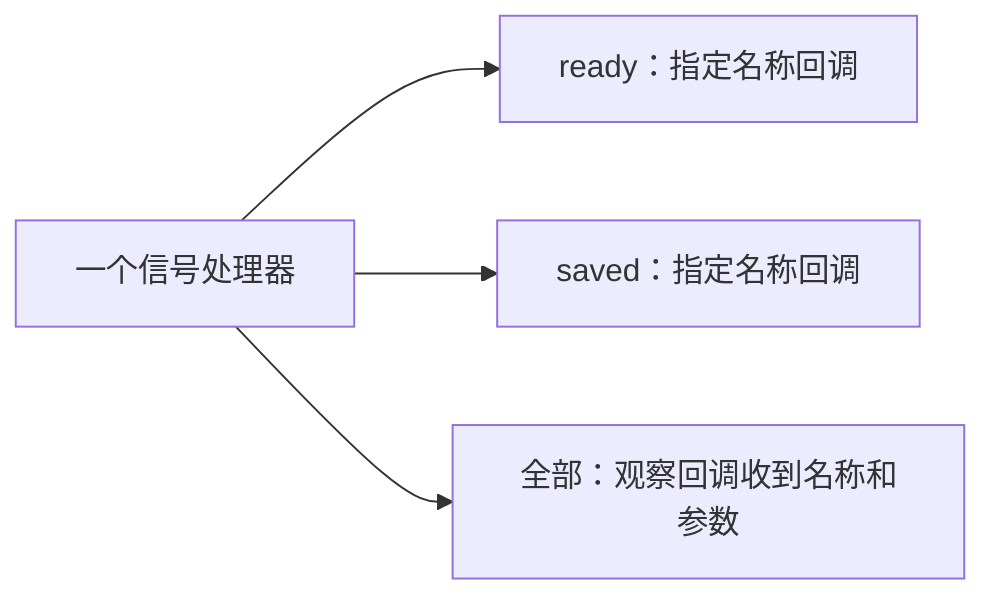

# 信号通知、观察与可写参数

[English](SIGNALS.md) · [README](../README.zh-CN.md)

## 1. 订阅一个名称，或订阅全部名称

信号处理器属于你的某个组件，负责保存订阅，在组件发出信号时同步调用回调。它不会创建工作线程、消息队列或进程级全局事件总线。

| 需求 | C | C++11 |
| --- | --- | --- |
| 接收一个指定名称 | `hx_os_signal_connect` | `SignalHandler::connect` |
| 接收一个处理器的所有名称 | `hx_os_signal_connect_all` | `SignalHandler::connectAll` |
| 发出通知 | `hx_os_signal_emit` | `SignalHandler::notify` |
| 取消订阅，并等它的回调结束 | `hx_os_signal_disconnect_until` | `SignalHandler::disconnectUntil` |
| 停止处理器，并等所有回调结束 | `hx_os_signal_handler_close_until` | `SignalHandler::closeUntil` |

订阅全部信号后，注册时尚未出现的名称也能收到。一次订阅占一个连接名额，不按信号名称数量计算。按名称订阅 `"*"` 仍然只接收名称恰好为 `"*"` 的信号，不是通配符。



三类回调统一按注册顺序排列。发出 `ready` 时，调用它的指定名称回调和全部信号观察回调，不调用 `saved` 的指定名称回调。

## 2. 运行 C 示例

[signal_observer.c](../examples/signal_observer.c) 是完整程序：注册一个观察回调，然后依次发出 `ready` 和 `saved`，两次都带整数参数 `items = 42`。回调写法如下：

```c
static hx_os_status HX_OS_CALL on_signal(const char *name,
	const hx_os_signal_arguments *arguments, void *user, hx_os_error *error)
{
	int64_t items;
	hx_os_status status;

	(void)user;
	status = hx_os_signal_arguments_get_i64(arguments, "items", &items,
		error);
	if (status == HX_OS_OK)
		printf("%s: %lld items\n", name, (long long)items);

	return status;
}
```

按普通方式配置工程并开启示例后，构建：

```sh
cmake --build build --config Release --target hx_os_signal_observer
```

Visual Studio 生成器运行 `build/bin/Release/hx_os_signal_observer.exe`；Linux 单配置生成器运行 `./build/bin/hx_os_signal_observer`。预期输出：

```text
ready: 42 items
saved: 42 items
```

发出通知的函数会在所选回调都完成后才返回，因此回调应尽量简短。需要把后续工作提交给线程池时，应先复制参数，再处理有界提交和失败，不能直接把借用视图交给后台任务。

## 3. 读取参数，或复制后继续使用

全部信号回调接收 `hx_os_signal_arguments`，它是借用的只读视图。指定名称回调继续接收已有的 `const hx_os_calldata *`，原有固定参数包 ABI 不变。

| 操作 | 含义 |
| --- | --- |
| `count()` | 参数数量；空视图返回零 |
| `get_bool/i64/u64/double/string/bytes/pointer()` | 按准确类型读取，不隐式转换数字或字符串 |
| `get()` | 返回带类型标记的 `hx_os_param_value`，适合运行时判断类型 |
| `at()` | 按从零开始的下标遍历，不应依赖字段顺序长期固定 |
| `copy()` | 创建独立的 `hx_os_params`，使用 `hx_os_params_destroy` 释放 |

表中 C 函数名省略了 `hx_os_signal_arguments_` 前缀。缺少字段返回 `HX_OS_NOT_FOUND`，类型不同返回 `HX_OS_TYPE_MISMATCH`，下标越界返回 `HX_OS_RANGE`；读取失败保留原输出。读取视图不分配内存。字符串长度保留内部 NUL；名称仍是带结尾 NUL 的 UTF-8。

视图对象、信号名称、字段名称和字符串片段只保证在本次回调内有效。不要保存视图地址、销毁它或强转成可写参数包。发起方必须让输入 calldata 在整个通知期间保持有效且不变，包括分配器回调期间。指针参数仍然借用原对象，其生命周期和并发访问由应用负责。

需要延后处理时，在回调内调用 `hx_os_signal_arguments_copy(arguments, context, &owned, &error)`。名称和字符串会复制，原始指针仍借用；失败时 `owned` 为 null，部分分配会释放。复制需要开启 `HX_OS_ENABLE_PARAMETERS`，使用[参数包的容量约定](PARAMETERS.zh-CN.md)：固定 calldata 使用默认容量，可增长输入保留自己的容量设置。关闭该模块仍可订阅、观察和读取。旧通知入口保留固定 calldata ABI；新增 `emit_params` 可以携带全部七种可增长参数类型。

## 4. C++11 写法

包含 `<hx/Signal.hpp>`。对于已有的 `hx::SignalHandler handler`，可以在返回 `hx_os_status` 的函数中这样订阅：

```cpp
auto connected = handler.connectAll(
	[](hx::StringView name, hx::SignalArguments args) noexcept
		-> hx::Result<void> {
		auto count = args.integer("items");
		if (!count)
			return hx::Failure(count.error());

		std::printf("%.*s: %lld items\n", static_cast<int>(name.size()),
			name.data(), static_cast<long long>(count.value()));

		return hx::Result<void>();
	});
if (!connected)
	return connected.status();
```

打印需要包含 `<cstdio>`。需要单独取消这次订阅时，保存 `connected.value()`；成功关闭整个处理器也会回收它的订阅。回调捕获的应用对象必须覆盖在途回调的生命周期，继续遵循 `SignalHandler` 原有的显式截止时间关闭契约。

`args.stringView()` 借用字符串，`args.string()` 返回独立字符串，`args.copy()` 返回拥有独立参数包的 `Result<Parameters>`；`value()`、`at()` 对应 C 的带类型值查询。回调可以返回 `void`、`hx_os_status` 或 `Result<void>`，遵循不使用异常的既有约定。

Qt 项目使用 `notify()`，可以避开 Qt 的 `emit` 宏。旧的 `emit()` 别名仍保留；头文件只在声明别名时临时屏蔽宏，随后立即恢复调用方的宏。两种写法都不依赖 Qt。

## 5. 顺序、失败、关闭和成本

- 每次通知按注册顺序快照选中的连接。回调中新增的订阅从下一次通知开始参与；回调尚未启动就被取消时，本次跳过它。
- 只读回调失败时保留第一个错误，继续通知其它符合条件的订阅者。`called` 返回实际启动的回调数。
- 多个线程同时发出信号时，同一个回调可能并行执行。回调在内部互斥锁外执行，应用自行保护状态。递归通知仍受已有深度上限约束。
- 成功取消订阅后阻止后续启动；`disconnect_until` 还会等待在途回调和清理结束。超时后处理器及借用对象继续保留，可以重试。回调等待自己或上层回调结束会返回 `HX_OS_DEADLOCK`。
- 注册成功后，库接管可选的 cleanup 动作；注册失败不调用它。连接回收时清理一次；不能在仍有其它回调执行时卸载其代码。
- 创建处理器时预分配有上限的连接槽。C 注册和参数读取不新增分配；非空通知仍保留原先的一次有界快照分配，新视图使用栈内存。C++ 注册分配捕获对象空间，显式复制分配独立参数内容。

关闭 `HX_OS_ENABLE_SIGNALS` 后保留明确的不支持入口。命名过程仍遵循自己的单回调和成功后发布返回参数的契约。下面的可写派发还需要开启 PARAMETERS。

## 6. 在通知过程中修改参数

用 `hx_os_signal_connect_mutable` 订阅一个名称，或用 `hx_os_signal_connect_all_mutable` 订阅全部名称。发起方持有 `hx_os_params`，调用 `hx_os_signal_emit_params(handler, name, parameters, &called, &error)`。这些订阅与只读观察者共用同一个处理器、连接上限、注册顺序和取消／关闭规则。`hx_os_signal_connect_observer` 可以让通用只读视图只观察一个指定名称。

[完整音量示例](../examples/signal_mutable.c) 从 80 开始，由回调限制到 60，再分别从观察者和发起方打印。构建 `hx_os_signal_mutable`，按第 2 节相同的方式运行对应程序，预期输出：

```text
Observer: volume = 60
Caller: volume = 60
```

修改立即生效。如果某个回调把 80 改为 60 后返回错误，后续有效回调仍会运行并读到 60，最后返回第一个错误。若后续回调再次修改，发起方读到最后的值。单次 setter 失败会保留该字段的旧值，但不会撤销此前已经成功的 setter。需要同时检查返回状态和业务状态，失败不代表回滚。第一个回调开始前的分配失败不会改变参数包。

库在整个同步调用期间借用 owner；回调里尝试销毁会返回 BUSY，并保留指针。不要在派发期间移动／销毁 C++ owner，也不要在回调结束后继续保留借用引用。并行通知使用不同参数包；回调捕获的业务状态也需要自行同步。递归调用同步执行，并受深度限制。先取得字符串／字节视图，再直接修改参数包或递归发出通知，会使该视图失效；应重新读取或提前复制。可写派发会先复制信号名称，因此名称即使来自参数值，也允许回调替换该字段。

## 7. 与已有回调一起使用

| 订阅类型 | 原有固定 calldata 的 `emit` | 新的 `emit_params` |
| --- | --- | --- |
| 既有固定参数只读回调 | 保持原有借用 calldata | 数据能完整表示时，收到临时固定参数副本 |
| `connect_observer`／`connect_all` | 借用只读视图 | 借用支持全部七种类型的只读视图 |
| 可写回调 | 返回 TYPE_MISMATCH，不启动该回调 | 借用并原地修改可增长参数包 |

固定参数副本不会丢字段或强转类型。bytes／u64 返回 UNREPRESENTABLE，字段数量或文本超过固定参数容量返回 LIMIT。受影响的固定回调不启动，派发保留第一个错误并继续其它有效订阅。需要接收大参数或二进制数据时，用通用观察者。`called` 不计入没有启动的不兼容回调。名称 `"*"` 仍然按普通字面量处理。

C++11 对应接口为：`observe(name, callback)` 接收通用只读视图；`connectMutable(name, callback)` 接收 `ParametersRef`；`connectAllMutable(callback)` 接收 `(StringView, ParametersRef)`；`notifyMutable(name, parameters)` 发出可写通知。均沿用无异常回调和 Result 错误机制。例如，在返回 `hx_os_status` 的函数中，已有创建成功的 handler 和参数 owner 时：

```cpp
auto connected = handler.connectMutable("volume",
	[](hx::ParametersRef data) noexcept -> hx::Result<void> {
		auto volume = data.integer("volume");
		if (!volume)
			return hx::Failure(volume.error());

		return data.setInt("volume", volume.value() > 60
			? 60 : volume.value());
	});
if (!connected)
	return connected.status();

auto notified = handler.notifyMutable("volume", parameters);
if (!notified)
	return notified.status();
```

通知 Result 在回调报错时仍保留实际启动的回调数，读取前检查 `hasValue()`。`SignalArguments::unsignedInteger` 和 `bytesView` 用于读取新增的无符号整数和字节类型。

## 8. 用可增长参数调用命名过程

使用 `hx_os_proc_add_params` 注册，再调用 `hx_os_proc_call_params(handler, name, input, &result, &error)`。result 是独立 owner，最后用 `hx_os_params_destroy` 释放；input 为 null 时创建空参数包。库使用处理器的 context 复制输入及其容量设置，回调修改这份私有副本。只有返回 OK 才交付结果；任何失败都会释放部分副本并让 result 保持 null。调用期间输入必须有效且不变；输出 owner 变量不能覆盖另一个尚未释放的 owner。

这与可写信号有意区分：命名过程在成功时返回一个结果，通知允许多个订阅者逐步修改共享参数。借用指针指向的对象、文件或设备上的副作用，都不能靠这两个接口自动回滚。

固定和可增长过程共用唯一名称空间。用不匹配的参数包类型调用，返回 TYPE_MISMATCH，不执行用户回调。创建、回收、截止时间和自有分配器重入保护沿用已有过程机制。回调可以使用普通参数 setter，但不能在调用期间销毁借用副本。

C++11 使用 `ProcedureHandler::addParams(name, callback)`，回调接收 `ParametersRef`；`callParams(name, input)` 返回 `Result<Parameters>`，结果在处理器关闭后仍有效。完整的错误检查调用见 [C++ 契约测试](../tests/test_cpp_dispatch.cpp)，参数生命周期见[参数包说明](PARAMETERS.zh-CN.md)。
