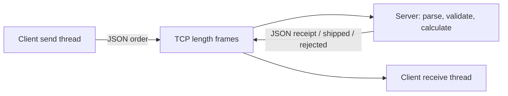

# TCP application example: submit orders and receive results

[简体中文](TCP_BUSINESS.zh-CN.md) · [README](../README.md) · [Socket C API](../include/hx_os_net.h)

## 1. Independent TCP programs

The dedicated TCP client and server call `hx_os_socket_*` directly. They use neither `hx_ipc_*`, HXIP framing nor the IPC device service. They can build and run with `HX_OS_ENABLE_IPC=OFF`.

One client sender and one receiver share a TCP connection. The sender submits three orders while the receiver handles receipts, shipping notifications and rejection. The server serves one connection and stops after three orders; its state is in memory only.

## 2. Build and run

From the repository root:

```sh
cmake -S . -B build-net -DHX_OS_BUILD_TESTS=ON -DHX_OS_BUILD_EXAMPLES=ON
cmake --build build-net --config Release --parallel 4
```

Windows PowerShell, Visual Studio build:

```powershell
python examples/run_tcp_business.py --bin-dir build-net/bin/Release
python examples/run_tcp_business.py --fragmented --bin-dir build-net/bin/Release
```

Linux/WSL uses `python3` and `--bin-dir build-net/bin`. Existing development directories are `build-shared-msvc/bin/Release` or `build-shared-linux/bin`; omit `Release` with Windows Ninja. The automatic runner chooses a free port.

For manual execution, **terminal one**:

```powershell
.\build-net\bin\Release\hx_os_tcp_order_server.exe 39001
```

After `Listening:`, **terminal two**:

```powershell
.\build-net\bin\Release\hx_os_tcp_order_client.exe 39001
```

On Linux/WSL run `./build-net/bin/hx_os_tcp_order_server 39001` and `./build-net/bin/hx_os_tcp_order_client 39001` separately. The argument is a port number; these programs bind/connect to `127.0.0.1`, not a `tcp://` URI. The server has a 15-second overall deadline; client I/O has 10 seconds. Restart the server for each demonstration.

## 3. Send JSON orders and receive JSON results



An order is a JSON object. Its note includes Chinese, quotes, a backslash and a supplementary-plane character:

```json
{"type":"order","id":1,"sku":101,"quantity":2,"note":"桌面 \"设备\"\\A🌐"}
```

The server parses fields and returns the decoded note in the receipt:

```json
{"type":"receipt","id":1,"ok":true,"total_cents":2500,"note":"桌面 \"设备\"\\A🌐"}
```

It separately sends a shipping notification:

```json
{"type":"shipped","id":1,"ok":true}
```

| Order | Validated result |
| --- | --- |
| `id=1, sku=101, quantity=2` | Unit price 1250 cents, total 2500, then `shipped` |
| `id=2, sku=102, quantity=1` | Unit price 9000 cents, total 9000, then `shipped` |
| `id=3, sku=101, quantity=0` | `{"type":"rejected","id":3,"ok":false,"reason":"invalid_order"}` |

Accepted orders total 11500 cents. `id`, `sku` and `quantity` must be JSON integers, with quantity in 1–10. `note` must be a string of at most 128 UTF-8 bytes. `"1"`, `true` and `1.0` are not integer quantities. Order IDs are application payload fields, not IPC-routed requests.

## 4. Encoding and TCP framing

TCP still needs message boundaries: two-byte big-endian UTF-8 payload byte count, followed by at most 1023 bytes of JSON. Count bytes, not Chinese characters. The receiver assembles one frame, then parses one JSON object rather than using `sscanf` or raw string comparisons.

| File | Entry points |
| --- | --- |
| [tcp_order_client.c](../examples/tcp_order_client.c) | `send_orders()` typed fields; `receive_receipts()` parsed results, amounts and notes |
| [tcp_order_server.c](../examples/tcp_order_server.c) | `process_orders()` schema/range checks; `send_order_json()` response encoding |
| [tcp_business.h](../examples/tcp_business.h) | Length framing, partial I/O and finite waits |
| [business_json.h](../examples/business_json.h) | Codec helpers only: existing JSON parser, settings serialization, type and capacity checks |

Adapt fields in this fragment; `stream` is an established TCP connection:

```c
json_field fields[] = {
	json_text("type", "order"), json_int("id", 1),
	json_int("sku", 101), json_int("quantity", 2),
	json_text("note", "桌面设备")
};
hx_string wire = HX_STRING_INIT;
if (json_encode(fields, 5, &wire)) {
	int sent = tcp_send_text(stream, hx_string_c_str(&wire));
	/* Check sent before continuing the business operation. */
	(void)sent;
}
hx_string_destroy(&wire);
```

These helpers are private to the examples; business I/O remains raw TCP without IPC forwarding. The serializer handles quotes, backslashes and control characters. Parsing rejects duplicate keys and non-object roots, with limits of depth 8, 64 nodes and 64 KiB parsing memory. Default-enabled `CONFIG`, `CONFIG_SERIALIZE` and `SETTINGS` are required; no dependency was added.

A short mutex serializes nonblocking socket calls; retries sleep 1 ms outside it. Exactly one thread writes complete frames and one reads them. Main joins before destroying mutex, socket and network. Documents and temporary strings are released after use. Mid-frame timeout/disconnect fails the connection instead of reinterpreting leftovers. This finite example is not a throughput benchmark.

## 5. Executable tests

```sh
ctest --test-dir build-net -C Release -R "^tcp_business_" --output-on-failure
```

| Test | Checks |
| --- | --- |
| `tcp_business_orders` | Two C processes: JSON orders, receipts, notifications, rejection and note round-trip |
| `tcp_business_framing` | Python raw socket splits a header/body and coalesces following frames, using different JSON key order/whitespace |
| `tcp_business_json_validation` | Seven faults: string quantity, bool quantity, real quantity, missing quantity, malformed JSON, duplicate key, array root |

Run the last case directly:

```powershell
python examples/run_tcp_business.py --json-errors --bin-dir build-net/bin/Release
```

Python uses its standard `json` module and UTF-8, not HXIP. Invalid field types/ranges receive `rejected`; invalid order objects receive `{"type":"error","ok":false,"reason":"invalid_json_request"}`. Each run still verifies the preceding two orders total 11500 cents, unchanged by invalid input.

Raw TCP does not supply cross-restart sessions or retry deduplication; this example covers the current connection. See the separate [IPC](IPC_BUSINESS.md), [UDP](UDP_BUSINESS.md) and [KCP](KCP_BUSINESS.md) workflows.
