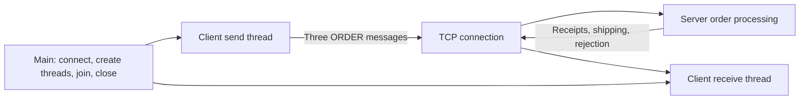

# TCP application example: submit orders and receive results

[简体中文](TCP_BUSINESS.zh-CN.md) · [README](../README.md) · [Socket C API](../include/hx_os_net.h)

## 1. Independent TCP programs

The dedicated TCP client and server call `hx_os_socket_*` directly. They use neither `hx_ipc_*`, HXIP framing nor the IPC device service. They can build and run with `HX_OS_ENABLE_IPC=OFF`.

One client sender and one receiver share a TCP connection. The sender submits three orders while the receiver handles receipts, shipping notifications and rejection. The server serves one connection and stops after three orders; its state is in memory only.

## 2. Build and run

From the repository root:

```sh
cmake -S . -B build-net -DHX_OS_BUILD_TESTS=ON -DHX_OS_BUILD_EXAMPLES=ON
cmake --build build-net --config Release --parallel 4
```

Windows PowerShell, Visual Studio build:

```powershell
python examples/run_tcp_business.py --bin-dir build-net/bin/Release
python examples/run_tcp_business.py --fragmented --bin-dir build-net/bin/Release
```

Linux/WSL uses `python3` and `--bin-dir build-net/bin`. Existing development directories are `build-shared-msvc/bin/Release` or `build-shared-linux/bin`; omit `Release` with Windows Ninja. The automatic runner chooses a free port.

For manual execution, **terminal one**:

```powershell
.\build-net\bin\Release\hx_os_tcp_order_server.exe 39001
```

After `Listening:`, **terminal two**:

```powershell
.\build-net\bin\Release\hx_os_tcp_order_client.exe 39001
```

On Linux/WSL run `./build-net/bin/hx_os_tcp_order_server 39001` and `./build-net/bin/hx_os_tcp_order_client 39001` separately. The argument is a port number; these programs bind/connect to `127.0.0.1`, not a `tcp://` URI. The server has a 15-second overall deadline; client I/O has 10 seconds. Restart the server for each demonstration.

## 3. Threads and results



| Request | Result |
| --- | --- |
| `ORDER id=1 sku=101 qty=2` | Unit price 1250 cents; receipt for 2500, then `SHIPPED id=1` |
| `ORDER id=2 sku=102 qty=1` | Unit price 9000 cents; receipt for 9000, then `SHIPPED id=2` |
| `ORDER id=3 sku=101 qty=0` | Invalid quantity: `REJECTED id=3 reason=invalid_order`; no charge |

The server accepts two orders totaling `11500` cents. Integer amounts avoid floating-point pricing in the example. `id` is an application-defined order ID in the payload; the client checks it, with no IPC request router involved.

```text
[TCP receive thread] RECEIPT id=1 total_cents=2500
[TCP receive thread] SHIPPED id=1
[TCP receive thread] RECEIPT id=2 total_cents=9000
[TCP receive thread] SHIPPED id=2
[TCP receive thread] REJECTED id=3 reason=invalid_order
TCP CLIENT PASS: 3 orders, 2 receipts, 2 notices, 1 rejection
TCP SERVER PASS: accepted=2 total_cents=11500
```

## 4. Framing and code entry points

TCP is a byte stream. This example defines a two-byte big-endian payload length followed by 1–127 ASCII bytes. Both sides read a complete frame before processing it, rejecting oversized, empty or embedded-NUL payloads.

| File | What to read |
| --- | --- |
| [tcp_order_client.c](../examples/tcp_order_client.c) | `send_orders()` and the independent `receive_receipts()` thread |
| [tcp_order_server.c](../examples/tcp_order_server.c) | `process_orders()` parses orders, calculates totals and sends results |
| [tcp_business.h](../examples/tcp_business.h) | `tcp_send_text()` / `tcp_receive_text()` implement framing; `tcp_transfer()` handles partial I/O and deadlines |
| [run_tcp_business.py](../examples/run_tcp_business.py) | Business assertions and split/coalesced writes from a standard-library Python TCP peer |

Business code uses:

```c
if (!tcp_send_text(job->stream, "ORDER id=1 sku=101 qty=2"))
	return NULL;
```

`tcp_send_text()` is an example-private helper over `hx_os_socket_send_some()`; receiving uses `hx_os_socket_receive_some()`. It is not a new public library API and never forwards to IPC. A short mutex serializes each nonblocking socket call. After `WOULD_BLOCK`, retry sleeps for 1 ms outside the lock. Exactly one thread sends complete frames and one receives them; this does not authorize multiple independent frame writers on the same raw stream.

The finite demonstration has no unbounded queue. Main joins both threads before destroying the mutex, socket and network owner. Timeout/disconnect inside a frame fails the connection; leftover bytes are not treated as a new message. Long-running high-throughput applications can use the library loop for readiness-driven I/O; the short retry interval here is not a performance benchmark.

## 5. Tests

```sh
ctest --test-dir build-net -C Release -R "^tcp_business_" --output-on-failure
```

`tcp_business_orders` runs two C processes and verifies threaded communication and totals. `tcp_business_framing` uses a normal Python socket, splits the first header/body across writes, then combines the remaining two frames in one write. The server must still parse three orders. That Python peer implements this simple example protocol, not HXIP.

Raw TCP does not supply application sessions, retry deduplication or restart recovery. Define those in the real protocol; this example covers a finite workflow on one live connection. See [validation](VALIDATION.md). Other workflows are documented separately: [IPC](IPC_BUSINESS.md), [UDP](UDP_BUSINESS.md), [KCP](KCP_BUSINESS.md).
