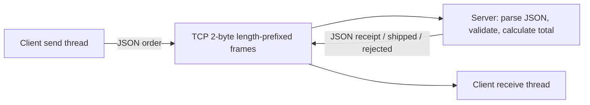

# TCP Business Example: Order Submission and Asynchronous Receipts over Raw Sockets

[简体中文](TCP_BUSINESS.zh-CN.md) · [README](../README.md) · [Socket C API](../include/hx_os_net.h)

When your application needs to communicate with a standard TCP server or client—using custom length-prefixed framing and UTF-8 JSON payloads over raw TCP streams rather than `hx_ipc`'s HXIP protocol—you can build directly on `hx_os_socket_*`. This example implements an end-to-end order processing workflow where a multi-threaded TCP client submits orders and concurrently receives receipts, shipping notifications, and rejection messages from a TCP server.

Complete the one-time [example build setup](../examples/README.md#run) before starting. Below, `build` refers to your existing CMake build directory.

## 1. Independent TCP programs

The dedicated TCP client (`hx_os_tcp_order_client`) and server (`hx_os_tcp_order_server`) call `hx_os_socket_*` directly:
- **Zero `hx_ipc` Dependency**: They do not call `hx_ipc_*`, do not use HXIP headers, and do not launch the IPC device server. Both programs build and run even when `HX_OS_ENABLE_IPC=OFF`.
- **Full-Duplex Client Threads**: One client sender thread and one client receiver thread share a single TCP connection. The sender submits three orders while the receiver processes order receipts (`receipt`), asynchronous shipping notifications (`shipped`), and validation rejections (`rejected`). The server handles one connection, processes the three orders in memory, and exits cleanly.

## 2. Build and run

From the repository root, build the TCP order server and client targets:

```sh
cmake -S . -B build -DHX_OS_BUILD_EXAMPLES=ON
cmake --build build --config Release --target hx_os_tcp_order_server
cmake --build build --config Release --target hx_os_tcp_order_client
```

**Windows PowerShell (Visual Studio build, automated runner):**

```powershell
python examples/run_tcp_business.py --bin-dir build/bin/Release
python examples/run_tcp_business.py --fragmented --bin-dir build/bin/Release
```

On Linux or WSL, use `python3` and `--bin-dir build/bin` (or point `--bin-dir` at an existing build folder such as `build-shared-msvc/bin/Release` or `build-shared-linux/bin`; omit `Release` for Windows Ninja builds). The automated runner picks an available ephemeral port and verifies every response.

### Manual Execution in Two Terminals

To run the C binaries directly without Python, start the server on port `39001` in **Terminal 1**:

```powershell
.\build\bin\Release\hx_os_tcp_order_server.exe 39001
```

Once `Listening:` is printed, run the client in **Terminal 2**:

```powershell
.\build\bin\Release\hx_os_tcp_order_client.exe 39001
```

On Linux/WSL, run `./build/bin/hx_os_tcp_order_server 39001` and `./build/bin/hx_os_tcp_order_client 39001` in separate terminals. Note that the command-line argument is a **port number** (`39001`), not a `tcp://` URI—both programs bind and connect to `127.0.0.1`. The server has a 15-second overall deadline and client I/O uses a 10-second deadline; restart the server before each manual run.

## 3. Send JSON orders and receive JSON results



Each order is encoded as a UTF-8 JSON object. To exercise string escaping and multi-byte UTF-8 handling, the order `note` includes Chinese text, escaped quotes, a backslash, and a supplementary-plane emoji:

```json
{"type":"order","id":1,"sku":101,"quantity":2,"note":"桌面 \"设备\"\\A🌐"}
```

The server parses and validates the fields, then returns the decoded `note` inside the order `receipt`:

```json
{"type":"receipt","id":1,"ok":true,"total_cents":2500,"note":"桌面 \"设备\"\\A🌐"}
```

It also sends a separate asynchronous shipping notification:

```json
{"type":"shipped","id":1,"ok":true}
```

### Validation Outcomes for the Three Demo Orders

| Order Parameters | Server Validation & Result |
| --- | --- |
| `id=1, sku=101, quantity=2` | Unit price 1250 cents; returns `receipt` with `total_cents=2500`, followed by `shipped` |
| `id=2, sku=102, quantity=1` | Unit price 9000 cents; returns `receipt` with `total_cents=9000`, followed by `shipped` |
| `id=3, sku=101, quantity=0` | Out-of-range quantity; returns `{"type":"rejected","id":3,"ok":false,"reason":"invalid_order"}` |

The two valid orders total `11500` cents. The server enforces strict JSON field types and bounds:
- `id`, `sku`, and `quantity` must be true JSON integers (with `quantity` in `1`–`10`). Strings like `"1"`, booleans like `true`, and floats like `1.0` are rejected.
- `note` must be a JSON string of at most 128 UTF-8 bytes.
- Order `id` values are application-level JSON fields rather than IPC request IDs.

## 4. Encoding and TCP framing

Because TCP is a byte stream without built-in message boundaries, this example frames each message as a **2-byte big-endian unsigned byte length followed by at most 1023 bytes of UTF-8 JSON**. Always measure length in **UTF-8 bytes**, not character or code-point counts. The receiver loops until the complete frame arrives and then parses the payload with the library's JSON parser rather than relying on `sscanf` or ad-hoc substring checks.

| File | Key Functions & Responsibilities |
| --- | --- |
| [tcp_order_client.c](../examples/tcp_order_client.c) | `send_orders()` encodes typed JSON fields; `receive_receipts()` parses responses and verifies totals and notes |
| [tcp_order_server.c](../examples/tcp_order_server.c) | `process_orders()` validates JSON schema and ranges; `send_order_json()` encodes responses |
| [tcp_business.h](../examples/tcp_business.h) | Implements 2-byte big-endian length framing, partial read/write loops, and bounded deadlines |
| [business_json.h](../examples/business_json.h) | JSON codec helpers built on the library's JSON parser and settings serializer |

To adapt the sender for your own fields over an established `stream`:

```c
json_field fields[] = {
	json_text("type", "order"), json_int("id", 1),
	json_int("sku", 101), json_int("quantity", 2),
	json_text("note", "桌面设备")
};

hx_string wire = HX_STRING_INIT;

if (json_encode(fields, 5, &wire)) {
	int sent = tcp_send_text(stream, hx_string_c_str(&wire));
	// Check sent before continuing the business operation.
	(void)sent;
}

hx_string_destroy(&wire);
```

> [!NOTE]
> **Parser Limits and Non-Blocking Concurrency Model**
> - **Safe Escaping & Bounded Parsing**: The serializer escapes quotes, backslashes, and control characters automatically. The receiver rejects duplicate keys and non-object roots, enforcing a maximum depth of 8, at most 64 nodes, and a 64 KiB parser memory budget using the default-enabled `CONFIG`, `CONFIG_SERIALIZE`, and `SETTINGS` modules.
> - **Non-Blocking Socket Serialization**: A lightweight mutex serializes individual non-blocking socket calls; when a call returns `HX_OS_WOULD_BLOCK`, the thread releases the mutex and sleeps 1 ms before retrying. Exactly one thread writes complete frames and one thread reads complete frames. The main thread joins both worker threads before destroying the mutex, socket, and network handle. Any mid-frame timeout or disconnect fails the connection immediately rather than misinterpreting leftover bytes as a new frame.

### Files to copy into your own project

To use this example as a starting point for your own TCP service:
1. Copy [tcp_order_server.c](../examples/tcp_order_server.c), [tcp_order_client.c](../examples/tcp_order_client.c), and the companion headers [tcp_business.h](../examples/tcp_business.h), [network_demo.h](../examples/network_demo.h), and [business_json.h](../examples/business_json.h).
2. Create separate CMake executable targets for the client and server (each defines `main()`) and link both against `hx_c_platform::hx_c_platform` (see [Using an Installed Package](USAGE.md#installed-project)). Helpers like `tcp_send_text` and `json_field` come from those example headers, not from the public `hx_os.h` API.
3. Run the unmodified binaries in two terminals first using the commands in Section 2, then customize the JSON fields and business handlers while preserving the thread-join and cleanup order.

## 5. Run the business example

`run_tcp_business.py` supports three verification modes:

```sh
python examples/run_tcp_business.py --bin-dir build/bin/Release
python examples/run_tcp_business.py --bin-dir build/bin/Release --fragmented
python examples/run_tcp_business.py --bin-dir build/bin/Release \
  --json-errors
```

(On Linux, replace `build/bin/Release` with `build/bin`.)
- **Default mode**: Runs the standard three-order workflow.
- **`--fragmented`**: Splits and coalesces TCP writes to verify that the 2-byte length framing handles partial reads and back-to-back frames cleanly.
- **`--json-errors`**: Injects malformed JSON and invalid field types to verify that the server rejects bad input gracefully.
