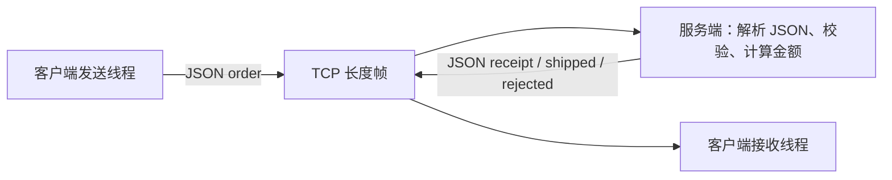

# TCP 业务示例：订单发送与回执接收

[English](TCP_BUSINESS.md) · [README](../README.zh-CN.md) · [socket C 接口](../include/hx_os_net.h)

## 1. 独立的 TCP 程序

本例直接使用 `hx_os_socket_*`，由自己的 TCP 客户端和服务端完成订单业务。它不调用 `hx_ipc_*`，不使用 HXIP 协议，也不启动 IPC 的设备服务端。关闭 `HX_OS_ENABLE_IPC` 后仍能构建和运行。

客户端有一个发送线程和一个接收线程，共用一条 TCP 连接。发送线程提交三个订单，接收线程同时处理订单回执、发货通知和拒绝信息。服务端只服务一个连接、处理三个订单后结束，状态只保存在内存中。

## 2. 构建和运行

仓库根目录：

```sh
cmake -S . -B build-net -DHX_OS_BUILD_EXAMPLES=ON
cmake --build build-net --config Release --parallel 4
```

Windows PowerShell，Visual Studio 构建：

```powershell
python examples/run_tcp_business.py --bin-dir build-net/bin/Release
python examples/run_tcp_business.py --fragmented --bin-dir build-net/bin/Release
```

Linux/WSL 对应使用 `python3` 和 `--bin-dir build-net/bin`。已有构建可替换为 `build-shared-msvc/bin/Release` 或 `build-shared-linux/bin`；Windows Ninja 去掉 `Release`。自动运行器选择空闲端口。

手工运行时，**终端一**：

```powershell
.\build-net\bin\Release\hx_os_tcp_order_server.exe 39001
```

看到 `Listening:` 后，**终端二**：

```powershell
.\build-net\bin\Release\hx_os_tcp_order_client.exe 39001
```

Linux/WSL 分别运行 `./build-net/bin/hx_os_tcp_order_server 39001` 和 `./build-net/bin/hx_os_tcp_order_client 39001`。参数是端口号；本例固定连接/监听 `127.0.0.1`，不接收 `tcp://` URI。服务端整体期限 15 秒，客户端 I/O 期限 10 秒；每次演示重新启动服务端。

## 3. 发送 JSON 订单，接收 JSON 回执



订单是一个真正的 JSON 对象，示例备注包含中文、引号、反斜杠和补充平面字符：

```json
{"type":"order","id":1,"sku":101,"quantity":2,"note":"桌面 \"设备\"\\A🌐"}
```

服务端解析字段后返回回执，并原样回传解析后的备注：

```json
{"type":"receipt","id":1,"ok":true,"total_cents":2500,"note":"桌面 \"设备\"\\A🌐"}
```

随后独立发送发货通知：

```json
{"type":"shipped","id":1,"ok":true}
```

| 订单 | 校验后的结果 |
| --- | --- |
| `id=1, sku=101, quantity=2` | 单价 1250 分，回执 2500 分，另发 `shipped` |
| `id=2, sku=102, quantity=1` | 单价 9000 分，回执 9000 分，另发 `shipped` |
| `id=3, sku=101, quantity=0` | `{"type":"rejected","id":3,"ok":false,"reason":"invalid_order"}` |

有效订单合计 11500 分。`id`、`sku`、`quantity` 必须是 JSON 整数，数量为 1～10；`note` 必须是字符串且 UTF-8 长度不超过 128 字节。字符串 `"1"`、布尔值 `true`、实数 `1.0` 都不能代替整数数量。订单编号由应用在 JSON 中定义和检查，不经过 IPC 请求路由。

## 4. 编解码与 TCP 消息边界

TCP 字节流仍需要消息边界。本例使用 `2 字节大端 UTF-8 正文字节数 + JSON 正文`，每个正文最多 1023 字节。长度按 UTF-8 字节计，不按中文字符个数计。接收端收齐后解析一个 JSON 对象，不用 `sscanf` 或字符串比较代替 JSON 解析。

| 文件 | 看哪里 |
| --- | --- |
| [tcp_order_client.c](../examples/tcp_order_client.c) | `send_orders()` 构造类型化字段；`receive_receipts()` 解析回复、检查金额和备注 |
| [tcp_order_server.c](../examples/tcp_order_server.c) | `process_orders()` 校验 JSON 和业务范围；`send_order_json()` 编码回复 |
| [tcp_business.h](../examples/tcp_business.h) | 长度帧、短读短写、有限等待 |
| [business_json.h](../examples/business_json.h) | 仅编解码辅助：现有 JSON 解析器与 settings 序列化、类型检查、容量限制 |

发送片段可以照着改字段，`stream` 是已连接的 TCP 流：

```c
json_field fields[] = {
	json_text("type", "order"), json_int("id", 1),
	json_int("sku", 101), json_int("quantity", 2),
	json_text("note", "桌面设备")
};

hx_string wire = HX_STRING_INIT;

if (json_encode(fields, 5, &wire)) {
	int sent = tcp_send_text(stream, hx_string_c_str(&wire));
	/* Check sent before continuing the business operation. */
	(void)sent;
}

hx_string_destroy(&wire);
```

这些是示例私有辅助函数；业务始终调用原始 TCP socket，不转发到 IPC。序列化器负责引号、反斜杠与控制字符转义；接收端拒绝重复键和非对象根节点。解析深度最多 8、节点最多 64、解析内存限额 64 KiB。示例需要默认开启的 `CONFIG`、`CONFIG_SERIALIZE`、`SETTINGS`，没有新增第三方依赖。

每个非阻塞 socket 调用在短互斥区内串行，`WOULD_BLOCK` 后在锁外休眠 1 毫秒。只有一个线程发送完整帧、一个线程接收完整帧。主线程先 join，再释放锁、socket 和 network；解析文档与临时字符串在使用后释放。半帧超时/断开使本连接失败，不把残留当下一条消息。这是有限业务演示，不是高吞吐基准。

## 5. 运行业务示例

```sh
python examples/run_tcp_business.py --bin-dir build-net/bin/Release
python examples/run_tcp_business.py --bin-dir build-net/bin/Release --fragmented
python examples/run_tcp_business.py --bin-dir build-net/bin/Release --json-errors
```

第一条运行正常订单流程；--fragmented 演示分段和合并收包；--json-errors 演示非法字段与错误回复。三种方式均只使用公开示例，Linux 的程序目录改为 build-net/bin。
