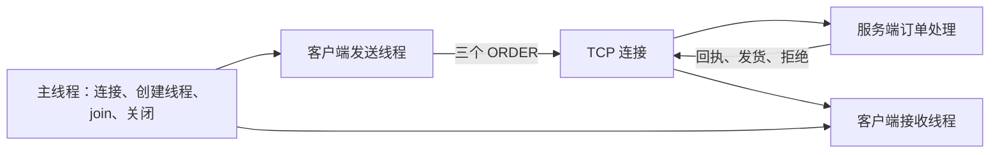

# TCP 业务示例：订单发送与回执接收

[English](TCP_BUSINESS.md) · [README](../README.zh-CN.md) · [socket C 接口](../include/hx_os_net.h)

## 1. 独立的 TCP 程序

本例直接使用 `hx_os_socket_*`，由自己的 TCP 客户端和服务端完成订单业务。它不调用 `hx_ipc_*`，不使用 HXIP 协议，也不启动 IPC 的设备服务端。关闭 `HX_OS_ENABLE_IPC` 后仍能构建和运行。

客户端有一个发送线程和一个接收线程，共用一条 TCP 连接。发送线程提交三个订单，接收线程同时处理订单回执、发货通知和拒绝信息。服务端只服务一个连接、处理三个订单后结束，状态只保存在内存中。

## 2. 构建和运行

仓库根目录：

```sh
cmake -S . -B build-net -DHX_OS_BUILD_TESTS=ON -DHX_OS_BUILD_EXAMPLES=ON
cmake --build build-net --config Release --parallel 4
```

Windows PowerShell，Visual Studio 构建：

```powershell
python examples/run_tcp_business.py --bin-dir build-net/bin/Release
python examples/run_tcp_business.py --fragmented --bin-dir build-net/bin/Release
```

Linux/WSL 对应使用 `python3` 和 `--bin-dir build-net/bin`。已有构建可替换为 `build-shared-msvc/bin/Release` 或 `build-shared-linux/bin`；Windows Ninja 去掉 `Release`。自动运行器选择空闲端口。

手工运行时，**终端一**：

```powershell
.\build-net\bin\Release\hx_os_tcp_order_server.exe 39001
```

看到 `Listening:` 后，**终端二**：

```powershell
.\build-net\bin\Release\hx_os_tcp_order_client.exe 39001
```

Linux/WSL 分别运行 `./build-net/bin/hx_os_tcp_order_server 39001` 和 `./build-net/bin/hx_os_tcp_order_client 39001`。参数是端口号；本例固定连接/监听 `127.0.0.1`，不接收 `tcp://` URI。服务端整体期限 15 秒，客户端 I/O 期限 10 秒；每次演示重新启动服务端。

## 3. 线程与业务结果



| 请求 | 业务结果 |
| --- | --- |
| `ORDER id=1 sku=101 qty=2` | 单价 1250 分，回执金额 2500 分，另发 `SHIPPED id=1` |
| `ORDER id=2 sku=102 qty=1` | 单价 9000 分，回执金额 9000 分，另发 `SHIPPED id=2` |
| `ORDER id=3 sku=101 qty=0` | 数量无效，返回 `REJECTED id=3 reason=invalid_order`，不计入订单金额 |

服务端最终接受两单，合计 `11500` 分。金额用整数表示，避免示例引入浮点计价误差。`id` 是应用自己放进正文的订单编号；这里由客户端解析/检查，不由 IPC 自动匹配。

```text
[TCP receive thread] RECEIPT id=1 total_cents=2500
[TCP receive thread] SHIPPED id=1
[TCP receive thread] RECEIPT id=2 total_cents=9000
[TCP receive thread] SHIPPED id=2
[TCP receive thread] REJECTED id=3 reason=invalid_order
TCP CLIENT PASS: 3 orders, 2 receipts, 2 notices, 1 rejection
TCP SERVER PASS: accepted=2 total_cents=11500
```

## 4. 消息边界与关键代码

TCP 提供字节流，不提供消息边界。本例自己约定 `2 字节大端正文长度 + 正文`；正文是 1～127 字节 ASCII，支持的命令见上表。双方按长度收齐一条后再处理，明确拒绝过长、空正文和内嵌 NUL。

| 文件 | 看哪里 |
| --- | --- |
| [tcp_order_client.c](../examples/tcp_order_client.c) | `send_orders()` 是发送线程，`receive_receipts()` 是独立接收线程 |
| [tcp_order_server.c](../examples/tcp_order_server.c) | `process_orders()` 解析订单、计算金额、发送回复与通知 |
| [tcp_business.h](../examples/tcp_business.h) | `tcp_send_text()` / `tcp_receive_text()` 的长度帧；`tcp_transfer()` 处理短读短写与截止时间 |
| [run_tcp_business.py](../examples/run_tcp_business.py) | 订单断言，以及标准库 Python TCP 对端的分段/合并写入 |

业务代码直接写成：

```c
if (!tcp_send_text(job->stream, "ORDER id=1 sku=101 qty=2"))
	return NULL;
```

`tcp_send_text()` 是本示例内部函数，底层循环调用 `hx_os_socket_send_some()`；接收路径调用 `hx_os_socket_receive_some()`。函数不是新公共库 API，也不转发到 IPC。为了遵守原始 socket 的操作串行契约，每次非阻塞调用有一个短互斥区，遇到 `WOULD_BLOCK` 后在锁外休眠 1 毫秒。完整帧只有一个发送线程，完整消息只有一个接收线程；不能据此把多个发送者直接接到同一条原始流上。

这一小批量演示没有无界队列。主线程先 join 两个线程，再释放互斥锁、关闭 socket、销毁 network。半条帧后发生超时/断线会让本次连接失败，不把残留正文当作下一个消息继续解析。长期高吞吐服务可使用库的 loop 接口集中处理就绪事件；这里的短周期重试不作为性能基准。

## 5. 测试

```sh
ctest --test-dir build-net -C Release -R "^tcp_business_" --output-on-failure
```

`tcp_business_orders` 运行两个独立 C 进程，验证线程收发和金额；`tcp_business_framing` 使用普通 Python socket，将第一个头和正文分开写入，再将后续两个请求合在一次写入中，验证服务端仍解析出三单。该 Python 对端没有实现 HXIP，展示了此 TCP 示例自己的简单协议。

原始 TCP 不自动提供应用会话、业务重试去重或重启恢复；这些应按实际协议定义。本例展示当前连接上的有限订单流程。目标平台结果见[验证记录](VALIDATION.zh-CN.md)。其他业务分别见 [IPC](IPC_BUSINESS.zh-CN.md)、[UDP](UDP_BUSINESS.zh-CN.md)、[KCP](KCP_BUSINESS.zh-CN.md)。
