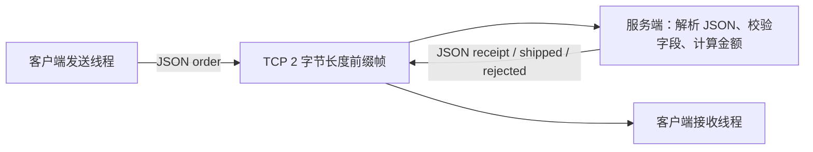

# TCP 业务示例：基于原生 Socket 的订单发送与异步回执

[English](TCP_BUSINESS.md) · [README](../README.zh-CN.md) · [Socket C 接口](../include/hx_os_net.h)

当你的应用需要直接与既有的 TCP 服务端或客户端通信（不使用 `hx_ipc` 的 HXIP 协议封装，而是在原始 TCP 字节流上自定义长度前缀帧与 UTF-8 JSON 报文）时，可以直接使用 `hx_os_socket_*` 接口。本示例实现了一套完整的“客户端双线程并发收发订单 + 服务端解析校验与异步发货通知”流程，演示如何在非阻塞 TCP 流上处理半包/粘包、严格校验 JSON 字段类型以及安全回收资源。

在开始前，请先完成一次[示例构建配置](../examples/README.zh-CN.md#run)。下文中的 `build` 是你现有构建目录的占位名，直接复用即可。

## 1. 独立的 TCP 程序

本示例由独立的客户端（`hx_os_tcp_order_client`）和服务端（`hx_os_tcp_order_server`）组成，直接调用 `hx_os_socket_*` 完成通信：
- **完全独立于 `hx_ipc`**：不调用任何 `hx_ipc_*` 函数，不使用 HXIP 线协议，也不依赖 IPC 设备服务端。即使在 CMake 中将 `HX_OS_ENABLE_IPC` 设为 `OFF`，本示例依然可以正常编译和运行。
- **全双工并发收发**：客户端内部启动一个发送线程和一个接收线程，二者共享同一条 TCP 连接。发送线程连续提交 3 笔订单；接收线程则同时接收订单回执（`receipt`）、异步发货通知（`shipped`）以及非法订单的拒绝消息（`rejected`）。服务端在内存中处理完这一个连接的 3 笔订单后正常退出。

## 2. 构建和运行

在仓库根目录下编译 TCP 订单服务端与客户端：

```sh
cmake -S . -B build -DHX_OS_BUILD_EXAMPLES=ON
cmake --build build --config Release --target hx_os_tcp_order_server
cmake --build build --config Release --target hx_os_tcp_order_client
```

**Windows PowerShell（Visual Studio 构建，一键自动化验证）：**

```powershell
python examples/run_tcp_business.py --bin-dir build/bin/Release
python examples/run_tcp_business.py --fragmented --bin-dir build/bin/Release
```

在 Linux 或 WSL 下，请使用 `python3` 并将目录改为 `--bin-dir build/bin`（若使用已有的共享库目录如 `build-shared-msvc/bin/Release` 或 `build-shared-linux/bin` 可直接替换；Windows Ninja 构建去掉 `Release`）。Python 运行器会自动挑选空闲端口并核对全流程输出。

### 在两个终端中手工运行

你也可以不借助 Python，直接在两个终端里运行 C 程序：

**终端一（启动服务端，监听本机 39001 端口）：**

```powershell
.\build\bin\Release\hx_os_tcp_order_server.exe 39001
```

看到 `Listening:` 后，在**终端二（运行客户端）**中执行：

```powershell
.\build\bin\Release\hx_os_tcp_order_client.exe 39001
```

在 Linux/WSL 下分别执行 `./build/bin/hx_os_tcp_order_server 39001` 和 `./build/bin/hx_os_tcp_order_client 39001`。注意命令行参数直接传入**端口号**（如 `39001`），程序内部固定绑定和连接 `127.0.0.1`，不接受 `tcp://` 前缀的 URI。服务端总运行期限为 15 秒，客户端单次 I/O 期限为 10 秒；每次重新演示时请重启服务端。

## 3. 发送 JSON 订单，接收 JSON 回执



每笔订单都是一个真实的 UTF-8 JSON 对象。为了验证转义与多字节字符处理，示例中的备注字段（`note`）特意包含了中文、双引号、反斜杠以及 Unicode 补充平面字符（Emoji）：

```json
{"type":"order","id":1,"sku":101,"quantity":2,"note":"桌面 \"设备\"\\A🌐"}
```

服务端解析并校验字段后，首先返回订单回执（`receipt`），并将解码后的备注原样重新序列化回传：

```json
{"type":"receipt","id":1,"ok":true,"total_cents":2500,"note":"桌面 \"设备\"\\A🌐"}
```

紧接着，服务端再单独发送一条发货通知（`shipped`）：

```json
{"type":"shipped","id":1,"ok":true}
```

### 三笔演示订单的校验结果

| 订单参数 | 服务端校验与计算结果 |
| --- | --- |
| `id=1, sku=101, quantity=2` | 单价 1250 分，返回 `total_cents=2500` 的 `receipt`，并追加发送 `shipped` |
| `id=2, sku=102, quantity=1` | 单价 9000 分，返回 `total_cents=9000` 的 `receipt`，并追加发送 `shipped` |
| `id=3, sku=101, quantity=0` | 数量越界，返回拒绝消息：`{"type":"rejected","id":3,"ok":false,"reason":"invalid_order"}` |

两笔有效订单的合计金额为 `11500` 分。服务端执行严格的 JSON 类型与范围检查：
- `id`、`sku` 和 `quantity` 必须是真正的 JSON 整数（其中 `quantity` 必须在 `1`～`10` 之间）；字符串 `"1"`、布尔值 `true` 或浮点数 `1.0` 均会被拒绝。
- `note` 必须是 JSON 字符串，且 UTF-8 字节长度不超过 128 字节。
- 订单编号 `id` 完全由应用层在 JSON 正文中定义和核对，不经过任何 IPC 请求路由表。

## 4. 编解码与 TCP 消息边界

由于 TCP 是面向字节流的协议，应用层必须自行定义消息边界。本示例采用经典的 **`2 字节大端无符号长度 + UTF-8 JSON 正文`** 分帧格式（单条正文上限为 1023 字节）。注意：头部长度按 **UTF-8 字节数**计算，绝不是按中文字符个数计算。接收端循环读满指定字节数后，交由本库内置的 JSON 解析器还原为结构化对象，而不是用脆弱的 `sscanf` 或子串查找去拼凑结果。

| 源码文件 | 核心函数与职责 |
| --- | --- |
| [tcp_order_client.c](../examples/tcp_order_client.c) | `send_orders()`：构造强类型 JSON 字段并发送；`receive_receipts()`：解析响应并核对金额与备注 |
| [tcp_order_server.c](../examples/tcp_order_server.c) | `process_orders()`：校验 JSON 结构与业务范围；`send_order_json()`：编码并发送响应帧 |
| [tcp_business.h](../examples/tcp_business.h) | 实现 2 字节大端长度前缀读写、处理非阻塞短读/短写（Partial Read/Write）与超时控制 |
| [business_json.h](../examples/business_json.h) | 复用本库内置 JSON 解析器与 Settings 序列化器的编解码辅助封装 |

在客户端中，构造并发送一笔订单的代码片段如下（`stream` 为已连接的 TCP 包装对象）：

```c
json_field fields[] = {
	json_text("type", "order"), json_int("id", 1),
	json_int("sku", 101), json_int("quantity", 2),
	json_text("note", "桌面设备")
};

hx_string wire = HX_STRING_INIT;

if (json_encode(fields, 5, &wire)) {
	int sent = tcp_send_text(stream, hx_string_c_str(&wire));
	// Check sent before continuing the business operation.
	(void)sent;
}

hx_string_destroy(&wire);
```

> [!NOTE]
> **安全边界与并发收发细节**
> - **编解码与内存限制**：序列化器会自动转义引号、反斜杠与控制字符；接收端解析器会拒绝重复键（Duplicate Keys）和非对象根节点，并限制最大解析深度为 8、最大节点数为 64、解析内存上限为 64 KiB。该功能仅依赖默认开启的 `CONFIG`、`CONFIG_SERIALIZE` 和 `SETTINGS` 模块。
> - **非阻塞 Socket 并发模型**：示例中的每次非阻塞 socket 读写都在短临界区（互斥锁）内发起；当遇到 `HX_OS_WOULD_BLOCK` 时，线程会先释放互斥锁再休眠 1 毫秒重试。整个连接严格保持“单线程写完整帧、单线程读完整帧”，主线程在 `join` 两个工作线程后才按序销毁互斥锁、socket 和网络上下文。如果读取半帧时发生超时或对端断开，连接会立即报错终止，绝不会把残留的半截字节当成下一条消息解析。

### 放进自己的工程时要复制什么

如果你想基于本例改造自己的 TCP 业务程序：
1. 复制 [tcp_order_server.c](../examples/tcp_order_server.c)、[tcp_order_client.c](../examples/tcp_order_client.c) 以及同目录下的辅助头文件 [tcp_business.h](../examples/tcp_business.h)、[network_demo.h](../examples/network_demo.h) 和 [business_json.h](../examples/business_json.h)。
2. 服务端和客户端各自包含 `main()`，请分别建立独立的 CMake 可执行目标，并链接 `hx_c_platform::hx_c_platform`（参见[已安装包接入指南](USAGE.zh-CN.md#installed-project)）。注意 `tcp_send_text`、`json_field` 等辅助函数定义在上述示例头文件中，并非 `#include <hx_os.h>` 自带的公共接口。
3. 先用第 2 节的双终端手动命令跑通原版示例，再替换为你自己的 JSON 字段和业务计算逻辑，同时保持原有的“先 `join` 收发线程、再销毁 socket 与锁”的关闭顺序。

## 5. 运行业务示例

`run_tcp_business.py` 提供了三种测试模式，可直接验证正常业务、极端拆包/粘包以及非法 JSON 拦截：

```sh
python examples/run_tcp_business.py --bin-dir build/bin/Release
python examples/run_tcp_business.py --bin-dir build/bin/Release --fragmented
python examples/run_tcp_business.py --bin-dir build/bin/Release \
  --json-errors
```

（Linux 下请将 `build/bin/Release` 替换为 `build/bin`。）
- **第一条命令**：运行标准订单收发流程。
- **`--fragmented`**：模拟 TCP 传输中的极端分段（半包）与多帧粘连（粘包），验证 2 字节长度帧解析器的稳健性。
- **`--json-errors`**：向服务端注入语法损坏、类型错误和越界字段，验证服务端能否安全返回拒绝消息而不崩溃。
