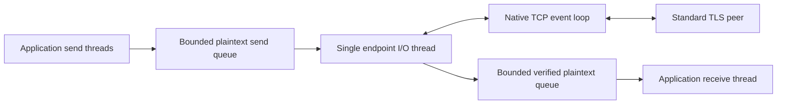

# TLS Connections and Threaded JSON Communication

[简体中文](TLS.zh-CN.md) · [README](../README.md) · [Cryptography](CRYPTO.md)

When your application needs encrypted transport over untrusted networks with strict X.509 certificate-chain and Subject Alternative Name (SAN) verification—while allowing a sender thread and a receiver thread to share the same connection safely—use `hx_os_tls`. It wraps OpenSSL 1.2/1.3 state machines, bounded BIO pairs, dual-stack Happy Eyeballs dialing, and a single internal I/O worker thread per endpoint so you never have to wire up raw `SSL_CTX` pointers, non-blocking socket loops, or partial-handshake state in application code.

> [!NOTE]
> `hx_os_tls` implements **Transport Layer Security over TCP**. For OS **thread-local storage**, use the separate `hx_os_tls_key` APIs. Peers written in other languages can use any standard TLS 1.2 or 1.3 implementation as long as they follow the same application framing.

## 1. Build and run the complete example

The runnable business workflow (`hx_os_tls_json_client` and `hx_os_tls_json_server`) demonstrates full-duplex threaded communication over TLS: one client sender thread and one client receiver thread share a single TLS connection. The client submits three temperature readings (`20`, `81`, and `22` for device `"温度传感器🌐"`), while the server returns three acknowledgements and pushes an asynchronous high-temperature `alarm` notification for the second reading (`81`).

### 1.1 Reuse an existing build directory

First build the native dependency stack following the [Dependency Guide](DEPENDENCIES.md#4-build-the-native-dependency-stack). `HX_OS_ENABLE_TLS` requires `CRYPTO`, `NETWORK`, `LOOP`, and `FILE_UTILS`, and this JSON workflow also uses `CONFIG`, `CONFIG_SERIALIZE`, and `SETTINGS` (all `ON` by default; disabling a prerequisite causes `hx_os_tls_available()` to return `0` and calls to return `HX_OS_NOT_SUPPORTED`).

If you are adding the prebuilt dependency SDK to a trimmed CMake build directory for the first time, pass these three cache variables on your `cmake -S` command line:

| CMake Variable | Description |
| --- | --- |
| `-DHX_OS_DEPENDENCY_PREFIX=...` | Absolute path to the built SDK install prefix (e.g., `E:/sdk/hx/prefix`), **not the `deps/` source tree** |
| `-DHX_OS_ENABLE_CRYPTO=ON` | Enables OpenSSL cryptographic support |
| `-DHX_OS_ENABLE_TLS=ON` | Enables the TLS connection module |

From the repository root, build the TLS server and client examples in your existing `build` directory (substitute `Debug` for `Release` if using a Debug SDK):

```sh
cmake -S . -B build -DHX_OS_BUILD_EXAMPLES=ON
cmake --build build --config Release --target hx_os_tls_json_server
cmake --build build --config Release --target hx_os_tls_json_client
```

### 1.2 Prepare a local demo certificate

Linking a TLS library does not supply server credentials or trust anchors. Use the OpenSSL CLI to generate a 1-day self-signed certificate for `localhost` / `127.0.0.1` inside `build/` without touching your OS trust store (ensure `openssl` is on `PATH` or invoke the binary inside your built SDK prefix, such as `& .\build-deps\prefix\bin\openssl.exe` in PowerShell):

**Windows PowerShell (no trailing spaces after backticks):**

```powershell
openssl req -x509 -newkey rsa:2048 -nodes -days 1 `
    -subj /CN=localhost `
    -addext subjectAltName=DNS:localhost,IP:127.0.0.1 `
    -keyout build/demo-key.pem -out build/demo-cert.pem
```

**Linux / WSL:**

```sh
openssl req -x509 -newkey rsa:2048 -nodes -days 1 \
  -subj /CN=localhost \
  -addext subjectAltName=DNS:localhost,IP:127.0.0.1 \
  -keyout build/demo-key.pem -out build/demo-cert.pem
```

### 1.3 Start both peers and check the result

From the repository root, run the automated test script, which selects a free port, starts the server, waits for `Listening:`, and runs the client:

**Windows (Visual Studio generator):**

```powershell
python examples/run_tls_business.py --bin-dir build/bin/Release `
    --certificate build/demo-cert.pem --private-key build/demo-key.pem `
    --ca build/demo-cert.pem
```

**Linux / WSL:**

```sh
python3 examples/run_tls_business.py --bin-dir build/bin \
  --certificate build/demo-cert.pem --private-key build/demo-key.pem \
  --ca build/demo-cert.pem
```

Successful output prints the exchanged JSON lines along with both pass banners:

```text
TLS CLIENT PASS: 3 JSON readings, 3 replies, 1 alarm
TLS SERVER PASS: 3 JSON readings processed
```

#### Running Manually in Two Terminals

To run the C binaries directly without Python, start the server in **Terminal 1**:

```powershell
.\build\bin\Release\hx_os_tls_json_server.exe 39004 `
    build/demo-cert.pem build/demo-key.pem
```

Once `Listening:` appears, run the client in **Terminal 2**:

```powershell
.\build\bin\Release\hx_os_tls_json_client.exe 39004 build/demo-cert.pem
```

(On Linux / WSL, run `./build/bin/hx_os_tls_json_server 39004 build/demo-cert.pem build/demo-key.pem` and `./build/bin/hx_os_tls_json_client 39004 build/demo-cert.pem`.)

By default, the client uses the extended API from Section 7 (with TCP Keepalive enabled). Append `--basic` to the client or runner command to exercise the basic `hx_os_tls_connect()` entry point instead:

```sh
./build/bin/hx_os_tls_json_client 39004 build/demo-cert.pem --basic
```

> [!TIP]
> **Troubleshooting Verification or Missing DLLs**
> - **Certificate Verification Failure**: The client verifies `localhost` against the certificate's SAN extension and validity window. Check the CA path, the `-addext subjectAltName=...` flag, and the local system clock—**never disable certificate verification**.
> - **Missing DLLs on Windows**: Verify that you are running the binary matching your SDK configuration (`Debug` vs. `Release`) and that the OpenSSL runtime DLLs are deployed per [Using an Installed Package](USAGE.md#installed-project).

### 1.4 Adapt the business code

The complete sources are [tls_json_client.c](../examples/tls_json_client.c) and [tls_json_server.c](../examples/tls_json_server.c). When copying them into your own project, include the companion headers [tls_json.h](../examples/tls_json.h), [network_demo.h](../examples/network_demo.h), and [business_json.h](../examples/business_json.h), and build the client and server as separate CMake executable targets linked to `hx_c_platform::hx_c_platform`.

Remember that **TLS encrypts a raw byte stream and does not create message boundaries on its own**. In this example, `tls_json.h` frames each message with a **4-byte big-endian byte length followed by UTF-8 JSON** (up to 1023 bytes), which differs from the TCP order example's 2-byte prefix and `hx_ipc`'s 64-byte HXIP header.

## 2. Direct C and C++ calls

In C, connecting, listening, accepting, sending, receiving, and closing all work through `hx_os_tls *` without exposing OpenSSL internals:

```c
hx_os_tls *connection = NULL;
hx_os_tls_options options = HX_OS_TLS_OPTIONS_INIT;
hx_os_error error;

options.ca_file = "ca.pem";
hx_os_status status = hx_os_tls_connect(
	"localhost", 4433, &options, &connection, &error);

/**
 * \brief Use connection only after checking status.
 *
 * \details On timeout/failure, an already accepted startup still leaves an
 * owner that must be closed or aborted.
 */
```

- **One-Step Connect vs. Staged Start + Wait**:
  - `hx_os_tls_connect()` and `hx_os_tls_listen()` wait up to 5 seconds by default; `connect_until` and `listen_until` accept an explicit monotonic deadline.
  - Call `hx_os_tls_start_connect()` or `hx_os_tls_start_listen()` to return as soon as the worker thread is spawned, then call `hx_os_tls_wait_ready_until()` to wait for readiness.
  - **Retained Owner Rule**: Validation failures before worker creation leave `*connection = NULL`. Once startup is accepted, however, a subsequent handshake timeout or verification failure **still leaves a non-NULL `*connection` handle that you must wait on, close (`close_until`), or abort (`abort_until`)—never leak a non-NULL owner pointer**.
- **Built-in Dual-Stack Multi-Address Dialer**:
  - Both basic (`hx_os_tls_connect`, `Tls::connect()`) and extended client entry points use the same staggered IPv4/IPv6 dialer (250 ms stagger, at most 2 concurrent TCP attempts, and a 2-second cap on stalled candidates while untried addresses remain). The first TCP candidate to connect proceeds to TLS handshake and certificate verification while the others are closed.
  - Basic clients start `handshake_timeout_ms` after OS DNS resolution returns; extended clients start that budget before DNS resolution begins.

In C++11, the exception-free [hx::Tls](../include/hx/Tls.hpp) wrapper borrows a durable `hx_os_tls *` owner:

```cpp
hx_os_tls *owner = NULL;
hx::Tls connection(owner);
hx_os_tls_options options = HX_OS_TLS_OPTIONS_INIT;
options.ca_file = "ca.pem";

auto opened = connection.connect("localhost", 4433, &options);
if (opened) {
	const char data[] = "hello";
	auto sent = connection.send(data, sizeof(data) - 1);
	// sent.value() is the accepted byte count, including on failure.
}

auto closed = connection.closeUntil(hx_os_deadline_after_ms(2000));
/**
 * \brief If owner is still non-NULL, keep it alive and retry, or explicitly
 * abort.
 *
 * \details The facade destructor does not close, kill or detach its worker.
 */
```

## 3. One sender and one receiver on the same connection



- **Single I/O Worker & Full-Duplex Concurrency**: Only the endpoint's single internal I/O worker thread touches OpenSSL connection objects (a server multiplexes all accepted peers on that one worker thread rather than spawning a thread per peer). Multiple application sender threads can call send concurrently (serialized per call internally), while one receiver thread calls receive independently (a second concurrent receiver on the same peer returns `HX_OS_BUSY`).
- **Bounded Memory Budgets**:
  - Defaults are `16` server peers (`1..1024` configurable) and `64 KiB` per peer per plaintext queue (`16 KiB..16 MiB` configurable, within a `256 MiB` total peer-storage ceiling); clients have `1` peer.
  - Each admitted peer allocates four `16 KiB` record buffers and two `32 KiB` BIO sides on admission (unused peer slots do not preallocate record buffers). Using bounded OpenSSL BIO pairs over the library's IOCP/epoll/kqueue adapters avoids narrowing 64-bit Windows `SOCKET` handles to `int` or triggering `SIGPIPE` on POSIX descriptors.
- **Blocking Thread Semantics**: Public TLS calls block the calling OS thread (do not call them directly inside a coroutine expecting coroutine suspension). Re-entering blocking TLS APIs from the internal TLS worker or during disposal returns `HX_OS_DEADLOCK`.

## 4. Bytes, messages, progress and cancellation

| Operation | Behavior & Caller Responsibility |
| --- | --- |
| `hx_os_tls_send_until` | Copies accepted plaintext into bounded internal storage. `HX_OS_OK` includes handing the resulting ciphertext to the OS, **not remote business confirmation**. On timeout or error, `*accepted` remains valid—**retry only the unaccepted suffix**. |
| `hx_os_tls_flush_until` | Waits only for bytes already accepted when `flush_until` was entered; subsequent sends do not extend that snapshot. |
| `hx_os_tls_receive_until` | Returns authenticated plaintext bytes (at least 1 byte) or an explicit error, timeout, or `HX_OS_EOF` into the caller's buffer. |
| `hx_os_tls_receive_exact_until` | Reads the exact byte count within one deadline; preserves the partial count on failure and reports `HX_OS_TRUNCATED_INPUT` if EOF arrives early. |
| `hx_os_tls_cancel_waits` | Wakes active application waits with cancellation without withdrawing already accepted bytes or closing the connection. |
| `hx_os_tls_get_peer_info` | Copies negotiated TLS version, cipher suite, peer address, leaf certificate SHA-256 fingerprint, and verification flags without exposing OpenSSL pointers. |

> [!WARNING]
> **Authenticated `HX_OS_EOF` vs. `HX_OS_TRUNCATED_INPUT` and Partial Frame Sends**
> - **Truncation Detection**: Already authenticated plaintext is delivered before any terminal read error. Normal `HX_OS_EOF` is reported only when a verified TLS `close_notify` alert is received; an abrupt TCP disconnect without `close_notify` returns `HX_OS_TRUNCATED_INPUT`.
> - **Resuming Partial Frame Writes**: Because accepted plaintext can continue draining after a send timeout, if a send fails after accepting only part of an application frame (`0 < accepted < frame_bytes`), either keep exclusive send access to finish writing the suffix or close the connection—**never let another thread interleave a new frame between the prefix and suffix**.
> - **Server `peer` Handles**: `hx_os_tls_accept_until()` returns each handshaken peer once using a non-reused local `peer` ID (clients always pass `0`). Close or abort finished peers with `hx_os_tls_peer_close_until()` or `hx_os_tls_peer_abort_until()` to free their listener slots.

## 5. Verification, trust stores and deployment

- **Mandatory Chain & SAN Verification**: Clients always verify the server certificate chain and its DNS/IP Subject Alternative Name (SAN): DNS/Punycode hostnames send SNI and reject partial wildcards, while numeric IPs verify IP SANs (with no insecure fallback to Common Name). Setting `options.server_name` overrides the verified identity without changing the destination IP/host. Verification failures terminate the handshake and record both the native OpenSSL error and X.509 cause code in `error.cause_code`.
- **PEM Credentials & mTLS**: Servers require certificate-chain and private-key PEM files; clients may supply both for mutual TLS (enforced by servers when `HX_OS_TLS_REQUIRE_CLIENT_CERTIFICATE` is set). File caps are `1 MiB` / 64 certs for chains, `4 MiB` / 4096 certs for CA bundles, `64 KiB` for private keys, and `1024` UTF-8 bytes for key passwords (temporary private-key buffers are securely zeroed on all cleanup paths).
- **System Trust Stores**: When `ca_file` is `NULL`, clients load default trust anchors from the Windows `ROOT` store, standard Linux/BSD CA bundle paths, macOS system anchors, or Android system/Conscrypt directories. If no trust store is available, verification fails explicitly rather than silently disabling checks; supply `ca_file` on minimal embedded targets.
- **Security Profile & Shared Libraries**: Only **TLS 1.2 / 1.3**, modern AEAD cipher suites, and **OpenSSL Security Level 2** are enabled (no renegotiation, 0-RTT early data, DTLS, or QUIC). OpenSSL links dynamically by default (`HX_OS_OPENSSL_STATIC=ON` is optional); stop calls, close endpoints, and let workers exit before unloading the library (see [CRYPTO.md Section 5](CRYPTO.md#5-threads-memory-and-unloading) for static-link rules).

## 6. Close, retry and tests

- **Graceful Close (`hx_os_tls_close_until`) vs. Abort (`hx_os_tls_abort_until`)**:
  - `close_until` stops new admissions, drains accepted outgoing data, and exchanges `close_notify`. If a peer stalls graceful shutdown until the deadline, the call returns `HX_OS_TIMEOUT` and **preserves the non-NULL owner** so you can either retry `close_until` or call `hx_os_tls_abort_until()` to discard queues, cancel I/O, and wait for worker retirement.
  - Neither function ever kills or detaches a worker thread. Always inspect both the returned status and whether the owner pointer has been set to `NULL`.

## 7. Configure TCP, ALPN and explicit certificate policy

Use `hx_os_tls_options_ex` with `hx_os_tls_connect_ex_until()` and `hx_os_tls_listen_ex_until()` when you need TCP Keepalive, socket buffer tuning, explicit dual-stack listeners, ALPN negotiation, leaf-certificate pinning, or local CRL checks:

```c
hx_os_tls *connection = NULL;
hx_os_tls_options_ex options = HX_OS_TLS_OPTIONS_EX_INIT;
hx_os_error error;

options.base.ca_file = "ca.pem";
options.socket.nodelay = 1;
options.socket.keepalive = 1;
options.socket.keepalive_idle_seconds = 30;
options.socket.keepalive_interval_seconds = 5;

hx_os_status status = hx_os_tls_connect_ex_until(NULL,
	"localhost", 4433, &options, hx_os_deadline_after_ms(5000),
	&connection, &error);
```

| Extended Setting | Description |
| --- | --- |
| `socket.nodelay`, `keepalive`, `dual_stack` | `-1` keeps default, `0` disables, `1` enables (explicit `socket.nodelay` overrides `base`) |
| `socket.dual_stack = 1` | Configures an IPv6 listener bound to `::` to accept both IPv4 and IPv6 clients |
| `socket.send_buffer_bytes`, `receive_buffer_bytes` | `0` keeps OS defaults; positive values request kernel socket buffer sizes (distinct from TLS plaintext queues) |
| `attempt_delay_ms` | Delay before starting the next dial candidate (default `250` ms, max 2 concurrent attempts) |
| `base.handshake_timeout_ms` | Covers **DNS + TCP candidates + TLS handshake** together on extended clients |

### 7.1 Agree on an application protocol with ALPN

Configure ALPN to negotiate an application protocol identifier (such as `"hx-json/1"`) during the TLS handshake:

```c
const char *protocols[] = {"hx-json/1"};
options.alpn = protocols;
options.alpn_count = 1;
options.require_alpn = 1;
```

Pass matching settings to `hx_os_tls_listen_ex_until()` on the server, which selects its first mutually supported protocol. After connecting or accepting, call `hx_os_tls_get_alpn(connection, 0, &selected, &error)` (replacing `0` with the accepted `peer` ID on a server) to read the negotiated string (returns `HX_OS_NOT_FOUND` if none was negotiated; setting `require_alpn = 1` rejects connections without a match).

### 7.2 Require a specific certificate or a local revocation list

- **Leaf Certificate SHA-256 Pinning**: Set `options.certificate_sha256` to the 32 raw bytes of the expected leaf certificate SHA-256 digest (binary bytes, not a hex string). Pinning runs **in addition to** normal CA chain and hostname verification—a matching pin never rescues an expired, untrusted, or wrong-host certificate.
- **Local PEM Certificate Revocation Lists (CRL)**: Set `options.crl_file = "revocations.pem"` and `options.crl_mode = HX_OS_TLS_CRL_LEAF` (or `HX_OS_TLS_CRL_CHAIN` for full-chain CRL checks, up to `4 MiB`). Missing, invalid, or expired CRLs fail verification, and revoked certificates report an authentication failure with the X.509 cause code.

### 7.3 Cancel DNS together with TLS startup

Initialize `hx_os_resolver_options dns = HX_OS_RESOLVER_OPTIONS_INIT` and set `options.resolver = &dns` before calling `hx_os_tls_connect_ex_until()`. The endpoint creates a private `c-ares` resolver on its I/O worker thread so DNS shares the connection/handshake deadline and cancels immediately on close or abort (see [Cancellable DNS](NETWORK_OPTIONS.md#12-connect-by-name-and-select-cancellable-dns)).

## 8. Reconnect with the same verified TLS profile

When a client repeatedly connects to the same service, create an **`hx_os_tls_profile`** once and reuse it across connections. The profile captures the target host, port, trust material, client credentials, ALPN list, certificate pin, and CRL configuration, and caches at most **one single-use TLS session ticket** isolated to that profile:

```c
hx_os_tls_profile *profile = NULL;
hx_os_tls *connection = NULL;
hx_os_status status = hx_os_tls_profile_create(NULL, "localhost", port,
	&options, &profile, &error);

if (status == HX_OS_OK)
	status = hx_os_tls_profile_connect_until(profile,
		hx_os_deadline_after_ms(5000), &connection, &error);
```

- **Checking Session Resumption**: Inspect `hx_os_tls_get_peer_info()` after connecting—`HX_OS_TLS_PEER_RESUMED` indicates the server resumed the cached session, while a full handshake occurs transparently otherwise. Even on resumption, the client re-verifies the cached certificate chain against the profile's trust anchors, current time, hostname, pin, and ALPN policy.
- **Enabling Server Session Tickets**: For servers built with this library, set `options.enable_session_tickets = 1` on `hx_os_tls_options_ex` to issue bounded stateless session tickets.
- **Profile Lifetime**: Call `hx_os_tls_profile_release()` once you stop creating new connections (active connections retain their own internal reference). In C++11, include `<hx/TlsProfile.hpp>` and use `hx::TlsProfile::create()` and `connect(owner, deadline)`.
