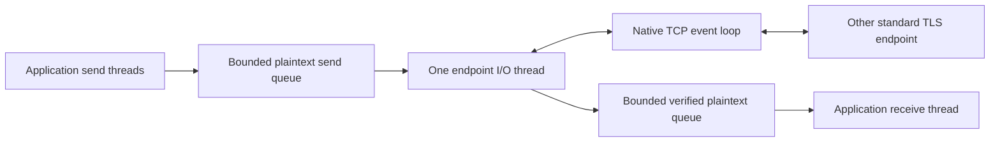

# TLS connections and threaded JSON communication

[简体中文](TLS.zh-CN.md) · [README](../README.md) · [Cryptography](CRYPTO.md)

Reuse the [configured example directory](../examples/README.md#run), replacing build and Release for your setup. Prepare a localhost-compatible demo certificate before running the peers; linking a crypto library does not supply identity or trust configuration.

## 1. Build and run the complete example

One sending thread and one receiving thread share a TLS connection. The client sends three temperature readings; the server returns three acknowledgements and pushes an alarm for the second, hot reading. You see business data, matching IDs and a notification, beyond just establishing a connection.

TLS means Transport Layer Security over TCP; thread-local storage uses the separate `hx_os_tls_key` APIs. A peer in another language can use standard TLS 1.2/1.3 while following this example's message framing.

### 1.1 Reuse an existing build directory

Prepare the SDK using the [dependency guide](DEPENDENCIES.md#4-build-the-native-dependency-stack). `HX_OS_ENABLE_TLS` requires CRYPTO, NETWORK, LOOP and FILE_UTILS; this example's JSON also needs CONFIG, CONFIG_SERIALIZE and SETTINGS. These default to ON. If you used the trimmed homepage setup, configure its `HX_OS_DEPENDENCY_PREFIX` and explicitly re-enable CRYPTO and TLS first. Initializing submodules does not build the SDK.

When a prerequisite is disabled, `hx_os_tls_available()` returns 0 and operations return `HX_OS_NOT_SUPPORTED`. Enabling a module starts no threads at program load; resources are created when opening a connection or listener.

Run everything below from the library checkout root. `build` means an existing directory; Windows and WSL use separate directories. For Debug, replace Release in both commands and paths. No TLS-specific build directory is needed.

When adding the SDK to a trimmed configuration for the first time, append these three arguments to the following `cmake -S` command or set the same entries in cmake-gui. They remain in the cache afterward:

| Argument | Value |
| --- | --- |
| `-DHX_OS_DEPENDENCY_PREFIX=...` | Absolute path to the built SDK prefix, such as `E:/sdk/hx/prefix`, not the deps source directory |
| `-DHX_OS_ENABLE_CRYPTO=ON` | Enable OpenSSL support |
| `-DHX_OS_ENABLE_TLS=ON` | Enable the TLS connection API |

```sh
cmake -S . -B build -DHX_OS_BUILD_EXAMPLES=ON
cmake --build build --config Release --target hx_os_tls_json_server
cmake --build build --config Release --target hx_os_tls_json_client
```

### 1.2 Prepare a local demo certificate

The OpenSSL CLI creates a self-signed certificate valid for one day. Files stay in the existing build directory; nothing is added to the system trust store. Put `openssl` on PATH or use the actual SDK executable, such as `& .\build-deps\prefix\bin\openssl.exe` in PowerShell. If you already have credentials, skip generation and pass your certificate, key and CA paths in section 1.3. These filenames are for the demo; regeneration overwrites files with the same names.

Windows PowerShell (backtick continuation, with no trailing spaces):

```powershell
openssl req -x509 -newkey rsa:2048 -nodes -days 1 `
    -subj /CN=localhost `
    -addext subjectAltName=DNS:localhost,IP:127.0.0.1 `
    -keyout build/demo-key.pem -out build/demo-cert.pem
```

Linux / WSL:

```sh
openssl req -x509 -newkey rsa:2048 -nodes -days 1 \
  -subj /CN=localhost \
  -addext subjectAltName=DNS:localhost,IP:127.0.0.1 \
  -keyout build/demo-key.pem -out build/demo-cert.pem
```

### 1.3 Start both peers and check the result

Stay in the library checkout root; do not cd into the certificate directory. The runner selects an available port, starts the server, waits for its listening address and then starts the client. Python is only needed by the runner, not by the two C programs.

Windows with Visual Studio:

```powershell
python examples/run_tls_business.py --bin-dir build/bin/Release `
    --certificate build/demo-cert.pem --private-key build/demo-key.pem `
    --ca build/demo-cert.pem
```

Linux / WSL:

```sh
python3 examples/run_tls_business.py --bin-dir build/bin \
  --certificate build/demo-cert.pem --private-key build/demo-key.pem \
  --ca build/demo-cert.pem
```

Success includes both lines below; `[TLS receive]` lines show the JSON. The three readings are 20, 81 and 22, with the device name `温度传感器🌐`:

```text
TLS CLIENT PASS: 3 JSON readings, 3 replies, 1 alarm
TLS SERVER PASS: 3 JSON readings processed
```

To observe both terminals without Python, start this in Windows terminal one:

```powershell
.\build\bin\Release\hx_os_tls_json_server.exe 39004 `
    build/demo-cert.pem build/demo-key.pem
```

Wait for `Listening:`, then run in terminal two:

```powershell
.\build\bin\Release\hx_os_tls_json_client.exe 39004 build/demo-cert.pem
```

The corresponding commands, in separate Linux / WSL terminals, are:

```sh
./build/bin/hx_os_tls_json_server 39004 build/demo-cert.pem build/demo-key.pem
./build/bin/hx_os_tls_json_client 39004 build/demo-cert.pem
```

The client connects to 127.0.0.1 and verifies localhost. The self-signed certificate is also the CA explicitly trusted for this connection. On verification failure, check CA paths, SAN, validity and local time; keep verification enabled. For a missing DLL, check the selected configuration's bin directory and matching SDK runtimes; see [installed-package deployment](USAGE.md#installed-project).

### 1.4 Adapt the business code

The complete sources are [tls_json_client.c](../examples/tls_json_client.c) and [tls_json_server.c](../examples/tls_json_server.c). Also copy tls_json.h, network_demo.h and business_json.h from the same directory into your own project. Build each program as a separate executable linked to the C library; no SDK initialization needs to move into business code.

Change the temperature fields and alarm handler first, retaining thread completion and close ordering. TLS encrypts a byte stream; **it does not identify JSON boundaries**. This example's tls_json.h uses a four-byte big-endian body length followed by UTF-8 JSON; the peer must do the same. It differs from the TCP order demo's two-byte prefix and IPC's HXIP protocol. Changing only a port does not make the demos interoperable.

The C API receives UTF-8 paths. A Windows application's non-ASCII native command line still needs conversion to UTF-8; the demo filenames here use ASCII. Use production certificate/key management in real deployments and remove the demo credentials when finished.

## 2. Direct C and C++ calls

The principal operations are connect/listen, accept, send, receive and explicit close. C callers do not prepare an OpenSSL context, network instance, socket, loop, encoding converter or worker thread.

```c
hx_os_tls *connection = NULL;
hx_os_tls_options options = HX_OS_TLS_OPTIONS_INIT;
hx_os_error error;

options.ca_file = "ca.pem";
hx_os_status status = hx_os_tls_connect(
	"localhost", 4433, &options, &connection, &error);

/**
 * \brief Use connection only after checking status.
 *
 * \details On timeout/failure, an already accepted startup still leaves an
 * owner that must be closed or aborted.
 */
```

Use `hx_os_tls_start_connect` or `start_listen` to return after the worker has been created. `wait_ready_until` waits separately. The `connect_until` and `listen_until` combinations accept one monotonic deadline; the simple shortcuts wait up to five seconds. Startup errors before worker creation leave `*out=NULL`; later startup failures retain the owner. Native DNS, certificate processing and file access are not forcibly interruptible.

The exception-free [C++11 facade](../include/hx/Tls.hpp) borrows a durable owner, as the IPC facade does:

```cpp
hx_os_tls *owner = NULL;
hx::Tls connection(owner);
hx_os_tls_options options = HX_OS_TLS_OPTIONS_INIT;
options.ca_file = "ca.pem";

auto opened = connection.connect("localhost", 4433, &options);
if (opened) {
	const char data[] = "hello";
	auto sent = connection.send(data, sizeof(data) - 1);
	// sent.value() is the accepted byte count, including on failure.
}

auto closed = connection.closeUntil(hx_os_deadline_after_ms(2000));
/**
 * \brief If owner is still non-NULL, keep it alive and retry, or explicitly
 * abort.
 *
 * \details The facade destructor does not close, kill or detach its worker.
 */
```

These are focused API fragments. Complete checked programs are the business examples. Do not return from a host scope that still owns an endpoint. A failed call does not automatically destroy that endpoint.

## 3. One sender and one receiver on the same connection



Only the owned I/O thread accesses that endpoint's OpenSSL connection objects. Application calls hold short mutex sections around queues and predicates; native I/O and allocations run outside that mutex. Multiple senders serialize whole calls. A simultaneous receiver remains independent; a second receiver on one peer returns `BUSY`. No FIFO fairness is promised.

One endpoint owns one worker. A server multiplexes its bounded peer table on that worker; it does not create a worker per accepted connection. The loop uses existing IOCP/epoll/kqueue adapters. OpenSSL uses bounded BIO pairs instead of narrowing a Windows `SOCKET` to an `int` or writing directly to a POSIX descriptor that could raise SIGPIPE.

Defaults are 16 server peers and 64 KiB per peer per plaintext queue; a client has one peer. Queue capacity must be 16 KiB..16 MiB, peers 1..1024. The combination must fit the 256 MiB peer-storage ceiling. Each live peer additionally has four 16 KiB record buffers, two 32 KiB BIO sides, metadata, native OpenSSL allocations and OS socket buffers. Pending loop requests and flush markers are bounded. Peers allocate on admission; unused slots do not allocate record buffers. Native OpenSSL memory is outside the hx allocator budget. Existing non-TLS hot paths are unchanged; TLS itself copies queued data, uses locks and allocates native/request objects. This is not a zero-allocation or throughput-improvement claim.

`context=NULL` selects the immutable default allocator. Custom allocator callbacks must be thread-safe, allow cross-thread free and outlive the endpoint. Blocking TLS calls reentered from the owned TLS worker or during disposal return `DEADLOCK`; allocator callbacks should not manipulate those lifetimes. These synchronous application calls block their calling thread; do not treat them as coroutine suspension operations.

## 4. Bytes, messages, progress and cancellation

TLS is a byte stream. It does not give a read call a JSON/message boundary. The example's small [framing helper](../examples/tls_json.h) sends a four-byte big-endian length followed by UTF-8 JSON, limits a document to 1023 bytes and reads the complete header/body before parsing. It is separate from IPC/TCP/UDP/KCP business logic. A different language needs to implement that same example framing, not the hx C ABI.

| Operation | Result and responsibility |
| --- | --- |
| `send_until` | Copies accepted plaintext into owned bounded storage. Success includes handing its encrypted bytes to the OS, not a peer application acknowledgement. `*accepted` remains meaningful on timeout/error. Retry only the unaccepted suffix. |
| `flush_until` | Waits for bytes accepted at call entry. Later sends do not extend that snapshot. It does not acknowledge remote processing. |
| `receive_until` | Returns some authenticated plaintext and its count, or an explicit error/timeout/EOF. The caller owns the output buffer. |
| `receive_exact_until` | Accumulates the requested number of bytes under one deadline. Failure preserves the partial count. Premature orderly EOF becomes `TRUNCATED_INPUT`. |
| `cancel_waits` | Wakes current application waits with cancellation. It does not withdraw bytes already accepted or close the transport; subsequent calls can continue. Completion racing cancellation can win. |
| `get_peer_info` | Copies negotiated version, cipher, peer address and certificate SHA-256 fingerprint/verification flags. It exposes no native OpenSSL pointer. |

Buffered, already authenticated plaintext is delivered before the terminal read error. Ordinary EOF requires TLS `close_notify`; an abrupt TCP EOF is reported as `TRUNCATED_INPUT`. A reset can retain its native transport error. `NOW` is an immediate poll; `INFINITE` is explicit. Deadline expiry never promises that native work or remote execution was undone.

Accepted send data may leave after a timeout. If a failed send contains only part of an application frame, retain serialization while sending its suffix, or abandon that connection. Do not let another producer insert a different message between the prefix and suffix. The finite demo chooses to end that session on any partial-frame failure.

Server `accept_until` announces each successfully handshaken peer once. IDs are opaque, local to that endpoint and never reused during its lifetime; clients use peer `0`. They are not on-wire device, request or cross-restart session identifiers. The example carries request/device fields in JSON. Accepted peers remain addressable until explicitly closed/aborted or the endpoint closes. Failed unannounced handshakes are reclaimed; a full live-peer table stops accepting. There is no automatic reconnect or idle timeout policy.

## 5. Verification, trust stores and deployment

Certificate failures preserve the native OpenSSL error and the X.509 verification result in `error.cause_code`. Clients always verify the server chain and its DNS/IP Subject Alternative Name. DNS/Punycode names use SNI and disallow partial wildcards; numeric IPs use IP verification. No automatic IDNA conversion or Common Name fallback. `server_name` changes the identity being verified, not the address being connected to. Resolved addresses are tried sequentially on TCP failures within one connection/handshake deadline; certificate failures do not fall back to an unverified mode.

A supplied `ca_file` replaces default trust. Servers require certificate-chain and private-key PEM paths. Clients can supply both for mutual TLS; servers enforce client certificates only with `HX_OS_TLS_REQUIRE_CLIENT_CERTIFICATE`. The chain file is bounded to 1 MiB/64 entries, CA bundle to 4 MiB/4096 entries, key to 64 KiB and UTF-8 password to 1024 bytes. An encrypted PEM key uses the supplied password; there is no interactive password prompt. Relative paths are captured against the current working directory during creation; files must stay stable through startup. UTF-8 Windows paths are opened by hx, then parsed from memory. Temporary private-key bytes are wiped on every owned-buffer cleanup path.

Default trust adapters use the Windows ROOT store, common Linux/BSD system CA bundle locations, macOS system anchors, or Android system/Conscrypt certificate directories. Unavailable trust fails; it never silently disables verification. An explicit CA is available for embedded systems without a system bundle. Apple's non-macOS default-store adapter reports `NOT_SUPPORTED`; supply explicit CA material there. Current Android emulator evidence and dynamic runtime deployment are in the [Android guide](ANDROID.md); different OS/API/app sandboxes still need their own acceptance. macOS validation is deferred.

The verification engine is OpenSSL's X.509 policy. Windows store properties outside certificate extensions and macOS Keychain-specific policy overrides are not reproduced. There is no automatic AIA downloading, revocation/OCSP service, certificate pinning policy or platform UI. The fingerprint is information for application policy, not an automatic trust override. TLS 1.3 client handshake completion alone cannot prove that a server has accepted the client's certificate; a later alert may report rejection.

Only TLS 1.2/1.3, authenticated modern cipher suites and OpenSSL security level 2 are enabled. No renegotiation, session resumption, early data, DTLS or QUIC. Raw TLS also does not provide HTTP, JSON request routing or application authorization.

OpenSSL remains dynamically linked by default. The build and install now include both selected SSL and Crypto runtimes; static core consumers also need the matching SDK package. `HX_OS_OPENSSL_STATIC=ON` remains available. The endpoint's private context is used only on its worker, which performs native thread cleanup before exit. Stop application calls, retire endpoints and join their workers before unloading this library or its OpenSSL runtime. External raw crypto callers retain the separate [static-link cleanup obligations](CRYPTO.md#5-threads-memory-and-unloading).

## 6. Close, retry and tests

`close_until` rejects new admission, drains accepted sends and exchanges `close_notify`. Explicit close discards unread application data. A noncooperating peer can delay graceful close. At the deadline the same owner remains valid and the close continues; call again or choose `abort_until`, which explicitly discards queues, cancels transport operations and waits for their actual retirement. Neither entry kills or detaches a thread. A native error can be returned with owner NULL once cleanup has completed; inspect both status and ownership.

Stop new application calls before endpoint destruction. In-flight calls wake and retire; one close caller is allowed. `peer_close_until`/`peer_abort_until` apply the same rules to one server peer. Keep the allocator, its user data and loaded code alive while the endpoint remains owned.

See [platform support](PLATFORMS.md) for target build/deployment requirements and limits. Public examples are independent of private maintainer regressions.
