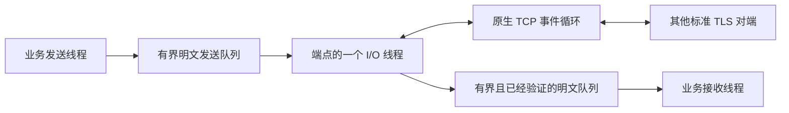

# TLS 加密连接与分线程收发 JSON

[English](TLS.md) · [README](../README.zh-CN.md) · [数据加密](CRYPTO.zh-CN.md)

下方命令复用[已配置的示例目录](../examples/README.zh-CN.md#run)，build 与 Release 按自己的配置替换。先准备与 localhost 匹配的演示证书，再运行两端；仅有加密库并不能替代证书和信任配置。

## 1. 构建并运行完整示例

本例让一个发送线程和一个接收线程共用 TLS 连接：客户端发送三条温度读数，服务端回复三条确认，并对第二条高温数据主动发送告警。你会看到业务数据、匹配编号和主动通知，而不是只看到“连接成功”。

这里的 TLS 是 TCP 上的传输层安全协议；线程局部存储使用另一组 `hx_os_tls_key` 接口。对端可以使用其他语言的标准 TLS 1.2／1.3 实现，并遵守本例的消息帧格式。

### 1.1 复用已有构建目录

先按[依赖指南](DEPENDENCIES.zh-CN.md#4-构建依赖)准备 SDK。`HX_OS_ENABLE_TLS` 依赖 CRYPTO、NETWORK、LOOP、FILE_UTILS；本例的 JSON 还需要 CONFIG、CONFIG_SERIALIZE、SETTINGS。这些模块默认开启。如果沿用首页的精简配置，需先给该构建配置好 `HX_OS_DEPENDENCY_PREFIX`，并显式重新开启 CRYPTO 和 TLS；仅初始化子模块不能替代 SDK 构建。

关闭必要模块后，`hx_os_tls_available()` 返回 0，操作返回 `HX_OS_NOT_SUPPORTED`。仅启用模块不会在程序加载时启动线程，创建连接或监听器时才创建所需资源。

下文全部在库源码根目录执行。`build` 是已有的构建目录，Windows 和 WSL 各用各自的目录。Debug 构建将 Release 同时替换为 Debug；无需新建 TLS 构建目录。

首次为精简配置接入 SDK 时，把这三个参数加在下一条 `cmake -S` 命令后面，或在 cmake-gui 中填写同名配置；之后不用每次重复：

| 参数 | 填什么 |
| --- | --- |
| `-DHX_OS_DEPENDENCY_PREFIX=...` | 已编译 SDK 的 prefix 绝对路径，例如 `E:/sdk/hx/prefix`，不是 deps 源码路径 |
| `-DHX_OS_ENABLE_CRYPTO=ON` | 开启 OpenSSL 支持 |
| `-DHX_OS_ENABLE_TLS=ON` | 开启 TLS 连接接口 |

```sh
cmake -S . -B build -DHX_OS_BUILD_EXAMPLES=ON
cmake --build build --config Release --target hx_os_tls_json_server
cmake --build build --config Release --target hx_os_tls_json_client
```

### 1.2 准备本机演示证书

下面用 OpenSSL 命令行生成一天有效的自签名证书；文件放进已有 build 目录，不写入系统信任库。`openssl` 需在 PATH 中，或替换为 SDK 内的实际可执行文件，例如 PowerShell 的 `& .\build-deps\prefix\bin\openssl.exe`。已经有证书时跳过生成，用自己的证书、私钥和 CA 路径运行第 1.3 节。以下文件名专供演示，重新生成会覆盖同名文件。

Windows PowerShell（反引号续行，不能在反引号后加空格）：

```powershell
openssl req -x509 -newkey rsa:2048 -nodes -days 1 `
    -subj /CN=localhost `
    -addext subjectAltName=DNS:localhost,IP:127.0.0.1 `
    -keyout build/demo-key.pem -out build/demo-cert.pem
```

Linux / WSL:

```sh
openssl req -x509 -newkey rsa:2048 -nodes -days 1 \
  -subj /CN=localhost \
  -addext subjectAltName=DNS:localhost,IP:127.0.0.1 \
  -keyout build/demo-key.pem -out build/demo-cert.pem
```

### 1.3 启动两端并核对结果

仍在库源码根目录运行，不要 cd 到证书目录。运行器自动选择空闲端口、启动服务端、等待监听就绪，再启动客户端；Python 只用于运行器，两个 C 程序本身不依赖它。

Windows Visual Studio：

```powershell
python examples/run_tls_business.py --bin-dir build/bin/Release `
    --certificate build/demo-cert.pem --private-key build/demo-key.pem `
    --ca build/demo-cert.pem
```

Linux / WSL:

```sh
python3 examples/run_tls_business.py --bin-dir build/bin \
  --certificate build/demo-cert.pem --private-key build/demo-key.pem \
  --ca build/demo-cert.pem
```

成功输出中包含以下两行，`[TLS receive]` 行展示实际 JSON。三条读数是 20、81、22，设备名是 `温度传感器🌐`：

```text
TLS CLIENT PASS: 3 JSON readings, 3 replies, 1 alarm
TLS SERVER PASS: 3 JSON readings processed
```

要观察两个窗口中的收发，可以不用 Python。Windows 在终端一运行：

```powershell
.\build\bin\Release\hx_os_tls_json_server.exe 39004 `
    build/demo-cert.pem build/demo-key.pem
```

等它输出 `Listening:`，在终端二运行：

```powershell
.\build\bin\Release\hx_os_tls_json_client.exe 39004 build/demo-cert.pem
```

Linux／WSL 两个终端对应的命令为：

```sh
./build/bin/hx_os_tls_json_server 39004 build/demo-cert.pem build/demo-key.pem
./build/bin/hx_os_tls_json_client 39004 build/demo-cert.pem
```

客户端解析并连接 localhost，服务端监听 127.0.0.1。普通和扩展 TLS 入口都会尝试候选地址并验证 localhost 身份。自签名证书同时作为本次连接显式信任的 CA。证书验证失败时检查 CA 路径、SAN、有效期和本机时间，不要关闭验证。提示缺少 DLL 时检查所选配置的 bin 目录及匹配 SDK 的运行库，见[安装包部署](USAGE.zh-CN.md#installed-project)。

想使用原来的简洁入口 `hx_os_tls_connect`，在上面的运行脚本命令或第二个终端的客户端命令末尾追加 `--basic`。例如：

```sh
./build/bin/hx_os_tls_json_client 39004 build/demo-cert.pem --basic
```

Windows 将程序路径换为 `build/bin/Release/hx_os_tls_json_client.exe`，参数相同。每次运行都重新启动服务端。两种模式输出相同的 JSON 和 PASS 提示：`--basic` 使用普通选项，默认扩展模式还开启 Keepalive，不需要增加示例构建目标。

### 1.4 改成自己的业务

完整源码是 [tls_json_client.c](../examples/tls_json_client.c) 和 [tls_json_server.c](../examples/tls_json_server.c)。复制到自己的工程时还需要同目录的 tls_json.h、network_demo.h、business_json.h；每个程序分别作为一个 executable。它们链接同一个 C 库，不需要把 SDK 的内部初始化搬进业务代码。

先替换温度字段和告警处理，保留线程退出与关闭顺序。TLS 加密的是字节流，**不会自动识别 JSON 边界**；本例 tls_json.h 使用“4 字节大端正文字节数 + UTF-8 JSON”，对端也必须这样处理。它与 TCP 订单例子的 2 字节长度帧、IPC 的 HXIP 协议不同；不能只改端口就互通。

C 接口接收 UTF-8 路径；Windows 应用若接收非 ASCII 命令行路径，仍需将自己的原生命令行转为 UTF-8。本页证书文件名为 ASCII。生产环境使用正式的证书和密钥管理方式；演示文件用完可以删除。

## 2. C 和 C++ 怎样直接调用

主要步骤就是连接／监听、接受连接、发送、接收和显式关闭。C 调用者不需要自己准备 OpenSSL context、network、socket、loop、编码转换器或内部工作线程。

```c
hx_os_tls *connection = NULL;
hx_os_tls_options options = HX_OS_TLS_OPTIONS_INIT;
hx_os_error error;

options.ca_file = "ca.pem";
hx_os_status status = hx_os_tls_connect(
	"localhost", 4433, &options, &connection, &error);

/**
 * \brief Use connection only after checking status.
 *
 * \details On timeout/failure, an already accepted startup still leaves an
 * owner that must be closed or aborted.
 */
```

希望创建工作线程后立即返回时，用 `hx_os_tls_start_connect`／`start_listen`，随后通过 `wait_ready_until` 等待。`connect_until`／`listen_until` 封装这两个步骤，接收单调时钟截止时间；简单入口默认等待五秒。工作线程创建前的失败保持 `*out=NULL`，接受启动后的失败则保留对象。原生 DNS、证书处理和文件访问无法被强制打断。

普通 C 入口和 C++ `Tls::connect()` 现在与扩展入口使用同一个多地址拨号器。IPv4／IPv6 候选交替尝试，默认相隔 250 ms 开始，最多同时保留两个连接。在还有地址未尝试时，停滞候选最多占用位置两秒；剩余预算较短时会缩短等待。第一个 TCP 连接成功后继续验证证书和 TLS 握手，其余候选关闭。这是建立连接时的地址选择，不是后续收发失败后的自动重连。

旧入口保留系统 DNS 及原来的计时起点：`handshake_timeout_ms` 在 DNS 返回后开始，供全部 TCP 候选和 TLS 握手共用；扩展入口则在 DNS 前开始这份预算。传给 `connect_until` 或 `wait_ready_until` 的截止时间只限制调用者本次等待，不会销毁或自动取消对象。等待超时后，仍非空的所有者必须保留，可以继续等待、关闭或显式中止。DNS 本身也需要可取消时，使用扩展入口的 resolver 选项。

不使用异常的 [C++11 包装](../include/hx/Tls.hpp)与 IPC 包装一样，借用由宿主持有的指针：

```cpp
hx_os_tls *owner = NULL;
hx::Tls connection(owner);
hx_os_tls_options options = HX_OS_TLS_OPTIONS_INIT;
options.ca_file = "ca.pem";

auto opened = connection.connect("localhost", 4433, &options);
if (opened) {
	const char data[] = "hello";
	auto sent = connection.send(data, sizeof(data) - 1);
	// sent.value() is the accepted byte count, including on failure.
}

auto closed = connection.closeUntil(hx_os_deadline_after_ms(2000));
/**
 * \brief If owner is still non-NULL, keep it alive and retry, or explicitly
 * abort.
 *
 * \details The facade destructor does not close, kill or detach its worker.
 */
```

上面是聚焦调用方式的片段。带完整检查的程序见业务示例。宿主不能在仍持有端点时直接让所有者离开作用域；调用失败不会自动销毁这个端点。

## 3. 同一连接怎样分线程发送和接收



只有内部 I/O 线程操作该端点的 OpenSSL 连接对象。业务调用只在操作队列和等待条件时短暂持锁，原生 I/O 和分配器回调在锁外执行。多个发送者按完整调用串行进入，同时进行的接收独立等待；同一 peer 的第二个接收者返回 `BUSY`。不承诺 FIFO 公平性。

每个端点拥有一个工作线程。服务端在这个线程里处理有数量上限的连接，不为每个连接新建线程。事件循环复用现有 IOCP／epoll／kqueue 适配。OpenSSL 使用有界 BIO pair，避免把 Windows `SOCKET` 缩窄为 `int`，也避免直接写 POSIX 描述符而触发 SIGPIPE。

默认服务端最多 16 个 peer，每个 peer 的发送／接收明文队列各 64 KiB；客户端只有一个 peer。队列容量范围为 16 KiB～16 MiB，peer 数量为 1～1024，组合后须满足 256 MiB 的 peer 存储上限。每个存活 peer 另有四个 16 KiB 记录缓冲、两侧各 32 KiB 的 BIO、元数据、OpenSSL 内部分配和系统 socket 缓冲。未完成 loop 请求和 flush 标记同样有上限。接纳连接时才分配记录缓冲，空闲槽位不提前分配。OpenSSL 内存不受 hx 分配器预算约束。既有非 TLS 热路径保持不变；TLS 自身会复制排队数据、持锁并分配原生／请求对象，不能称为零分配，也不把这些设计当成吞吐提升证据。

`context=NULL` 采用不可变的默认分配器。自定义分配器必须线程安全、支持跨线程释放，并活到端点回收。内部 TLS 工作线程或回收过程重入阻塞 TLS 接口时返回 `DEADLOCK`；分配器回调不应管理这些对象的生命周期。这些同步业务调用会阻塞调用线程，不能当作协程挂起接口使用。

## 4. 字节、消息、部分完成与取消

TLS 提供字节流，一次读取不保证对应一条 JSON。示例的[小型分帧辅助](../examples/tls_json.h)使用“四字节大端长度 + UTF-8 JSON”，单条文档最多 1023 字节，收齐头部和正文后才解析。它与 IPC／TCP／UDP／KCP 的业务逻辑分开。其他语言只需实现这个示例的分帧格式，不需要接入 hx C ABI。

| 操作 | 返回含义与调用责任 |
| --- | --- |
| `send_until` | 把已接受明文复制到有界自有缓冲。成功包含把对应密文字节交给操作系统，不代表对端业务已确认。超时／错误时 `*accepted` 仍有效，只重试未接受的后缀。 |
| `flush_until` | 只等待调用瞬间已经接受的字节；后续发送不延长本次等待，也不表示对端处理完成。 |
| `receive_until` | 返回部分已经认证的明文及数量，或明确的错误、超时、EOF。输出缓冲由调用方持有。 |
| `receive_exact_until` | 在一个截止时间内收齐指定数量；失败保留已收到字节数，提前出现正常 EOF 时返回 `TRUNCATED_INPUT`。 |
| `cancel_waits` | 唤醒当前业务等待并报告取消；不撤回已接受数据，也不关闭连接，新调用可以继续。完成与取消竞争时，已经完成的操作可以获胜。 |
| `get_peer_info` | 复制协商版本、密码套件、对端地址、证书 SHA-256 指纹及验证标志，不暴露 OpenSSL 原生指针。 |

缓冲中已经通过认证的数据先交给调用方，再返回最终读取错误。只有收到 TLS `close_notify` 才报告普通 EOF；TCP 突然 EOF 报告 `TRUNCATED_INPUT`，连接复位则可以保留原生传输错误。`NOW` 立即检查，`INFINITE` 必须显式传入。截止时间到达不代表原生操作或远端业务已经撤销。

已接受的数据可能在发送超时后继续发出。如果失败前只接受了一部分业务帧，调用者应继续保持发送排他性，补齐后缀；或者放弃这条连接。不能让另一个生产者把其他消息插入这个前缀和后缀之间。有限时长的示例选择在出现部分帧失败时结束该会话。

服务端 `accept_until` 对每个成功握手的 peer 只返回一次。peer ID 是该端点内不重复使用的不透明标识；客户端用 `0` 指定唯一 peer。它不是在线路上传输的设备号、请求号或跨重启会话号，示例在 JSON 里携带请求／设备字段。已接纳 peer 一直可查询，直到显式关闭／中止或端点关闭。失败且未通知业务的握手会回收；存活 peer 表满时暂停接受新连接。不隐含自动重连和业务空闲超时策略。

客户端在 socket 接入阶段中止连接时，已知可恢复的错误不会停止整个监听器，循环仍按取消／截止时间契约继续接受连接。监听器失效、资源耗尽等情况仍报告失败，详见[网络契约](CONTRACTS.zh-CN.md#网络与事件循环)。

## 5. 证书验证、信任来源与发布

证书失败保留原生 OpenSSL 错误，并通过 `error.cause_code` 保留 X.509 验证结果。客户端始终验证服务端证书链及 DNS／IP Subject Alternative Name。DNS／Punycode 名称使用 SNI，并拒绝部分通配符；数字 IP 使用 IP 验证。不自动做 IDNA 转换，也不回退到 Common Name。`server_name` 改变被验证的身份，不改变实际连接地址。所有客户端入口共用第 2 节介绍的有界多地址拨号器；证书失败仍终止连接，不会关闭验证继续尝试。

提供 `ca_file` 时替换默认信任来源。服务端必须给出证书链和私钥 PEM 路径；客户端也可同时提供二者用于双向认证。服务端只有显式选择 `HX_OS_TLS_REQUIRE_CLIENT_CERTIFICATE` 才强制验证客户端证书。证书链上限为 1 MiB／64 项，CA 包为 4 MiB／4096 项，私钥为 64 KiB，UTF-8 密码为 1024 字节。加密 PEM 使用传入密码，不弹出交互式密码输入。相对路径在创建时根据当前工作目录固定，文件内容需要保持稳定直到启动完成。Windows 路径通过 hx 的 UTF-8 文件接口打开，再从内存解析；私钥临时缓冲的自有清理路径会擦除内容。

默认信任适配使用 Windows ROOT 存储、常见 Linux／BSD 系统 CA 包位置、macOS 系统信任锚，或 Android system／Conscrypt 证书目录。信任来源不可用时明确失败，不会静默关闭验证。没有系统 CA 包的嵌入式设备可传入明确的 CA 文件。非 macOS 的 Apple 默认信任适配返回 `NOT_SUPPORTED`，需要显式提供 CA。当前 Android 模拟器证据和动态库部署见 [Android 说明](ANDROID.zh-CN.md)；不同系统／API／应用沙箱仍需各自验收，macOS 验证暂缓。

验证引擎采用 OpenSSL X.509 策略，不复刻 Windows 证书扩展以外的存储属性，也不复刻 macOS Keychain 专有策略覆盖。本模块不自动下载 AIA，不提供在线 OCSP 服务或系统 UI。扩展选项可以增加下文介绍的叶证书固定值及显式本地 CRL 检查；两者都不能跳过正常证书验证。TLS 1.3 客户端握手完成本身不能证明服务端已接受客户端证书，后续 alert 仍可能报告拒绝。

只启用 TLS 1.2／1.3、现代认证密码套件和 OpenSSL 安全级别 2。不启用重新协商、early data、DTLS 或 QUIC；会话恢复通过第 8 节的显式 profile 按需开启；原始 TLS 也不包含 HTTP、JSON 请求路由和业务授权。

OpenSSL 继续默认动态链接。构建及安装会包含选定的 SSL 和 Crypto 两个运行库，静态核心消费者也需要对应 SDK 包；仍可显式选择 `HX_OS_OPENSSL_STATIC=ON`。端点的私有 context 只在所属工作线程使用，该线程退出前完成原生线程清理。卸载本库或 OpenSSL 前，停止业务调用、回收端点并等待工作线程真正退出。外部原始加密调用者仍遵守单独的[静态链接清理契约](CRYPTO.zh-CN.md#5-线程内存与插件卸载)。

## 6. 关闭、重试与示例

`close_until` 停止接受新业务，排空已接受的发送数据，交换 `close_notify`。显式关闭会丢弃未读取的业务数据。不配合的对端可以延迟正常关闭；到达截止时间时保留同一个所有者并继续关闭，可以重试，或者明确选择 `abort_until` 丢弃队列、取消传输请求，再等待它们真正退出。两者都不强杀或分离线程。原生错误也可能与“所有者已经变为 NULL”同时返回，应同时检查状态与所有权。

销毁端点前停止发起新调用，已经在途的调用会被唤醒并退出，同一时刻只允许一个关闭者。`peer_close_until`／`peer_abort_until` 对一个服务端 peer 应用相同规则。端点仍被持有时，分配器、其 user 数据以及库代码都必须保持有效。

目标平台的编译、部署要求及限制见[平台支持](PLATFORMS.zh-CN.md)。公开示例独立于维护者的本地回归。


## 7. 配置 TCP、ALPN 和明确的证书策略

TLS 连接需要 Keepalive、系统缓冲区大小、明确的双栈监听或 ALPN 时，使用扩展入口。原来的 `hx_os_tls_options` 及函数保持不变。可运行的[客户端示例](../examples/tls_json_client.c)已经改用扩展入口配置 Keepalive，第 1 节的命令和 JSON 输出不变。

```c
hx_os_tls *connection = NULL;
hx_os_tls_options_ex options = HX_OS_TLS_OPTIONS_EX_INIT;
hx_os_error error;

options.base.ca_file = "ca.pem";
options.socket.nodelay = 1;
options.socket.keepalive = 1;
options.socket.keepalive_idle_seconds = 30;
options.socket.keepalive_interval_seconds = 5;

hx_os_status status = hx_os_tls_connect_ex_until(NULL,
	"localhost", 4433, &options, hx_os_deadline_after_ms(5000),
	&connection, &error);
```

先检查 `status`，成功后再收发。与原来的 TLS 接口相同，启动失败后只要 `connection` 非 NULL，就仍需关闭或中止。上述设置表示空闲 30 秒后开始 TCP 探测，请求 5 秒的探测间隔；探测次数默认是零，保留系统设置，也适用于 Windows 7／8.1。Keepalive 不表示对方程序已经处理了业务消息。

| 设置 | 含义 |
| --- | --- |
| `socket.nodelay`、`keepalive`、`dual_stack` | `-1` 保留现有设置，`0` 关闭，`1` 开启；显式 `nodelay` 优先于 base 中的同类标志。 |
| `socket.dual_stack = 1` | 在 IPv6 监听器绑定 `::` 前配置双栈；接入的 IPv4 对端保留映射后的 IPv6 地址，不隐式创建第二个监听器。 |
| `socket.send_buffer_bytes`、`receive_buffer_bytes` | 零保留系统缓冲，正数请求容量，操作系统可以调整实际值；这不会改变 TLS 明文队列的容量。 |
| `attempt_delay_ms` | 默认 250 ms 后启动下一个地址候选，最多同时连接两个；候选失败时立即推进，不等待整个间隔。 |
| `base.handshake_timeout_ms` | 扩展客户端的 DNS、TCP 候选和 TLS 握手共用此预算。普通 `hx_os_tls_options.handshake_timeout_ms` 保留 DNS 后开始的计时方式，覆盖 TCP 和 TLS。原生 DNS／文件工作不能强制打断。 |

不使用 TLS 时，也能直接使用 [hx_os_dial.h](../include/hx_os_dial.h) 中的 `hx_os_tcp_dial_until()` 和 `hx_os_tcp_dial_addresses_until()`。后者接收地址数组，不执行 DNS。两者都会关闭没有胜出的未发布 socket；成功返回的 socket 由调用者持有，关闭前应保持对应 network 有效。取消后不会遗留隐藏的后台连接任务。

### 7.1 用 ALPN 确认双方使用的业务协议

ALPN 在 TLS 握手时选择协议名称，不负责解析协议，也不增加消息边界。例如两端都使用本例 JSON 分帧时，可以配置：

```c
const char *protocols[] = {"hx-json/1"};
options.alpn = protocols;
options.alpn_count = 1;
options.require_alpn = 1;
```

服务端调用 `hx_os_tls_listen_ex_until()` 时也传入对应设置，按服务端列表顺序选择首个双方都支持的名称。连接／接入成功后，准备 `hx_string selected = HX_STRING_INIT`，调用 `hx_os_tls_get_alpn(connection, 0, &selected, &error)`；服务端把 `0` 换成实际 peer ID。成功后字符串为 `hx-json/1`。没有协商结果时返回 `HX_OS_NOT_FOUND`，字符串保持原值；使用后销毁字符串。`require_alpn` 会拒绝没有协商成功的连接；如果明确要兼容不提供 ALPN 的对端，就保持为零。

名称使用可打印 ASCII，每个最多 255 字节，最多 16 项；启动返回前已复制，不借用调用栈数据，协商时也不会回调业务函数。TLS 1.3 服务端的策略拒绝可能在客户端本地握手完成后才到达，因此后续 I/O 错误也要处理。

### 7.2 要求指定证书或检查本地吊销列表

把预期叶证书 SHA-256 指纹的 32 个原始字节赋给 `options.certificate_sha256`。指纹应来自事先可信的分发渠道，不能把正在验证的连接自己提供的指纹直接当作信任依据。这是正常 CA 和主机名验证之外的附加检查：指纹相同，也不能放过过期、不受信任或主机名不符的证书。更换证书时创建采用新固定值的端点。接口会复制这些字节，此字段不接收十六进制文本。

如果部署流程会分发 PEM 证书吊销列表，设置 `options.crl_file = "revocations.pem"`、`options.crl_mode = HX_OS_TLS_CRL_LEAF`。需要同时检查证书链时使用 `HX_OS_TLS_CRL_CHAIN`。缺少适用 CRL、签名无效或 CRL 过期都会导致验证失败；已吊销证书返回认证错误并保留 X.509 原因码。文件上限为 4 MiB，本库不会自动下载或刷新。启动期间保持文件稳定，由部署流程更新，再创建新端点加载。服务端使用固定证书或 CRL 检查时，必须开启 `HX_OS_TLS_REQUIRE_CLIENT_CERTIFICATE`。

C++11 对应 `connectEx()`、`listenEx()`、`alpn()`，继续使用 `Result` 和显式关闭规则。客户端会话复用使用第 8 节的 profile；不提供在线 OCSP。


### 7.3 让 DNS 随 TLS 启动一起取消

准备 `hx_os_resolver_options dns = HX_OS_RESOLVER_OPTIONS_INIT`，在调用 `hx_os_tls_connect_ex_until()` 前设置 `options.resolver = &dns`。TLS 会复制这份配置，在已有 I/O 工作线程内创建私有 c-ares 解析器，让 DNS 共用连接／握手截止时间；关闭或中止启动时也会取消 DNS，不额外启动 DNS 工作线程。可选的 `dns.servers` 用于指定数字服务器地址。没有编入 c-ares 时，按正常启动结果及所有者保留规则报告 `HX_OS_NOT_SUPPORTED`。

`options.resolver=NULL` 继续使用原来的系统解析器。c-ares 不会复刻所有系统 DNS／VPN 策略，也不能把文件系统配置读取变成硬实时，具体见[解析器用法与限制](NETWORK_OPTIONS.zh-CN.md#12-按名称连接并选择可以取消的-dns)。服务端只接受数字绑定地址；传入解析器配置会明确报错，不会静默忽略。

## 8. 重连时复用同一份已验证 TLS 配置

设备需要反复连接同一个服务时，先创建一个 profile，后面的连接重复使用它。它固定保存主机、端口、信任证书、客户端身份、ALPN、指纹和 CRL 配置。每个 profile 最多缓存一份会话，新连接取用后便移出缓存；多个消费者不会共用全局会话缓存。

```c
hx_os_tls_profile *profile = NULL;
hx_os_tls *connection = NULL;
hx_os_status status = hx_os_tls_profile_create(NULL, "localhost", port,
	&options, &profile, &error);

if (status == HX_OS_OK)
	status = hx_os_tls_profile_connect_until(profile,
		hx_os_deadline_after_ms(5000), &connection, &error);
```

这里的 `options` 使用第 7 节的扩展配置，`port` 是你的服务端口。先收发业务数据，按原有显式关闭流程关闭连接，再次调用 `profile_connect_until` 建立下一条连接。用 `hx_os_tls_get_peer_info` 查看结果：包含 `HX_OS_TLS_PEER_RESUMED` 表示服务端接受了会话复用，否则正常进行完整的证书验证和握手。TLS 1.3 的票据可能在握手之后才到达，刚连接就立即中止，不保证已经拿到可复用会话。

超时后 `connection` 可能仍非空，必须保留并继续等待或关闭。停止创建新连接后，用 `hx_os_tls_profile_release` 释放自己的 profile 引用；存活连接持有各自的引用。C++11 提供 `<hx/TlsProfile.hpp>`、`hx::TlsProfile::create()` 和 `connect(owner, deadline)`，同样保留超时后的 owner。

复用会话仍会根据 profile 的信任材料和当前时间重新验证缓存证书链，并检查所配置的身份、指纹和 ALPN。CA／CRL 文件更新后，需要新建 profile 才会加载；不发送提前数据。使用本库服务端时，显式设置 `options.enable_session_tickets=1`，让该监听器签发数量受限的无状态会话票据。原有连接及服务端接口继续默认关闭会话复用。
