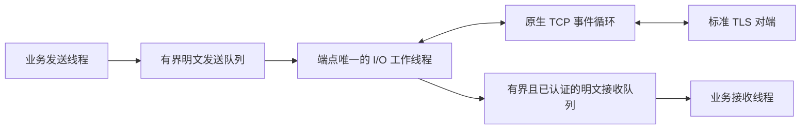

# TLS 加密连接与分线程收发 JSON

[English](TLS.md) · [README](../README.zh-CN.md) · [数据加密](CRYPTO.zh-CN.md)

当你的业务需要跨公网或不可信网络传输敏感数据、要求强制校验服务端/客户端 X.509 证书链与主机名（SAN），同时希望像普通连接一样让一个发送线程和一个接收线程安全地共享同一条加密通道时，可以直接使用 `hx_os_tls`。它在内部封装了 OpenSSL 1.2/1.3 状态机、BIO 内存对、双栈连接竞速（Happy Eyeballs）与单一后台 I/O 工作线程，你无需自己在业务代码里手动组装 OpenSSL `SSL_CTX`、非阻塞事件循环或处理部分握手状态。

> [!NOTE]
> 本文介绍的 `hx_os_tls` 是基于 TCP 的**传输层安全协议（Transport Layer Security）**；如果你要查找的是操作系统的**线程局部存储（Thread-Local Storage）**，请使用 `hx_os_tls_key` 系列接口。对端完全可以使用其他语言的标准 TLS 1.2 / 1.3 实现，只要应用层遵循相同的消息分帧格式即可互通。

## 1. 构建并运行完整示例

本示例（`hx_os_tls_json_client` 与 `hx_os_tls_json_server`）演示真实的全双工业务交互：客户端的一个发送线程和一个接收线程共用同一条 TLS 连接，连续上报 3 条温度传感器读数（`20`、`81`、`22`）；服务端校验后回发 3 条确认消息，并在收到第 2 条高温数据（`81`）时主动向客户端推送一条高温告警（`alarm`）。

### 1.1 复用已有构建目录

请先按照[依赖构建指南](DEPENDENCIES.zh-CN.md#4-构建依赖)准备好预编译的依赖 SDK。`HX_OS_ENABLE_TLS` 依赖 `CRYPTO`、`NETWORK`、`LOOP` 和 `FILE_UTILS` 模块；本示例中的 JSON 编解码还需要 `CONFIG`、`CONFIG_SERIALIZE` 和 `SETTINGS` 模块（默认全部开启；若关闭任一必需模块，`hx_os_tls_available()` 返回 `0`，相关调用返回 `HX_OS_NOT_SUPPORTED`）。

如果你之前使用的是关闭了外部依赖的精简构建目录，首次接入 SDK 时请在 `cmake -S` 命令后追加以下三个参数（配置写入缓存后无需每次重复）：

| CMake 参数 | 填写说明 |
| --- | --- |
| `-DHX_OS_DEPENDENCY_PREFIX=...` | 预编译依赖 SDK 的安装前缀绝对路径（例如 `E:/sdk/hx/prefix`），**注意不是 `deps/` 源码目录** |
| `-DHX_OS_ENABLE_CRYPTO=ON` | 开启 OpenSSL 密码学支持 |
| `-DHX_OS_ENABLE_TLS=ON` | 开启 TLS 安全连接模块 |

在仓库根目录下复用已有 `build` 目录编译 TLS 服务端与客户端示例（若使用 Debug 配置，请将下方的 `Release` 同步替换为 `Debug`）：

```sh
cmake -S . -B build -DHX_OS_BUILD_EXAMPLES=ON
cmake --build build --config Release --target hx_os_tls_json_server
cmake --build build --config Release --target hx_os_tls_json_client
```

### 1.2 准备本机演示证书

仅有加密库并不能替代身份证书。下面使用 OpenSSL 命令行工具在 `build/` 目录下生成一张有效期 1 天、包含 `DNS:localhost` 与 `IP:127.0.0.1` 主题备用名称（SAN）的自签名演示证书（不会修改操作系统的全局受信任根证书库）。请确保 `openssl` 已在系统 `PATH` 中，或直接调用依赖 SDK 中的可执行文件（如 PowerShell 下执行 `& .\build-deps\prefix\bin\openssl.exe`）：

**Windows PowerShell（注意反引号续行符后不要有空格）：**

```powershell
openssl req -x509 -newkey rsa:2048 -nodes -days 1 `
    -subj /CN=localhost `
    -addext subjectAltName=DNS:localhost,IP:127.0.0.1 `
    -keyout build/demo-key.pem -out build/demo-cert.pem
```

**Linux / WSL：**

```sh
openssl req -x509 -newkey rsa:2048 -nodes -days 1 \
  -subj /CN=localhost \
  -addext subjectAltName=DNS:localhost,IP:127.0.0.1 \
  -keyout build/demo-key.pem -out build/demo-cert.pem
```

### 1.3 启动两端并核对结果

保持在仓库根目录下执行自动化运行脚本，它会挑選空闲端口、启动服务端、等待监听就绪后再拉起客户端：

**Windows（Visual Studio 生成器）：**

```powershell
python examples/run_tls_business.py --bin-dir build/bin/Release `
    --certificate build/demo-cert.pem --private-key build/demo-key.pem `
    --ca build/demo-cert.pem
```

**Linux / WSL：**

```sh
python3 examples/run_tls_business.py --bin-dir build/bin \
  --certificate build/demo-cert.pem --private-key build/demo-key.pem \
  --ca build/demo-cert.pem
```

运行成功后，控制台会打印收到的 UTF-8 JSON 明文（设备名为 `"温度传感器🌐"`）以及以下两行通过标志：

```text
TLS CLIENT PASS: 3 JSON readings, 3 replies, 1 alarm
TLS SERVER PASS: 3 JSON readings processed
```

#### 在两个终端中手工运行

如果你想在两个独立窗口中直观看到双端交互（无需 Python），可以在**终端一**启动服务端：

```powershell
.\build\bin\Release\hx_os_tls_json_server.exe 39004 `
    build/demo-cert.pem build/demo-key.pem
```

看到 `Listening:` 后，在**终端二**启动客户端：

```powershell
.\build\bin\Release\hx_os_tls_json_client.exe 39004 build/demo-cert.pem
```

（Linux / WSL 下分别执行 `./build/bin/hx_os_tls_json_server 39004 build/demo-cert.pem build/demo-key.pem` 和 `./build/bin/hx_os_tls_json_client 39004 build/demo-cert.pem`。）

客户端默认使用第 7 节的扩展入口（开启了 TCP Keepalive）；如果你想测试基础连接入口 `hx_os_tls_connect()`，只需在客户端命令或运行器命令末尾追加 `--basic` 即可：

```sh
./build/bin/hx_os_tls_json_client 39004 build/demo-cert.pem --basic
```

> [!TIP]
> **常见运行排障**
> - **证书验证失败**：客户端会严格校验 `localhost` 的 SAN 扩展与有效期。若报错，请检查传入的 CA 路径、生成证书时是否带上了 `-addext subjectAltName=...` 以及本机系统时钟是否准确，**切勿通过关闭证书验证来掩盖问题**。
> - **Windows 提示缺少 DLL**：请检查运行目录是否与所选配置（Debug/Release）一致，以及依赖 SDK 的 OpenSSL 动态库是否已按[已安装包部署说明](USAGE.zh-CN.md#installed-project)位于可见路径。

### 1.4 改成自己的业务

完整源码位于 [tls_json_client.c](../examples/tls_json_client.c) 和 [tls_json_server.c](../examples/tls_json_server.c)。移植到自己的工程时，请同时复制同目录下的辅助头文件 [tls_json.h](../examples/tls_json.h)、[network_demo.h](../examples/network_demo.h) 和 [business_json.h](../examples/business_json.h)，并将客户端和服务端分别建为两个独立的 CMake 可执行目标，链接 `hx_c_platform::hx_c_platform`。

请注意：**TLS 加密传输的依然是无边界字节流，不会自动按 JSON 对象切包**。本示例中的 `tls_json.h` 采用 **`4 字节大端无符号长度 + UTF-8 JSON 正文`** 分帧（单条上限 1023 字节），对端必须采用相同的 4 字节长度头才能互通（注意 TCP 订单示例使用的是 2 字节长度头，而 `hx_ipc` 使用的是 64 字节 HXIP 帧头，三者不能仅靠改端口号直接混连）。

## 2. C 和 C++ 怎样直接调用

在 C 语言中，发起 TLS 连接、收发数据和显式关闭只需围绕 `hx_os_tls *` 进行，无需自己在业务层初始化 OpenSSL `SSL_CTX`、Socket 或事件循环：

```c
hx_os_tls *connection = NULL;
hx_os_tls_options options = HX_OS_TLS_OPTIONS_INIT;
hx_os_error error;

options.ca_file = "ca.pem";
hx_os_status status = hx_os_tls_connect(
	"localhost", 4433, &options, &connection, &error);

/**
 * \brief Use connection only after checking status.
 *
 * \details On timeout/failure, an already accepted startup still leaves an
 * owner that must be closed or aborted.
 */
```

- **同步一步连接 vs. 异步启动再等待**：
  - `hx_os_tls_connect()` / `hx_os_tls_listen()` 默认最多等待 5 秒；`connect_until` / `listen_until` 则接收自定义的单调时钟截止时间。
  - 如果你希望创建完内部工作线程后立即返回，可以调用 `hx_os_tls_start_connect()` / `hx_os_tls_start_listen()`，随后再调用 `hx_os_tls_wait_ready_until()` 等待握手或监听就绪。
  - **关键所有权规则**：如果在创建内部工作线程之前就发生参数错误，`*connection` 保持为 `NULL`；但一旦内部启动已被接纳，即便后续因握手超时或证书错误返回失败，**`*connection` 依然是非空的有效句柄——调用方必须继续等待、或调用 `close_until` / `abort_until` 回收它，绝不能直接丢弃非空指针！**
- **内置双栈多地址拨号（Happy Eyeballs）**：
  - 无论是基础的 `hx_os_tls_connect()`、C++ `Tls::connect()` 还是第 7 节的扩展入口，底层都共用同一个多地址竞速拨号器：交替尝试解析出的 IPv4 与 IPv6 候选地址（默认间隔 250 毫秒，最多 2 个并发尝试；存在未尝试候选时单个卡死连接最多占槽 2 秒）。第一个完成 TCP 连接的候选进入 TLS 握手与证书校验，其余候选自动关闭。
  - 在基础入口中，`handshake_timeout_ms` 从系统 DNS 解析返回后开始计时，覆盖所有 TCP 候选尝试与 TLS 握手；而在第 7 节的扩展入口中，该超时预算从 DNS 解析之前就开始统一计时。

在 C++11 中，零异常封装类 [hx::Tls](../include/hx/Tls.hpp) 借用由宿主持久持有的 `hx_os_tls *` 指针：

```cpp
hx_os_tls *owner = NULL;
hx::Tls connection(owner);
hx_os_tls_options options = HX_OS_TLS_OPTIONS_INIT;
options.ca_file = "ca.pem";

auto opened = connection.connect("localhost", 4433, &options);
if (opened) {
	const char data[] = "hello";
	auto sent = connection.send(data, sizeof(data) - 1);
	// sent.value() is the accepted byte count, including on failure.
}

auto closed = connection.closeUntil(hx_os_deadline_after_ms(2000));
/**
 * \brief If owner is still non-NULL, keep it alive and retry, or explicitly
 * abort.
 *
 * \details The facade destructor does not close, kill or detach its worker.
 */
```

## 3. 同一连接怎样分线程发送和接收



- **单工作线程与全双工并发**：每个 `hx_os_tls` 端点内部只启动 **1 个** I/O 工作线程（服务端在同一个工作线程上多路复用管理所有已接入的客户端槽位，绝不会为每个连接新建线程），且只有该工作线程会触碰 OpenSSL 的 `SSL` 对象。在业务层，多个发送线程可以并发调用发送接口（内部按完整调用自动串行化），同时允许 **1 个接收线程**并发调用接收接口（若对同一个 peer 启动第 2 个并发接收者，会立即返回 `HX_OS_BUSY`）。
- **有界内存预算**：
  - 默认情况下，服务端最多同时接纳 `16` 个客户端 peer（可配置范围为 `1..1024`），客户端固定为 `1` 个 peer。
  - 每个 peer 的明文发送队列和明文接收队列默认各为 `64 KiB`（可配置范围为 `16 KiB..16 MiB`，且总 peer 队列预算不超过 `256 MiB`）。
  - 只有当连接真正被接纳时，才会为该槽位分配 4 个 `16 KiB` 记录缓冲与双端各 `32 KiB` 的 OpenSSL BIO 内存对（空闲槽位不预先占用记录缓冲）。注意：OpenSSL 使用有界 BIO pair 与本库的 IOCP/epoll/kqueue 事件循环交互，从而避免了在 Windows 64 位下将 `SOCKET` 截断为 `int`，也避免了在 POSIX 下直接写 fd 触发 `SIGPIPE`。
- **阻塞语义与分配器约束**：公开的 TLS 收发接口会阻塞当前调用的操作系统线程（不可直接当作挂起协程的异步原语使用）。若在 TLS 内部工作线程或销毁过程中重入阻塞式 TLS 接口，会立即返回 `HX_OS_DEADLOCK`。

## 4. 字节、消息、部分完成与取消

| 核心操作接口 | 返回语义与调用方责任 |
| --- | --- |
| `hx_os_tls_send_until` | 将已被接纳的明文拷贝到内部有界队列。返回 `HX_OS_OK` 包含将对应密文提交给操作系统内核，但**不代表对端业务层已处理**。发生超时或错误时，`*accepted` 依然有效——**重试时只能提交未被接纳的剩余尾部字节**。 |
| `hx_os_tls_flush_until` | 仅等待调用开始瞬间已经进入发送队列的那批字节排空；后续其他线程新提交的发送不会延长本次等待。 |
| `hx_os_tls_receive_until` | 返回当前已解密并通过 MAC 认证的明文字节数（至少 1 字节），或返回明确错误、超时、`HX_OS_EOF`。输出缓冲区由调用方提供。 |
| `hx_os_tls_receive_exact_until` | 在给定截止时间内循环读满指定字节数；若中途超时或出错，仍会保留已读到的字节数；若在读满前遇到正常 TLS 关闭，则返回 `HX_OS_TRUNCATED_INPUT`。 |
| `hx_os_tls_cancel_waits` | 立即唤醒当前阻塞在收发上的业务线程并返回取消状态；**不会撤回已接纳的发送数据，也不会关闭底层连接**，后续新调用仍可继续使用该连接。 |
| `hx_os_tls_get_peer_info` | 拷贝协商出的 TLS 版本、密码套件、对端 IP 地址、叶证书 SHA-256 指纹及校验状态标志（不暴露 OpenSSL 原生指针）。 |

> [!WARNING]
> **区分安全关闭（`HX_OS_EOF`）与异常截断（`HX_OS_TRUNCATED_INPUT`），以及部分帧续传**
> - **防截断攻击**：接收队列中已通过认证的明文会优先交付给调用方；只有当对端正规发送了加密的 TLS `close_notify` 警报时，读取结尾才会报告正常的 `HX_OS_EOF`。如果底层 TCP 连接直接突然断开（未收到 `close_notify`），库会明确返回 `HX_OS_TRUNCATED_INPUT`，防止截断攻击被误认为正常流结束。
> - **部分帧发送超时处理**：如果一次发送因超时只接纳了半条业务帧（`0 < accepted < frame_bytes`），调用方要么独占发送权继续把剩余后缀补发完整，要么直接放弃并关闭该连接——**绝不能让其他发送线程在这半截帧中间插入另一条新消息**。
> - **服务端 `peer` 标识**：服务端通过 `hx_os_tls_accept_until()` 获取新接入连接的 `peer` 编号（客户端固定传 `0`）。该编号仅是当前端点内部的单调不复用句柄，不是线上协议字段；处理完某个客户端后，请调用 `hx_os_tls_peer_close_until()` 或 `hx_os_tls_peer_abort_until()` 释放其连接槽位。

## 5. 证书验证、信任来源与发布

- **强制证书与主机名校验**：客户端始终验证服务端证书链以及证书中的 DNS / IP 主题备用名称（Subject Alternative Name, SAN）：域名连接自动启用 SNI 并禁止左端部分通配符（如 `a*.example.com`），数字 IP 连接则严格核对 IP SAN（绝不回退到不安全的旧式 Common Name，也不自动做隐式 IDNA 转换）。若设置了 `options.server_name`，则按该名称校验身份，而实际 TCP 连接仍发往 `host` 参数指定的地址。证书校验一旦失败立即终止握手，并将原生 OpenSSL 错误与 X.509 原因码保存在 `error.cause_code` 中。
- **PEM 文件与双向认证（mTLS）**：服务端必须配置证书链与私钥 PEM 路径；客户端也可同时配置这两项以开启双向认证（服务端仅在显式开启 `HX_OS_TLS_REQUIRE_CLIENT_CERTIFICATE` 时才强制要求客户端证书）。文件大小上限分别为：证书链 `1 MiB`（最多 64 张）、CA 证书包 `4 MiB`（最多 4096 张）、私钥 `64 KiB`、UTF-8 私钥口令 `1024 字节`（内存中的临时私钥明文在所有清理路径上都会被安全擦除）。
- **跨平台默认系统信任库**：当未指定 `ca_file` 时，客户端默认加载操作系统的受信任根证书（Windows `ROOT` 证书存储、Linux/BSD 常见系统 CA 路径、macOS 系统信任锚或 Android 系统/Conscrypt 证书目录）。若系统信任库不可用，握手会明确报错而绝不会静默跳过验证；在无系统 CA 包的精简嵌入式环境中，请显式传入 `ca_file`。
- **安全基线与动态库清理**：仅启用 **TLS 1.2 / 1.3**、现代 AEAD 认证密码套件与 **OpenSSL Security Level 2**（禁用重协商、0-RTT Early Data）。OpenSSL 默认以动态库方式链接并随安装包一起分发（也可显式开启 `HX_OS_OPENSSL_STATIC=ON`）；在卸载本库或退出前，请先停止业务调用、关闭所有 TLS 端点并等待内部工作线程退出（外部直接调用底层 OpenSSL 的静态链接注意事项见[密码学模块说明](CRYPTO.zh-CN.md#5-线程内存与插件卸载)）。

## 6. 关闭、重试与示例

- **优雅关闭（`hx_os_tls_close_until`） vs. 强制中止（`hx_os_tls_abort_until`）**：
  - `close_until` 会停止接纳新请求、尽量排空已入队的待发数据，并与对端交换 TLS `close_notify`。如果对端不配合导致在截止时间内未能完成优雅关闭，函数返回 `HX_OS_TIMEOUT` 且**保留同一个非空句柄**——此时你可以再次调用 `close_until` 继续等待，或者改调 `hx_os_tls_abort_until()` 立即丢弃队列、取消底层传输并等待工作线程安全退场。
  - 无论是 `close_until` 还是 `abort_until`，都**绝不会强杀（Terminate）或分离（Detach）后台线程**。只有当句柄指针被置为 `NULL` 时，才代表底层资源与线程句柄已彻底清理完毕。

## 7. 配置 TCP、ALPN 和明确的证书策略

当你需要为 TLS 连接同时配置底层 TCP Keepalive、内核收发缓冲区大小、IPv6 双栈监听、ALPN 协议协商、叶证书指纹固定（Certificate Pinning）或本地证书吊销列表（CRL）时，请使用带 `_ex` 的扩展配置结构体 `hx_os_tls_options_ex` 与入口 `hx_os_tls_connect_ex_until()` / `hx_os_tls_listen_ex_until()`：

```c
hx_os_tls *connection = NULL;
hx_os_tls_options_ex options = HX_OS_TLS_OPTIONS_EX_INIT;
hx_os_error error;

options.base.ca_file = "ca.pem";
options.socket.nodelay = 1;
options.socket.keepalive = 1;
options.socket.keepalive_idle_seconds = 30;
options.socket.keepalive_interval_seconds = 5;

hx_os_status status = hx_os_tls_connect_ex_until(NULL,
	"localhost", 4433, &options, hx_os_deadline_after_ms(5000),
	&connection, &error);
```

| 扩展配置项 | 含义与生效规则 |
| --- | --- |
| `socket.nodelay`、`keepalive`、`dual_stack` | `-1` 保持默认，`0` 禁用，`1` 启用（显式设置的 `socket.nodelay` 优先级高于 `base` 中的同名标志） |
| `socket.dual_stack = 1` | 用于绑定 `::` 的 IPv6 监听器，使其同时接受 IPv4 与 IPv6 客户端 |
| `socket.send_buffer_bytes`、`receive_buffer_bytes` | `0` 保持系统默认，正整数请求调整内核 Socket 缓冲（不影响 TLS 明文队列上限） |
| `attempt_delay_ms` | 双栈候选地址交替发起连接的间隔（默认 `250` 毫秒，最多 2 个并发候选） |
| `base.handshake_timeout_ms` | 在扩展客户端中，该预算统一覆盖 **DNS 解析 + TCP 候选连接 + TLS 握手** 全过程 |

### 7.1 用 ALPN 确认双方使用的业务协议

通过 ALPN（应用层协议协商），客户端和服务端可以在 TLS 握手阶段直接确认双方使用的是否为同一套业务协议（例如 `"hx-json/1"`）：

```c
const char *protocols[] = {"hx-json/1"};
options.alpn = protocols;
options.alpn_count = 1;
options.require_alpn = 1;
```

服务端在调用 `hx_os_tls_listen_ex_until()` 时传入相同的协议列表，握手时会按服务端列表优先顺序选出第一个双方共有的协议名。连接建立后，可调用 `hx_os_tls_get_alpn(connection, 0, &selected, &error)`（服务端将 `0` 替换为具体的 `peer` ID）读取协商出的协议字符串（未协商出结果时返回 `HX_OS_NOT_FOUND`；开启 `require_alpn = 1` 则会在未能协商出共同协议时直接拒绝连接）。

### 7.2 要求指定证书或检查本地吊销列表

- **叶证书 SHA-256 指纹固定（Certificate Pinning）**：将事先通过可信渠道获取的 32 字节原始 SHA-256 二进制指纹赋给 `options.certificate_sha256`（注意传入的是 32 字节二进制而非 64 字符十六进制文本）。指纹核对是在标准 CA 证书链与主机名校验**全部通过之后**追加的额外锁死检查——即便指纹匹配，过期、不受信任或主机名不符的证书依然会被拒绝。
- **本地 PEM 证书吊销列表（CRL）**：设置 `options.crl_file = "revocations.pem"`，并将 `options.crl_mode` 设为 `HX_OS_TLS_CRL_LEAF`（仅检查叶证书）或 `HX_OS_TLS_CRL_CHAIN`（检查整条证书链）。缺失对应的 CRL、CRL 签名无效或 CRL 已过期均会导致校验失败；命中吊销列表的证书会返回认证失败并保留 X.509 原因码（CRL 文件上限为 `4 MiB`）。

### 7.3 让 DNS 随 TLS 启动一起取消

在调用 `hx_os_tls_connect_ex_until()` 前，只需声明 `hx_os_resolver_options dns = HX_OS_RESOLVER_OPTIONS_INIT` 并设置 `options.resolver = &dns`，TLS 端点就会在自己的 I/O 工作线程内创建一个私有的 `c-ares` 解析器，让 DNS 查询与后续 TCP/TLS 握手共享同一个截止时间，并在关闭或中止连接时立即取消挂起的 DNS 查询（详见[可取消 DNS 说明](NETWORK_OPTIONS.zh-CN.md#12-按名称连接并选择可以取消的-dns)）。

## 8. 重连时复用同一份已验证 TLS 配置

当客户端设备需要频繁向同一个服务端发起连接时，可以先创建一个 **`hx_os_tls_profile`**，后续每次连接直接复用该 Profile。它会固化保存目标主机、端口、CA 信任材料、客户端证书、ALPN、证书固定指纹和 CRL 策略，并在该 Profile 内部维护最多 **1 份单次消费的 TLS 会话票据（Session Ticket）**（不同 Profile 之间完全隔离，不共享进程级全局缓存）：

```c
hx_os_tls_profile *profile = NULL;
hx_os_tls *connection = NULL;
hx_os_status status = hx_os_tls_profile_create(NULL, "localhost", port,
	&options, &profile, &error);

if (status == HX_OS_OK)
	status = hx_os_tls_profile_connect_until(profile,
		hx_os_deadline_after_ms(5000), &connection, &error);
```

- **验证会话是否成功复用**：连接建立后调用 `hx_os_tls_get_peer_info()`，若标志位中包含 `HX_OS_TLS_PEER_RESUMED`，说明服务端接受了会话恢复；否则说明执行了完整的证书验证握手。注意：即便命中会话恢复，客户端依然会根据当前系统时间和 Profile 的信任材料重新验证缓存的证书链、主机名、指纹固定与 ALPN 策略。
- **服务端开启会话票据**：如果服务端也是用本库编写的，需在服务端扩展配置中显式设置 `options.enable_session_tickets = 1`，才会签发有数量上限的无状态会话票据（基础接口默认关闭会话恢复）。
- **释放规则**：不再发起新连接后，调用 `hx_os_tls_profile_release()` 释放应用层持有的 Profile 引用（已建立的存活连接内部会各自持有引用）。C++11 可包含 `<hx/TlsProfile.hpp>` 使用 `hx::TlsProfile::create()` 与 `connect(owner, deadline)`。
