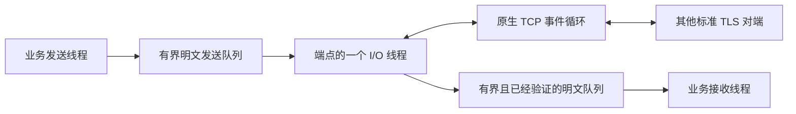

# TLS 加密连接与分线程收发 JSON

[English](TLS.md) · [README](../README.zh-CN.md) · [数据加密](CRYPTO.zh-CN.md)

## 1. 构建并运行完整示例

这里的 TLS 指传输层安全协议。线程局部存储仍使用 `hx_os_tls_key`。本模块实现 TCP 上的标准 TLS 1.2／1.3，对端可以使用 Python、Go、Java 或其他标准 TLS 实现。

先准备[依赖 SDK](DEPENDENCIES.zh-CN.md#4-构建依赖)。`HX_OS_ENABLE_TLS` 默认开启，依赖 CRYPTO、NETWORK、LOOP 和 FILE_UTILS。关闭任何必要模块后，`hx_os_tls_available()` 返回 0，TLS 操作明确返回 `HX_OS_NOT_SUPPORTED`。仅仅启用模块不会在程序加载时启动线程。

```sh
cmake -S . -B build -DCMAKE_BUILD_TYPE=Release -DHX_OS_DEPENDENCY_PREFIX=/absolute/path/to/build-deps/prefix -DHX_OS_BUILD_EXAMPLES=ON -DHX_OS_BUILD_TESTS=ON
cmake --build build --config Release --parallel 4
ctest --test-dir build -C Release -R "tls" --output-on-failure
```

一条命令运行两个业务程序：

```sh
# Linux/macOS 的构建目录
python3 examples/run_tls_business.py --bin-dir build/bin

# Visual Studio 的构建目录
python examples/run_tls_business.py --bin-dir build/bin/Release
```

运行器需要已构建测试目标。它会在临时目录生成本次测试专用的 CA 和服务端证书，选择空闲监听端口，启动独立客户端／服务端进程，核对所有 JSON 回复，并删除测试凭据。生成的身份只用于测试，不作为部署证书。

[C 客户端](../examples/tls_json_client.c)在同一条连接上启动一个发送线程和一个接收线程，发送三条温度读数。[C 服务端](../examples/tls_json_server.c)返回三条确认，并针对第二条高温读数额外发送一条告警。每条 JSON 带请求 `id`，读数还带 UTF-8 `device` 字段。成功输出包含：

```text
TLS CLIENT PASS: 3 JSON readings, 3 replies, 1 alarm
TLS SERVER PASS: 3 JSON readings processed
```

已有自己的证书和私钥时，可以分别启动：

```sh
hx_os_tls_json_server 39004 server-cert.pem server-key.pem
hx_os_tls_json_client 39004 ca.pem
```

示例证书的 Subject Alternative Name 必须包含 `localhost`。客户端连接 `127.0.0.1`，显式验证 `localhost`。C 接口接收 UTF-8 路径；Windows 宿主仍需负责把自己的命令行参数转换成 UTF-8。

## 2. C 和 C++ 怎样直接调用

主要步骤就是连接／监听、接受连接、发送、接收和显式关闭。C 调用者不需要自己准备 OpenSSL context、network、socket、loop、编码转换器或内部工作线程。

```c
hx_os_tls *connection = NULL;
hx_os_tls_options options = HX_OS_TLS_OPTIONS_INIT;
hx_os_error error;

options.ca_file = "ca.pem";
hx_os_status status = hx_os_tls_connect(
	"localhost", 4433, &options, &connection, &error);

/* Use connection only after checking status. On timeout/failure, an already
 * accepted startup still leaves an owner that must be closed or aborted. */
```

希望创建工作线程后立即返回时，用 `hx_os_tls_start_connect`／`start_listen`，随后通过 `wait_ready_until` 等待。`connect_until`／`listen_until` 封装这两个步骤，接收单调时钟截止时间；简单入口默认等待五秒。工作线程创建前的失败保持 `*out=NULL`，接受启动后的失败则保留对象。原生 DNS、证书处理和文件访问无法被强制打断。

不使用异常的 [C++11 包装](../include/hx/Tls.hpp)与 IPC 包装一样，借用由宿主持有的指针：

```cpp
hx_os_tls *owner = NULL;
hx::Tls connection(owner);
hx_os_tls_options options = HX_OS_TLS_OPTIONS_INIT;
options.ca_file = "ca.pem";

auto opened = connection.connect("localhost", 4433, &options);
if (opened) {
	const char data[] = "hello";
	auto sent = connection.send(data, sizeof(data) - 1);
	/* sent.value() is the accepted byte count, including on failure. */
}

auto closed = connection.closeUntil(hx_os_deadline_after_ms(2000));
/* If owner is still non-NULL, keep it alive and retry, or explicitly abort.
 * The facade destructor does not close, kill or detach its worker. */
```

上面是聚焦调用方式的片段。带完整检查的程序见业务示例和 [C++ 契约程序](../tests/test_cpp_tls.cpp)。宿主不能在仍持有端点时直接让所有者离开作用域；调用失败不会自动销毁这个端点。

## 3. 同一连接怎样分线程发送和接收



只有内部 I/O 线程操作该端点的 OpenSSL 连接对象。业务调用只在操作队列和等待条件时短暂持锁，原生 I/O 和分配器回调在锁外执行。多个发送者按完整调用串行进入，同时进行的接收独立等待；同一 peer 的第二个接收者返回 `BUSY`。不承诺 FIFO 公平性。

每个端点拥有一个工作线程。服务端在这个线程里处理有数量上限的连接，不为每个连接新建线程。事件循环复用现有 IOCP／epoll／kqueue 适配。OpenSSL 使用有界 BIO pair，避免把 Windows `SOCKET` 缩窄为 `int`，也避免直接写 POSIX 描述符而触发 SIGPIPE。

默认服务端最多 16 个 peer，每个 peer 的发送／接收明文队列各 64 KiB；客户端只有一个 peer。队列容量范围为 16 KiB～16 MiB，peer 数量为 1～1024，组合后须满足 256 MiB 的 peer 存储上限。每个存活 peer 另有四个 16 KiB 记录缓冲、两侧各 32 KiB 的 BIO、元数据、OpenSSL 内部分配和系统 socket 缓冲。未完成 loop 请求和 flush 标记同样有上限。接纳连接时才分配记录缓冲，空闲槽位不提前分配。OpenSSL 内存不受 hx 分配器预算约束。既有非 TLS 热路径保持不变；TLS 自身会复制排队数据、持锁并分配原生／请求对象，不能称为零分配，也不把这些设计当成吞吐提升证据。

`context=NULL` 采用不可变的默认分配器。自定义分配器必须线程安全、支持跨线程释放，并活到端点回收。内部 TLS 工作线程或回收过程重入阻塞 TLS 接口时返回 `DEADLOCK`；分配器回调不应管理这些对象的生命周期。这些同步业务调用会阻塞调用线程，不能当作协程挂起接口使用。

## 4. 字节、消息、部分完成与取消

TLS 提供字节流，一次读取不保证对应一条 JSON。示例的[小型分帧辅助](../examples/tls_json.h)使用“四字节大端长度 + UTF-8 JSON”，单条文档最多 1023 字节，收齐头部和正文后才解析。它与 IPC／TCP／UDP／KCP 的业务逻辑分开。其他语言只需实现这个示例的分帧格式，不需要接入 hx C ABI。

| 操作 | 返回含义与调用责任 |
| --- | --- |
| `send_until` | 把已接受明文复制到有界自有缓冲。成功包含把对应密文字节交给操作系统，不代表对端业务已确认。超时／错误时 `*accepted` 仍有效，只重试未接受的后缀。 |
| `flush_until` | 只等待调用瞬间已经接受的字节；后续发送不延长本次等待，也不表示对端处理完成。 |
| `receive_until` | 返回部分已经认证的明文及数量，或明确的错误、超时、EOF。输出缓冲由调用方持有。 |
| `receive_exact_until` | 在一个截止时间内收齐指定数量；失败保留已收到字节数，提前出现正常 EOF 时返回 `TRUNCATED_INPUT`。 |
| `cancel_waits` | 唤醒当前业务等待并报告取消；不撤回已接受数据，也不关闭连接，新调用可以继续。完成与取消竞争时，已经完成的操作可以获胜。 |
| `get_peer_info` | 复制协商版本、密码套件、对端地址、证书 SHA-256 指纹及验证标志，不暴露 OpenSSL 原生指针。 |

缓冲中已经通过认证的数据先交给调用方，再返回最终读取错误。只有收到 TLS `close_notify` 才报告普通 EOF；TCP 突然 EOF 报告 `TRUNCATED_INPUT`，连接复位则可以保留原生传输错误。`NOW` 立即检查，`INFINITE` 必须显式传入。截止时间到达不代表原生操作或远端业务已经撤销。

已接受的数据可能在发送超时后继续发出。如果失败前只接受了一部分业务帧，调用者应继续保持发送排他性，补齐后缀；或者放弃这条连接。不能让另一个生产者把其他消息插入这个前缀和后缀之间。有限时长的示例选择在出现部分帧失败时结束该会话。

服务端 `accept_until` 对每个成功握手的 peer 只返回一次。peer ID 是该端点内不重复使用的不透明标识；客户端用 `0` 指定唯一 peer。它不是在线路上传输的设备号、请求号或跨重启会话号，示例在 JSON 里携带请求／设备字段。已接纳 peer 一直可查询，直到显式关闭／中止或端点关闭。失败且未通知业务的握手会回收；存活 peer 表满时暂停接受新连接。不隐含自动重连和业务空闲超时策略。

## 5. 证书验证、信任来源与发布

证书失败保留原生 OpenSSL 错误，并通过 `error.cause_code` 保留 X.509 验证结果。客户端始终验证服务端证书链及 DNS／IP Subject Alternative Name。DNS／Punycode 名称使用 SNI，并拒绝部分通配符；数字 IP 使用 IP 验证。不自动做 IDNA 转换，也不回退到 Common Name。`server_name` 改变被验证的身份，不改变实际连接地址。TCP 失败时，在同一个连接／握手截止时间内顺序尝试解析得到的地址；证书失败不会回退到不验证模式。

提供 `ca_file` 时替换默认信任来源。服务端必须给出证书链和私钥 PEM 路径；客户端也可同时提供二者用于双向认证。服务端只有显式选择 `HX_OS_TLS_REQUIRE_CLIENT_CERTIFICATE` 才强制验证客户端证书。证书链上限为 1 MiB／64 项，CA 包为 4 MiB／4096 项，私钥为 64 KiB，UTF-8 密码为 1024 字节。加密 PEM 使用传入密码，不弹出交互式密码输入。相对路径在创建时根据当前工作目录固定，文件内容需要保持稳定直到启动完成。Windows 路径通过 hx 的 UTF-8 文件接口打开，再从内存解析；私钥临时缓冲的自有清理路径会擦除内容。

默认信任适配使用 Windows ROOT 存储、常见 Linux／BSD 系统 CA 包位置、macOS 系统信任锚，或 Android system／Conscrypt 证书目录。信任来源不可用时明确失败，不会静默关闭验证。没有系统 CA 包的嵌入式设备可传入明确的 CA 文件。非 macOS 的 Apple 默认信任适配返回 `NOT_SUPPORTED`，需要显式提供 CA。当前 Android 模拟器证据和动态库部署见 [Android 说明](ANDROID.zh-CN.md)；不同系统／API／应用沙箱仍需各自验收，macOS 验证暂缓。

验证引擎采用 OpenSSL X.509 策略，不复刻 Windows 证书扩展以外的存储属性，也不复刻 macOS Keychain 专有策略覆盖。本模块不自动下载 AIA，不提供吊销／OCSP 服务、证书固定策略或系统 UI。指纹供应用制定策略，不会自动改变信任结果。TLS 1.3 客户端握手完成本身不能证明服务端已接受客户端证书，后续 alert 仍可能报告拒绝。

只启用 TLS 1.2／1.3、现代认证密码套件和 OpenSSL 安全级别 2。不启用重新协商、会话恢复、early data、DTLS 或 QUIC；原始 TLS 也不包含 HTTP、JSON 请求路由和业务授权。

OpenSSL 继续默认动态链接。构建及安装会包含选定的 SSL 和 Crypto 两个运行库，静态核心消费者也需要对应 SDK 包；仍可显式选择 `HX_OS_OPENSSL_STATIC=ON`。端点的私有 context 只在所属工作线程使用，该线程退出前完成原生线程清理。卸载本库或 OpenSSL 前，停止业务调用、回收端点并等待工作线程真正退出。外部原始加密调用者仍遵守单独的[静态链接清理契约](CRYPTO.zh-CN.md#5-线程内存与插件卸载)。

## 6. 关闭、重试与验证

`close_until` 停止接受新业务，排空已接受的发送数据，交换 `close_notify`。显式关闭会丢弃未读取的业务数据。不配合的对端可以延迟正常关闭；到达截止时间时保留同一个所有者并继续关闭，可以重试，或者明确选择 `abort_until` 丢弃队列、取消传输请求，再等待它们真正退出。两者都不强杀或分离线程。原生错误也可能与“所有者已经变为 NULL”同时返回，应同时检查状态与所有权。

销毁端点前停止发起新调用，已经在途的调用会被唤醒并退出，同一时刻只允许一个关闭者。`peer_close_until`／`peer_abort_until` 对一个服务端 peer 应用相同规则。端点仍被持有时，分配器、其 user 数据以及库代码都必须保持有效。

测试覆盖双向同时传输、双向认证、错误主机名、过期证书、明确／系统信任拒绝、接收取消后继续使用、突然 EOF、部分输入、分配失败、C++ 错误及进度结果，以及原生 Python TLS 1.2／1.3 互通。发送背压和正常关闭停滞时保留所有者。JSON 测试启动两个进程，并实际运行独立业务发送／接收线程。具体宿主、sanitizer、安装消费及目标状态见[验证记录](VALIDATION.zh-CN.md)；宿主通过不能代替 macOS、Win7、Android 或嵌入式板卡验证。
