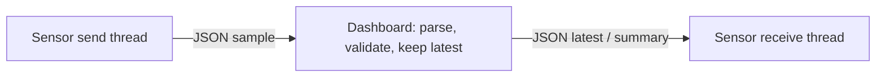

# UDP application example: sensor publishing and feedback

[简体中文](UDP_BUSINESS.zh-CN.md) · [README](../README.md) · [Socket C API](../include/hx_os_net.h)

Complete the [example setup](../examples/README.md#run) first. Below, build is a placeholder for your existing directory; protocols do not each need a new build directory. Run commands from the checkout and build the endpoints used here.

## 1. Independent UDP datagrams

This example calls `hx_os_socket_send_to()` and `hx_os_socket_receive_from()` with no IPC endpoint, HXIP framing or implicit handshake. One sensor thread publishes samples while another receives feedback. The dashboard holds two devices' latest state and replies. It runs with IPC disabled.

UDP retains loss, duplication and reordering. The chosen application policy keeps current state rather than promising delivery of every sample.

## 2. Build and run

```sh
cmake -S . -B build -DHX_OS_BUILD_EXAMPLES=ON
cmake --build build --config Release --target hx_os_udp_dashboard
cmake --build build --config Release --target hx_os_udp_sensor
```

Windows PowerShell, Visual Studio build:

```powershell
python examples/run_udp_business.py --bin-dir build/bin/Release
python examples/run_udp_business.py --simulate-gaps --bin-dir build/bin/Release
```

Linux/WSL uses `python3` with `--bin-dir build/bin`. Existing development paths are `build-shared-msvc/bin/Release` or `build-shared-linux/bin`; omit `Release` with Windows Ninja. The runner chooses a port and verifies both processes' state and feedback.

Manual Windows **terminal one**:

```powershell
.\build\bin\Release\hx_os_udp_dashboard.exe 39002
```

After `Listening:`, **terminal two**:

```powershell
.\build\bin\Release\hx_os_udp_sensor.exe 39002 --simulate-gaps
```

Omit `--simulate-gaps` for the ordinary run. On Linux/WSL use `./build/bin/hx_os_udp_dashboard 39002` and `./build/bin/hx_os_udp_sensor 39002 --simulate-gaps`. Both use `127.0.0.1`; the argument is a port number, not a `udp://` URI. Restart the dashboard for each workflow.

## 3. One JSON object per datagram



A sample has no TCP length prefix:

```json
{"type":"sample","device_id":101,"seq":10,"temperature_centi":2510}
```

`device_id`, `seq` and `temperature_centi` must be JSON integers. Temperature is in hundredths of a degree Celsius: `2510` means `25.10°C`. Devices are 101/102, sequences 1–10, temperatures -10000–20000. Missing fields, wrong types, invalid syntax and duplicate keys never update device state.

Both devices publish ten rounds approximately 30 ms apart. Every third accepted update triggers feedback to its source:

```json
{"type":"latest","device_id":101,"seq":3}
```

At the end of the collection window, return statistics and final temperature:

```json
{"type":"summary","device_id":101,"accepted":10,"newest":10,"gaps":0,"stale":0,"temperature_centi":2510}
```

Device identity is in JSON; `receive_from()` supplies source address/port. Initial data has a 10-second deadline, followed by a 1-second collection window. The sensor receiver waits 2 seconds and finishes normally even if feedback is missing.

## 4. Gaps, duplicates and late samples

| Condition | Action |
| --- | --- |
| Newer sequence | Update temperature and count observed gaps |
| Same/older sequence | Increment `stale`, preserve current temperature |
| Another source for the device | Ignore within this run, retaining the first binding |
| Oversized/truncated datagram | Explicit failure; no remainder becomes a new message |

`--simulate-gaps` deliberately omits 3/7, duplicates 4 and sends 6 after 8. It controls application input, not measured packet loss. Per-device normal loopback results are `accepted=10,newest=10,gaps=0,stale=0`; fault results are `accepted=8,newest=10,gaps=2,stale=2`, without old data overwriting current temperature.

Ordinary UDP still permits loss, duplication and reordering. The C sensor allows missing feedback; the automated fixture requires this small loopback batch to deliver expected JSON summaries and fails if it does not. This is not a reliable-UDP promise.

## 5. Adapt fields and business logic

| Source | Entry points |
| --- | --- |
| [udp_sensor.c](../examples/udp_sensor.c) | `publish_sample()` JSON construction; sender publishes, `receive_feedback()` parses/validates results |
| [udp_dashboard.c](../examples/udp_dashboard.c) | `receive_sample()` integer/range/source validation and state update; final JSON summaries |
| [udp_business.h](../examples/udp_business.h) | Whole-datagram I/O and finite waits |
| [run_udp_business.py](../examples/run_udp_business.py) | `json.loads` checks both devices' state and feedback |

Build the payload as typed fields:

```c
json_field fields[] = {
	json_text("type", "sample"), json_int("device_id", 101),
	json_int("seq", 1), json_int("temperature_centi", 2501)
};
```

Use `json_encode()` and send through this example's `udp_send_text()`. `publish_sample()` contains the full checks and cleanup. [business_json.h](../examples/business_json.h) shares only JSON encoding/decoding, with no IPC business forwarding.

Default-enabled `CONFIG`, `CONFIG_SERIALIZE` and `SETTINGS` provide built-in parsing and safe string escaping. UTF-8 payloads are at most 1023 bytes; parsing is limited to depth 8, 64 nodes and 64 KiB. Release documents and temporary strings; never retain pointers into a released document.

Short mutexes serialize nonblocking socket calls; retry sleeps occur outside locks. Main joins before cleanup. Real devices that reuse sequence numbers after restarting need application session IDs in their JSON protocol; address binding is not authentication.

## 6. Run the business example

```sh
python examples/run_udp_business.py --bin-dir build/bin/Release
python examples/run_udp_business.py --bin-dir build/bin/Release --simulate-gaps
```

Run normal samples/feedback first, then add gaps, duplicates and late data to observe receiver behavior. Use build/bin on Linux.

With WSL2 mirrored networking, `127.0.0.1` can traverse a virtual network with MTU 1500. This machine lost fragments above 1472 bytes of IPv4 UDP payload. The example keeps JSON to 1023 bytes. For larger business messages, see the [KCP example](KCP_BUSINESS.md) or [TCP example](TCP_BUSINESS.md); the library does not silently split ordinary UDP or change its loss semantics. Validate WSL-internal loopback separately from Windows/WSL communication; see the [IPC platform note](IPC.md).
