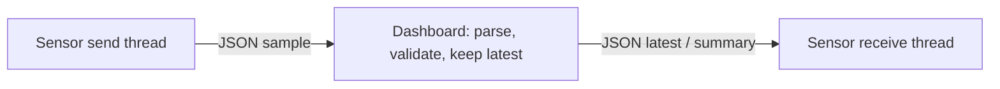

# UDP Business Example: Sensor Telemetry Publishing and Feedback

[简体中文](UDP_BUSINESS.zh-CN.md) · [README](../README.md) · [Socket C API](../include/hx_os_net.h)

In high-frequency sensor telemetry and status reporting, losing an occasional intermediate reading is often acceptable—what matters is keeping the **latest valid reading** for each device while tracking sequence gaps and out-of-order arrivals. This example builds directly on `hx_os_socket_send_to()` and `hx_os_socket_receive_from()` to implement a two-device UDP telemetry publisher and dashboard aggregator using UTF-8 JSON datagrams.

Complete the one-time [example build setup](../examples/README.md#run) before starting. Below, `build` refers to your existing CMake build directory.

## 1. Independent UDP datagrams

This workflow consists of two standalone programs—a sensor publisher (`hx_os_udp_sensor`) and a receiving dashboard (`hx_os_udp_dashboard`):
- **No `hx_ipc` Dependency**: Both programs send and receive raw UDP datagrams with no IPC endpoint, no HXIP framing, and no implicit handshake. They build and run even when `HX_OS_ENABLE_IPC=OFF`.
- **Latest-State Telemetry Model**: One sensor thread publishes temperature samples while a second sensor thread listens for dashboard feedback. Because ordinary UDP permits packet loss, duplication, and reordering, the dashboard retains each device's newest valid sample rather than promising reliable delivery of every historical reading.

## 2. Build and run

From the repository root, build the dashboard and sensor targets:

```sh
cmake -S . -B build -DHX_OS_BUILD_EXAMPLES=ON
cmake --build build --config Release --target hx_os_udp_dashboard
cmake --build build --config Release --target hx_os_udp_sensor
```

**Windows PowerShell (Visual Studio build, automated runner):**

```powershell
python examples/run_udp_business.py --bin-dir build/bin/Release
python examples/run_udp_business.py --simulate-gaps --bin-dir build/bin/Release
```

On Linux or WSL, use `python3` with `--bin-dir build/bin` (or pass an existing build path such as `build-shared-msvc/bin/Release` or `build-shared-linux/bin`; omit `Release` for Windows Ninja builds). The runner script selects a free UDP port and verifies both processes' state and summary outputs.

### Manual Execution in Two Terminals

To run the C binaries manually without Python, start the dashboard on port `39002` in **Terminal 1**:

```powershell
.\build\bin\Release\hx_os_udp_dashboard.exe 39002
```

Once `Listening:` appears, run the sensor in **Terminal 2** (pass `--simulate-gaps` to inject missing, duplicate, and reordered sequence numbers, or omit it for a clean run):

```powershell
.\build\bin\Release\hx_os_udp_sensor.exe 39002 --simulate-gaps
```

On Linux/WSL, run `./build/bin/hx_os_udp_dashboard 39002` and `./build/bin/hx_os_udp_sensor 39002 --simulate-gaps`. Both programs bind and send to `127.0.0.1`; the command-line argument is a **port number**, not a `udp://` URI. Restart the dashboard before each manual run.

## 3. One JSON object per datagram



Because UDP preserves datagram boundaries, each packet carries a single UTF-8 JSON object without a TCP length prefix:

```json
{"type":"sample","device_id":101,"seq":10,"temperature_centi":2510}
```

### Schema Validation and Feedback Timing

- **Strict Field Validation**: `device_id`, `seq`, and `temperature_centi` must be true JSON integers. Temperature is expressed in **hundredths of a degree Celsius** (`2510` = `25.10°C`). Valid devices are `101` and `102`, valid sequences are `1`–`10`, and valid temperatures are `-10000`–`20000`. Datagrams with missing fields, wrong types, invalid syntax, or duplicate keys are ignored without modifying device state.
- **Periodic Progress (`latest`)**: Both simulated devices publish 10 rounds roughly 30 ms apart. Every third accepted update for a device triggers a progress datagram back to the sender address reported by `hx_os_socket_receive_from()`:

```json
{"type":"latest","device_id":101,"seq":3}
```

- **Window Summary (`summary`)**: The dashboard waits up to 10 seconds for the first packet and then collects packets for a 1-second window before sending a final summary per device:

```json
{"type":"summary","device_id":101,"accepted":10,"newest":10,"gaps":0,"stale":0,"temperature_centi":2510}
```

The sensor's receiver thread waits up to 2 seconds for feedback and exits cleanly even if feedback packets are lost.

## 4. Gaps, duplicates and late samples

The dashboard tracks the highest sequence number seen per device (`newest`) and handles out-of-order traffic explicitly:

| Incoming Datagram Condition | Dashboard Action |
| --- | --- |
| Sequence > current `newest` | Accept sample (`accepted++`), update latest temperature, and add any skipped sequence numbers to `gaps` |
| Sequence <= current `newest` | Count as duplicate or late (`stale++`) and **preserve the newer temperature** |
| Same `device_id` from a different source IP/port | Ignore during this run, retaining the first source binding |
| Oversized / truncated datagram | Fail explicitly without reinterpreting leftover bytes as a new message |

Passing `--simulate-gaps` causes the sensor to **omit sequences `3` and `7`, duplicate sequence `4`, and send sequence `6` after sequence `8`**:
- **Normal loopback run**: Each device reports `accepted=10, newest=10, gaps=0, stale=0`.
- **Simulated-gap run (`--simulate-gaps`)**: Each device reports `accepted=8, newest=10, gaps=2, stale=2`, and stale packet `6` never overwrites the newer temperature from packet `8` or `10`.

> [!NOTE]
> While the C sensor executable tolerates missing feedback datagrams, the automated test runner `run_udp_business.py` asserts that this small local loopback batch delivers all expected JSON summaries so regressions are caught immediately.

## 5. Adapt fields and business logic

| Source File | Key Functions & Responsibilities |
| --- | --- |
| [udp_sensor.c](../examples/udp_sensor.c) | `publish_sample()` JSON construction and sending; `receive_feedback()` parses and validates dashboard replies |
| [udp_dashboard.c](../examples/udp_dashboard.c) | `receive_sample()` integer/range/source validation and state updates; window-end JSON summaries |
| [udp_business.h](../examples/udp_business.h) | Whole-datagram non-blocking I/O helpers with finite deadlines |
| [run_udp_business.py](../examples/run_udp_business.py) | Parses logged JSON with `json.loads` and checks both devices' statistics and feedback |

To construct a sample payload using typed fields:

```c
json_field fields[] = {
	json_text("type", "sample"), json_int("device_id", 101),
	json_int("seq", 1), json_int("temperature_centi", 2501)
};
```

Pass `fields` to `json_encode()` and transmit the resulting string with `udp_send_text()` (see `publish_sample()` for full error checking and cleanup). The shared [business_json.h](../examples/business_json.h) helper uses the default-enabled `CONFIG`, `CONFIG_SERIALIZE`, and `SETTINGS` modules for safe string escaping and bounded JSON parsing (1023-byte payload cap, depth 8, 64 nodes, and 64 KiB parser memory). Always release parsed config documents and temporary `hx_string` instances after each packet, and never retain pointers into a released document.

Non-blocking socket calls from the sensor's two threads are serialized with a short mutex, sleeping outside the lock on `HX_OS_WOULD_BLOCK`. The main thread joins both worker threads before closing the socket and mutex. If a real sensor device can restart and reset its sequence counter to `1`, include a random session ID in your JSON schema (source IP/port binding is not cryptographic authentication).

### Files to copy into your own project

To adapt this UDP workflow for your own project:
1. Copy [udp_dashboard.c](../examples/udp_dashboard.c), [udp_sensor.c](../examples/udp_sensor.c), and the companion headers [udp_business.h](../examples/udp_business.h), [network_demo.h](../examples/network_demo.h), and [business_json.h](../examples/business_json.h).
2. Build the dashboard and sensor as two separate CMake executable targets linked against `hx_c_platform::hx_c_platform` (see [Using an Installed Package](USAGE.md#installed-project)). Helpers like `json_field` and `json_encode` live in `business_json.h` rather than the public `hx_os.h` header.
3. Run the unmodified binaries in two terminals first using the commands in Section 2, then customize the JSON fields and aggregation rules while preserving the thread-join and cleanup order.

## 6. Run the business example

```sh
python examples/run_udp_business.py --bin-dir build/bin/Release
python examples/run_udp_business.py --bin-dir build/bin/Release --simulate-gaps
```

(On Linux, replace `build/bin/Release` with `build/bin`.) Run the normal workflow first, then add `--simulate-gaps` to observe how gaps, duplicates, and reordered packets are tallied.

> [!WARNING]
> **UDP Payload Size Limits Under WSL2 Mirrored Networking**
> Under WSL2 mirrored networking, IPv4 loopback traffic (`127.0.0.1`) can traverse a virtual network path with an MTU of 1500 where fragmented IPv4 UDP payloads above 1472 bytes may be dropped. This example caps JSON datagrams at 1023 bytes to stay well below the fragmentation threshold. For larger messages that require reliable delivery, use the [KCP Business Example](KCP_BUSINESS.md) or [TCP Business Example](TCP_BUSINESS.md) (see also the [IPC Platform Notes](IPC.md)).
