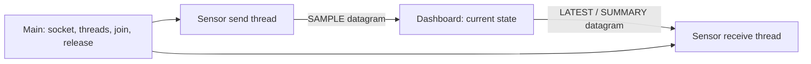

# UDP application example: sensor publishing and feedback

[简体中文](UDP_BUSINESS.zh-CN.md) · [README](../README.md) · [Socket C API](../include/hx_os_net.h)

## 1. Independent UDP datagrams

This example calls `hx_os_socket_send_to()` and `hx_os_socket_receive_from()` with no IPC endpoint, HXIP framing or implicit handshake. One sensor thread publishes samples while another receives feedback. The dashboard holds two devices' latest state and replies. It runs with IPC disabled.

UDP retains loss, duplication and reordering. The chosen application policy keeps current state rather than promising delivery of every sample.

## 2. Build and run

```sh
cmake -S . -B build-net -DHX_OS_BUILD_TESTS=ON -DHX_OS_BUILD_EXAMPLES=ON
cmake --build build-net --config Release --parallel 4
```

Windows PowerShell, Visual Studio build:

```powershell
python examples/run_udp_business.py --bin-dir build-net/bin/Release
python examples/run_udp_business.py --simulate-gaps --bin-dir build-net/bin/Release
```

Linux/WSL uses `python3` with `--bin-dir build-net/bin`. Existing development paths are `build-shared-msvc/bin/Release` or `build-shared-linux/bin`; omit `Release` with Windows Ninja. The runner chooses a port and verifies both processes' state and feedback.

Manual Windows **terminal one**:

```powershell
.\build-net\bin\Release\hx_os_udp_dashboard.exe 39002
```

After `Listening:`, **terminal two**:

```powershell
.\build-net\bin\Release\hx_os_udp_sensor.exe 39002 --simulate-gaps
```

Omit `--simulate-gaps` for the ordinary run. On Linux/WSL use `./build-net/bin/hx_os_udp_dashboard 39002` and `./build-net/bin/hx_os_udp_sensor 39002 --simulate-gaps`. Both use `127.0.0.1`; the argument is a port number, not a `udp://` URI. Restart the dashboard for each workflow.

## 3. Communication in both directions



`SAMPLE device=101 seq=10 temperature_centi=2510` carries a device ID, sequence within this run, and temperature in hundredths of a degree Celsius: `2510` means `25.10°C`. Each ASCII payload is at most 127 bytes and has no TCP length prefix.

The sender publishes ten rounds for devices `101`/`102`, roughly 30 ms apart. Every third accepted update triggers `LATEST device=101 seq=N` feedback to the source address. A final `SUMMARY` follows the collection window. Device identity is in the payload; `receive_from()` supplies the source address and port.

The dashboard waits up to 10 seconds for initial data, then collects for 1 second. The feedback thread waits 2 seconds and ends normally at its deadline; lost feedback never causes indefinite waiting. These are application demonstration limits.

## 4. Gaps, duplicates and late samples

| Condition | Dashboard behavior |
| --- | --- |
| Greater `seq` | Update temperature and count observed sequence gaps |
| Equal or smaller `seq` | Increment `stale`, preserving current temperature |
| Oversized/truncated datagram | Explicit failure; no remainder becomes a new message |
| Another source for the same device | Ignore it in this demonstration, keeping the first binding |

`--simulate-gaps` deliberately omits `3`/`7`, duplicates `4`, and sends `6` after `8`. This controls application input, not actual network packet loss.

| Mode | accepted | newest | gaps | stale |
| --- | --- | --- | --- | --- |
| Normal small loopback batch | 10 | 10 | 0 | 0 |
| Sequence fault demonstration | 8 | 10 | 2 | 2 |

```text
[UDP receive thread] SUMMARY device=101 accepted=8 newest=10 gaps=2 stale=2
[UDP receive thread] SUMMARY device=102 accepted=8 newest=10 gaps=2 stale=2
UDP SENSOR PASS: send/receive threads joined; feedback=6
```

`feedback=6` is expected in the controlled fixture. The C program permits lost feedback; the automated test requires this small loopback run to produce the expected result and reports failure if it does not. It does not make ordinary UDP reliable.

## 5. Sources and ownership

| Source | Entry points |
| --- | --- |
| [udp_sensor.c](../examples/udp_sensor.c) | `publish_samples()` sender, `receive_feedback()` receiver, `main()` resource ownership |
| [udp_dashboard.c](../examples/udp_dashboard.c) | `receive_sample()` validates numbers, updates each device and replies to the source |
| [udp_business.h](../examples/udp_business.h) | Whole-datagram I/O, bounds and finite waits |
| [run_udp_business.py](../examples/run_udp_business.py) | Independent normal/fault assertions |

Once the sender has prepared the payload and destination:

```c
if (!udp_send_text(job->endpoint, &job->destination, sample))
	return 0;
```

This private example helper directly uses `send_to()`, with no IPC forwarding. A short mutex serializes nonblocking socket calls; retry sleeps for 1 ms outside it. Main joins both threads before destroying mutex, socket and network; borrowed parameters remain alive. There is no application message queue.

The example covers one process run. If real devices reuse sequence numbers after restarting, define a session identifier and switching policy in your datagram protocol. Address binding is not authentication. For reliable transfer see the separate [KCP](KCP_BUSINESS.md) or [TCP](TCP_BUSINESS.md) workflows.

## 6. Automated tests

```sh
ctest --test-dir build-net -C Release -R "^udp_business_" --output-on-failure
```

`udp_business_samples` and `udp_business_gaps` check both devices' final temperatures, sequence statistics, feedback and thread/process completion. They do not use IPC business programs. See [validation](VALIDATION.md) for target evidence.
