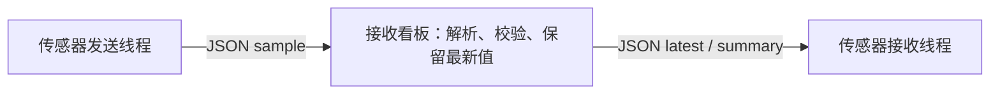

# UDP 业务示例：传感器上报与双向反馈

[English](UDP_BUSINESS.md) · [README](../README.zh-CN.md) · [Socket C 接口](../include/hx_os_net.h)

在高频传感器采样、设备心跳上报或实时遥测场景中，偶尔丢失一两个历史采样点往往是可以接受的——业务真正关心的是**设备最新的状态值**以及这段时间内的缺号（Gaps）与乱序（Stale）统计。本示例直接使用底层 `hx_os_socket_send_to()` 与 `hx_os_socket_receive_from()` 构建一套完整的“双设备 UDP JSON 采样上报 + 看板聚合反馈”系统，演示如何在不引入重传机制的前提下，优雅处理 UDP 的丢包、重复与乱序到达。

在开始前，请先完成一次[示例构建配置](../examples/README.zh-CN.md#run)。下文中的 `build` 是你现有构建目录的占位名，直接复用即可。

## 1. 独立的 UDP 数据报程序

本示例由传感器端（`hx_os_udp_sensor`）和接收看板端（`hx_os_udp_dashboard`）两个独立程序组成：
- **完全独立于 `hx_ipc`**：直接收发原始 UDP 数据报，不使用 `hx_ipc` 连接、不加 HXIP 帧头，也没有隐式握手。即使在构建时关闭 `HX_OS_ENABLE_IPC`，本示例依然可以正常编译运行。
- **符合 UDP 特性的业务状态机**：传感器端通过一个发送线程上报采样数据，并通过另一个接收线程监听看板端的反馈；看板端在内存中维护两台模拟设备的最新温度与序号统计，并向来源地址回发阶段性进度与最终汇总。

## 2. 构建与运行

在仓库根目录下构建看板端与传感器端可执行目标：

```sh
cmake -S . -B build -DHX_OS_BUILD_EXAMPLES=ON
cmake --build build --config Release --target hx_os_udp_dashboard
cmake --build build --config Release --target hx_os_udp_sensor
```

**Windows PowerShell（Visual Studio 构建，一键自动化验证）：**

```powershell
python examples/run_udp_business.py --bin-dir build/bin/Release
python examples/run_udp_business.py --simulate-gaps --bin-dir build/bin/Release
```

在 Linux 或 WSL 下，请使用 `python3` 并将目录改为 `--bin-dir build/bin`（也可直接指定已有的 `build-shared-msvc/bin/Release` 或 `build-shared-linux/bin`；Windows Ninja 构建去掉 `Release`）。Python 运行脚本会自动挑选空闲 UDP 端口，启动双端进程并核对统计汇总与反馈报文。

### 在两个终端中手工运行

你也可以在两个终端里直接运行 C 程序（加上 `--simulate-gaps` 可主动模拟漏发、重复与乱序）：

**Windows 终端一（启动接收看板，监听 39002 端口）：**

```powershell
.\build\bin\Release\hx_os_udp_dashboard.exe 39002
```

看到 `Listening:` 后，在**终端二（运行传感器端）**中执行：

```powershell
.\build\bin\Release\hx_os_udp_sensor.exe 39002 --simulate-gaps
```

去掉 `--simulate-gaps` 即可运行无丢包的正常采样流程。在 Linux/WSL 下分别执行 `./build/bin/hx_os_udp_dashboard 39002` 和 `./build/bin/hx_os_udp_sensor 39002 --simulate-gaps`。两端固定使用 `127.0.0.1` 回环地址，命令行参数直接传入**端口号**（不要传 `udp://` URI）。每次重新运行前请重新启动接收看板。

## 3. 一个数据报就是一个 JSON 对象



与 TCP 字节流不同，UDP 天然以数据报（Datagram）为边界，因此每条报文无需添加 2 字节长度前缀，直接发送一个完整的 UTF-8 JSON 对象即可：

```json
{"type":"sample","device_id":101,"seq":10,"temperature_centi":2510}
```

### 字段校验与反馈时序

- **严格的类型与范围校验**：`device_id`、`seq` 和 `temperature_centi` 必须是真正的 JSON 整数。其中温度单位为**百分之一摄氏度**（例如 `2510` 代表 `25.10°C`）。合法设备号为 `101` 或 `102`，合法序号为 `1`～`10`，合法温度范围为 `-10000`～`20000`。任何缺失字段、类型不符、语法损坏或重复键（Duplicate Keys）的数据报都会被直接忽略，绝不会污染设备状态。
- **阶段性反馈（`latest`）**：两台模拟设备各发送 10 轮采样，每轮间隔约 30 毫秒。接收看板每成功采纳某台设备的 3 个新样本，就会顺着 `hx_os_socket_receive_from()` 拿到的来源地址和端口回发一条进度确认：

```json
{"type":"latest","device_id":101,"seq":3}
```

- **窗口汇总（`summary`）**：接收看板等待首条数据报的超时上限为 10 秒，收到首包后开启 1 秒的数据收集窗口；窗口到期后，向传感器端发送每台设备的最终统计与最新温度：

```json
{"type":"summary","device_id":101,"accepted":10,"newest":10,"gaps":0,"stale":0,"temperature_centi":2510}
```

传感器端的接收线程最多等待 2 秒反馈，到期后即使未收齐反馈也会正常退出，绝不会无限期挂起。

## 4. 缺号、重复与晚到

接收看板针对每台设备维护单调递增的最大序号（`newest`），并按以下规则处理乱序与异常报文：

| 接收到的数据报情况 | 接收看板处理策略 |
| --- | --- |
| 序号严格大于当前 `newest` | 采纳样本（`accepted++`），更新当前最新温度，并累加中间跳过的序号空缺数（`gaps`） |
| 序号等于或小于当前 `newest` | 判定为重复包或迟到的旧包，累加过期计数（`stale++`），**绝不用旧温度覆盖最新温度** |
| 同一 `device_id` 从另一个源地址/端口发来 | 在本轮运行中直接忽略，保持首次收到该设备时的源地址绑定 |
| 数据报超过接收缓冲区容量而被截断 | 明确报错丢弃，绝不把截断残留当作新消息解析 |

当传入 `--simulate-gaps` 参数时，传感器端会故意**漏发序号 `3` 和 `7`、重复发送序号 `4`、并在发送序号 `8` 之后才延迟发出序号 `6`**：
- **正常模式结果**：每台设备均为 `accepted=10, newest=10, gaps=0, stale=0`。
- **异常模拟结果（`--simulate-gaps`）**：每台设备均为 `accepted=8, newest=10, gaps=2, stale=2`，且最终保留的温度始终是序号 `10` 的最新值。

> [!NOTE]
> C 语言传感器程序本身允许反馈包在网络中丢失并正常退出；而自动化测试脚本 `run_udp_business.py` 为了验证本机回环下的端到端逻辑，会断言本批次的 JSON 汇总全部到达（这只是测试断言，不代表普通 UDP 具备可靠传输承诺）。

## 5. 到哪里改字段与业务

| 源码文件 | 核心函数与职责 |
| --- | --- |
| [udp_sensor.c](../examples/udp_sensor.c) | `publish_sample()`：构造并发送采样 JSON；`receive_feedback()`：独立线程接收并校验看板反馈 |
| [udp_dashboard.c](../examples/udp_dashboard.c) | `receive_sample()`：解析整数、校验范围与来源地址并更新最新状态；收集窗口结束后编码 `summary` 汇总 |
| [udp_business.h](../examples/udp_business.h) | 封装完整 UDP 数据报收发与有限截止时间等待 |
| [run_udp_business.py](../examples/run_udp_business.py) | 使用 Python `json.loads` 核对两台设备的统计计数与反馈结果 |

在传感器端，构造一条采样报文只需声明类型化字段数组：

```c
json_field fields[] = {
	json_text("type", "sample"), json_int("device_id", 101),
	json_int("seq", 1), json_int("temperature_centi", 2501)
};
```

随后将 `fields` 传给 `json_encode()` 生成 UTF-8 字符串，再调用 `udp_send_text()` 发出（完整的错误检查与内存释放见 `publish_sample()`）。辅助头文件 [business_json.h](../examples/business_json.h) 复用了默认开启的 `CONFIG`、`CONFIG_SERIALIZE` 和 `SETTINGS` 模块，提供安全的字符串转义与内置 JSON 解析（单报文上限 1023 字节，解析深度上限 8、节点上限 64、内存限额 64 KiB）。注意每处理完一条报文后必须立即释放解析文档与临时字符串，切勿保留指向已销毁文档内部的裸指针。

在并发设计上，传感器端两个线程的非阻塞 socket 调用通过短互斥锁串行保护，遇到 `HX_OS_WOULD_BLOCK` 时在锁外休眠等待；主线程始终先 `join` 子线程再销毁 socket 与锁。如果真实物理设备重启后会从头复用序号 `1`，建议在你的 JSON 协议中增加一个随机会话字段（注意：源 IP/端口绑定仅用于防误串，不能替代密码学身份认证）。

### 放进自己的工程时要复制什么

如果你想基于本例改造自己的 UDP 遥测或状态上报程序：
1. 复制 [udp_dashboard.c](../examples/udp_dashboard.c)、[udp_sensor.c](../examples/udp_sensor.c) 以及同目录下的辅助头文件 [udp_business.h](../examples/udp_business.h)、[network_demo.h](../examples/network_demo.h) 和 [business_json.h](../examples/business_json.h)。
2. 将两个含 `main()` 的源文件分别配置为独立的 CMake 可执行目标，并链接 `hx_c_platform::hx_c_platform`（外部工程接入参见[已安装包接入指南](USAGE.zh-CN.md#installed-project)）。注意 `json_field`、`json_encode` 等是示例头文件中的辅助封装，并非 `#include <hx_os.h>` 自带的公共 API。
3. 先用第 2 节的手动命令在两个终端中跑通，再替换字段定义与业务聚合逻辑，保留原有的线程退出与资源关闭顺序。

## 6. 运行业务示例

```sh
python examples/run_udp_business.py --bin-dir build/bin/Release
python examples/run_udp_business.py --bin-dir build/bin/Release --simulate-gaps
```

（Linux 下请将 `build/bin/Release` 替换为 `build/bin`。）第一条命令验证正常连续采样与反馈；第二条命令注入缺号、重复和乱序样本，验证看板端的去重与保新逻辑。

> [!WARNING]
> **WSL2 镜像网络（Mirrored Networking）下的 UDP 载荷大小限制**
> 在开启了镜像网络模式的 WSL2 环境中，即使是发往 `127.0.0.1` 的 IPv4 回环流量也可能穿过 MTU 1500 的虚拟网卡路径；实测超过 1472 字节的 IPv4 UDP 载荷会出现 IP 分片丢失。本示例将单条 JSON 报文严格限制在 1023 字节以内，确保处于安全的不分片范围内。如果你的业务需要传输更大的消息且要求可靠送达，请改用 [KCP 业务示例](KCP_BUSINESS.zh-CN.md) 或 [TCP 业务示例](TCP_BUSINESS.zh-CN.md)（详见 [IPC 平台说明](IPC.zh-CN.md)）。
