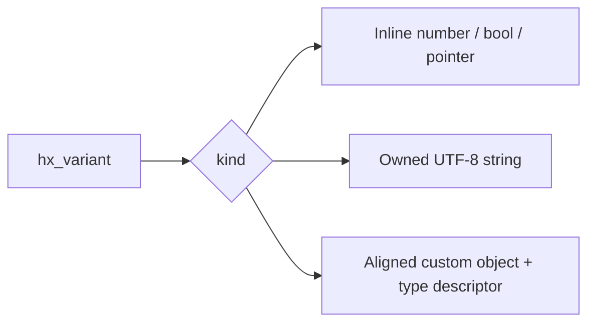

# Variant values: one variable, different types

[简体中文](VARIANT.zh-CN.md) · [Home](../README.md) · [Task tutorial](USAGE.md#variant)

- [1. What it does](#purpose)
- [2. Store numbers, strings and a structure in C](#c-start)
- [3. Copy, move and read values](#ownership)
- [4. Structures that own resources](#custom)
- [5. Direct C++11 calls and visitors](#cpp)
- [6. Use vector, queue and map](#containers)
- [7. Memory, allocators and module selection](#allocation)
- [8. Errors, threads and plugin lifetimes](#contracts)
- [9. Differences from C++ variant](#comparison)
- [10. Usage examples and platform limits](#verification)

<a id="purpose"></a>

## 1. What it does

`hx_variant` is a value with a type tag. Store `42`, later replace it with `"hello"`, or store your own `point` structure. One object holds one active value; replacement releases the old value. A vector/queue holds multiple elements; a variant lets each element have a different type.

Include `<hx_variant.h>` or the C umbrella `<hx_os.h>`. The C++11 facade is `<hx/Variant.hpp>`. No global initialization, configuration/settings tree, new third-party dependency or C++ runtime is required by the C implementation.

| Type | C setter / getter | Behavior |
| --- | --- | --- |
| Empty | `hx_variant_clear` / `hx_variant_kind` | Initially empty; clear releases the active value |
| Boolean | `set_bool` / `get_bool` | C uses int; nonzero input becomes 1 |
| Signed integers | `set_i32/i64` / `get_i32/i64` | int32_t / int64_t, no implicit conversion |
| Unsigned integers | `set_u32/u64` / `get_u32/u64` | uint32_t / uint64_t, no implicit conversion |
| Floating point | `set_float/double` / `get_float/double` | Native values, including NaN/infinity |
| String | `set_cstr/string` / `get_string_view/string` | Owned UTF-8 bytes; explicit lengths allow NUL |
| Raw pointer | `set_pointer` / `get_pointer` | Borrowed pointee, never released |
| Custom structure | `set_custom/emplace_custom` / `get_custom` | Checked identity, aligned storage, custom copy/drop |

Abbreviated entries use the complete `hx_variant_` prefix: `set_i32` is `hx_variant_set_i32`.



These are alternative representations. Only the representation selected by kind is active; storing a structure does not keep the former number/string active.

<a id="c-start"></a>

## 2. Store numbers, strings and a structure in C

Store/display an integer, then replace it with a string, then with a coordinate structure. Save as `main.c` and use the [tutorial's C99 CMake configuration](USAGE.md#c-project). No input files are needed. The built project also supplies the `hx_os_variant` example.

```c
#include <hx_variant.h>
#include <stdio.h>

typedef struct point {
	double x;
	double y;
} point;
HX_VARIANT_DEFINE_TRIVIAL_TYPE(point_type, point);

int main(void)
{
	hx_variant value = HX_VARIANT_INIT;
	point position = {2, 5};
	const void *object = NULL;
	hx_string_view text;
	int32_t count;
	hx_os_status status;

	if (!(hx_os_capabilities() & HX_OS_CAP_VARIANT)) {
		puts("Variant support is disabled");

		return 0;
	}

	status = hx_variant_set_i32(&value, 42, NULL);
	if (status != HX_OS_OK)
		goto failed;

	status = hx_variant_get_i32(&value, &count, NULL);
	if (status != HX_OS_OK)
		goto failed;

	printf("Integer: %d\n", (int)count);

	status = hx_variant_set_cstr(&value, "hello", NULL);
	if (status != HX_OS_OK)
		goto failed;

	status = hx_variant_get_string_view(&value, &text, NULL);
	if (status != HX_OS_OK)
		goto failed;

	printf("String: %.*s\n", (int)text.size, text.data);

	status = hx_variant_set_custom(&value, &point_type, &position, NULL);
	if (status != HX_OS_OK)
		goto failed;

	status = hx_variant_get_custom(&value, &point_type, &object, NULL);
	if (status != HX_OS_OK)
		goto failed;

	printf("Point: %.1f, %.1f\n", ((const point *)object)->x,
		((const point *)object)->y);

	hx_variant_destroy(&value);

	return 0;

failed:
	fprintf(stderr, "Variant failed: %s\n", hx_os_status_name(status));
	hx_variant_destroy(&value);

	return 1;
}
```

Expected output:

```text
Integer: 42
String: hello
Point: 2.0, 5.0
```

1. HX_VARIANT_INIT creates an empty value with the default allocator. Initialize each object exactly once.
2. set_i32 stores a 32-bit integer; get_i32 checks the active type and copies it into count.
3. set_cstr copies text and replaces the integer. get_string_view borrows that text; do not release text or keep it beyond its owner.
4. HX_VARIANT_DEFINE_TRIVIAL_TYPE declares the size/alignment of point. These coordinates have no separately owned members and support a byte copy.
5. set_custom copies position, so later edits to the source do not change the stored value. get_custom checks the same point_type before lending its object; read it as const point*.
6. destroy releases the active value. The example also cleans up through its failed branch.

Do not independently copy an owning variant by structure assignment. Use copy as described below.

<a id="ownership"></a>

## 3. Copy, move and read values

| Operation | Success | Failure |
| --- | --- | --- |
| `hx_variant_copy(out, source, error)` | Deep copy using out's context; source unchanged | Previous out preserved |
| `hx_variant_move(out, source)` | Release out, transfer value/context; source becomes default empty | Valid initialized owners: no failure/allocation |
| `hx_variant_swap(a, b)` | Exchange value and context | No failure/allocation |
| `hx_variant_clear(value)` | Release value, retain context | Cannot fail |
| `hx_variant_destroy(value)` | Release value/context lease, reset to default empty | Cannot fail; repeated destroy allowed |
| Scalar getters | Copy the numeric value | Output unchanged |
| get_string_view | Borrow text | Output unchanged |
| get_string | Copy into the output hx_string's context | Output unchanged |
| get_custom/get_custom_mut | Borrow the corresponding structure | Output unchanged |

Copy does not duplicate a string pointer. set_string/set_cstr retain text bytes, so inputs need only survive the call. hx_variant_take_string transfers an existing hx_string on success, empties the source and adds no allocation; its buffer continues to use its original allocator.

Types are exact: get_i64 on an i32 reports TYPE_MISMATCH. There is no silent integer widening or text-to-number parsing. C++ get<T>() follows the same rule. After failure, do not use an output as though written or call result.value().

Strings require strict UTF-8. Invalid input reports INVALID_ENCODING. hx_string_view lengths preserve embedded NUL; set_cstr ends at the first NUL. UTF-8 storage is separate from terminal decoding; this module does not implicitly convert other encodings.

Text views expire on replacement/clear/destroy. Structure pointers expire when that object is released. A variant move or container growth does not relocate separately allocated structure contents, but a pointer to a container's variant element may expire and must be acquired again. Owners cannot form ownership cycles; do not move an outer owner into its own child. Copy/construct/drop callbacks cannot mutate participating values.

<a id="custom"></a>

## 4. Structures that own resources

A structure containing hx_string, allocated memory or an owned file handle cannot usually be byte-copied: both copies could release the same resource. Supply copy/drop callbacks. Saving/cloning uses copy; replacement/clear/destruction uses drop. Borrowed pointers can be byte-copied if their lifetime remains valid, but the library does not thereby acquire the pointee.

This complete C program stores Alice/18, changes the input to Bob, and still reads Alice from the saved record:

```c
#include <hx_variant.h>
#include <stdio.h>

typedef struct user_record {
	hx_string name;
	int32_t age;
} user_record;

static hx_os_status HX_OS_CALL record_copy(void *destination,
	const void *source, hx_os_context *context, void *user,
	hx_os_error *error)
{
	user_record *out = destination;
	const user_record *input = source;
	hx_os_status status;

	(void)user;
	hx_string_init(&out->name, context);

	status = hx_string_copy(&out->name, &input->name, error);
	if (status != HX_OS_OK) {
		hx_string_destroy(&out->name);

		return status;
	}

	out->age = input->age;

	return HX_OS_OK;
}

static void HX_OS_CALL record_drop(void *object, void *user)
{
	(void)user;

	hx_string_destroy(&((user_record *)object)->name);
}

static const hx_variant_type record_type = {
	sizeof(user_record), 0, record_copy, record_drop, NULL, 0};

int main(void)
{
	user_record input = {HX_STRING_INIT, 18};
	hx_variant value = HX_VARIANT_INIT;
	const void *object = NULL;

	hx_os_status status = hx_string_assign_cstr(&input.name, "Alice", NULL);
	if (status == HX_OS_OK)
		status = hx_variant_set_custom(
			&value, &record_type, &input, NULL);

	if (status == HX_OS_OK)
		status = hx_string_assign_cstr(&input.name, "Bob", NULL);

	if (status == HX_OS_OK)
		status = hx_variant_get_custom(
			&value, &record_type, &object, NULL);

	if (status == HX_OS_OK) {
		const user_record *saved = object;

		printf("Record: %s, %d\n", hx_string_c_str(&saved->name),
			(int)saved->age);
	}
	else
		fprintf(stderr, "%s\n", hx_os_status_name(status));

	hx_variant_destroy(&value);
	hx_string_destroy(&input.name);

	return status == HX_OS_OK ? 0 : 1;
}
```

Expected output: `Record: Alice, 18`.

record_copy receives aligned, uninitialized storage. It initializes/copies name using the destination context, then copies age. If allocation fails, the callback cleans up its partially initialized resources before returning. The library frees only the raw candidate storage and never calls drop on failed construction; the former variant remains unchanged.

record_drop releases the nested name; the library releases the outer allocation, so the callback must not free it again. Drop returns normally. Each successfully constructed object is dropped once. No global registration is needed.

A descriptor's address is its type identity: two identical descriptor contents are still different types. Across C files, declare `extern const hx_variant_type point_type;` in a shared header and define it with the macro in one .c file. Keep the immutable descriptor, callback code and borrowed user state alive until all associated values retire.

For fallible direct construction use hx_variant_emplace_custom(value, type, construct, user, error). Publication follows successful construction. NULL copy with non-NULL drop, or NO_COPY, permits construction/move but rejects set_custom/copy with NOT_SUPPORTED. NULL copy/drop together default to byte copying, so nontrivial types must declare their operations. NO_COPY cannot be combined with copy. Size must be nonzero; alignment is zero or a power of two. Invalid descriptors report INVALID; allocation-size overflow reports RANGE.

<a id="cpp"></a>

## 5. Direct C++11 calls and visitors

hx::Variant accepts runtime choices; hx::TypedVariant<Ts...> declares its allowed types and rejects other writes during compilation. This is C++11 without <variant>/C++17. The facade reuses the C implementation, uses no exceptions and never implicitly copies resource owners.

Save this complete program as main.cpp and use the [C++ CMake configuration with exceptions disabled](USAGE.md#cpp-project), or run hx_os_cpp_variant:

```cpp
#include <hx/Variant.hpp>
#include <cstdio>

struct Point {
	double x;
	double y;
};

int main()
{
	if (!(hx_os_capabilities() & HX_OS_CAP_VARIANT)) {
		std::puts("Variant support is disabled");

		return 0;
	}

	hx::TypedVariant<int32_t, double, hx::StringView, Point> value;

	if (!value.set(int32_t(42)))
		return 1;

	auto count = value.get<int32_t>();

	if (!count)
		return 1;

	std::printf("Integer: %d\n", static_cast<int>(count.value()));

	if (!value.set("hello"))
		return 1;

	auto text = value.get<hx::StringView>();

	if (!text)
		return 1;

	std::printf("String: %.*s\n", static_cast<int>(text.value().size()),
		text.value().data());

	if (!value.set(Point{2, 5}))
		return 1;

	auto position = value.get<Point>();

	if (!position)
		return 1;

	std::printf(
		"Point: %.1f, %.1f\n", position.value().x, position.value().y);
}
```

The output matches the C program in section 2. set(Point{2,5}) supplies a descriptor automatically; get<Point>() returns a checked structure reference. StringView is the canonical string alternative: writes own copied bytes, reads borrow a view. Its name does not mean that the variant merely retains the source pointer.

| C++ operation | Example |
| --- | --- |
| Store integer | `value.set(int32_t(42))` |
| Store floating point | `value.set(3.5)` |
| Store string | `value.set("hello")` |
| Transfer an existing String | Open Variant: `value.takeString(std::move(text))` |
| Store structure | `value.set(Point{2, 5})` |
| Construct custom type directly | `value.emplace<MyType>(arguments...)` |
| Check type | `value.holds<Point>()` |
| Read | `auto result = value.get<Point>();`, then value() on success |
| Explicit copy | `auto copied = value.clone(context);` |
| Move | `hx::Variant moved(std::move(value));` |
| Clear | `value.clear()`; destructor releases automatically |

Scalar get returns a copy, StringView a borrowed view, custom get a reference; const owners give const structure references. Borrowing from a temporary variant is prohibited. Native scalar types are bool, int32_t/uint32_t, int64_t/uint64_t, float, double and void*; other C++ types use custom storage. Clone's default NULL context selects the default allocator; pass a custom context explicitly when needed.

Copy construction/destruction must be noexcept, as must direct construction through emplace. Use emplace for resource types without copying; clone reports NOT_SUPPORTED when copying is prohibited. For complex types with recoverable allocation failures, use a C descriptor and native() with explicit errors. Do not pretend std::string or other potentially throwing copies cannot fail. Automatic C++ copy construction does not inject context into arbitrary user classes; their nested resources follow their own policy. Use the C copy callback for destination-context-aware copying.

A visitor chooses the overload matching the active value. Complete C++11 program:

```cpp
#include <hx/Variant.hpp>
#include <cstdio>

struct PrintValue {
	void operator()(int32_t value) const noexcept
	{
		std::printf("Integer: %d\n", static_cast<int>(value));
	}

	void operator()(hx::StringView value) const noexcept
	{
		std::printf("String: %.*s\n", static_cast<int>(value.size()),
			value.data());
	}
};

int main()
{
	hx::TypedVariant<int32_t, hx::StringView> value;

	if (!value.set("hello"))
		return 1;

	auto printed = value.visit(PrintValue{});

	return printed ? 0 : 1;
}
```

Output: `String: hello`. Visiting is synchronous, stores no callback and allocates no callback state. Return void, hx_os_status or Result<void>. Function-object overloads must be noexcept; C++11 function pointers promise normal return by contract.

TypedVariant visits declared alternatives. Open Variant selects a range with value.visit<int32_t, hx::StringView>(PrintValue{}). No match reports TYPE_MISMATCH. TypedVariant starts empty and becomes empty on clear, even if empty is not listed; add hx::EmptyValue and an overload to visit that state. Lists contain 1..64 unique object types without cv/ref qualifiers. Dispatch checks the list, with O(N) worst-case complexity.

<a id="containers"></a>

## 6. Use vector, queue and map

hx_variant_container_options_init provides copy/drop operations for container elements. This complete C program stores an integer and a string and prints `Values: 42, hello`:

```c
#include <hx_variant.h>
#include <hx_container.h>
#include <stdio.h>

int main(void)
{
	hx_os_container_options options;
	hx_os_vector *values = NULL;
	hx_variant value = HX_VARIANT_INIT;
	const hx_variant *saved;
	hx_string_view text;
	int32_t number;
	hx_os_status status;

	hx_variant_container_options_init(&options, NULL);
	options.max_items = 16;

	status = hx_os_vector_create(NULL, &options, &values, NULL);
	if (status == HX_OS_OK)
		status = hx_variant_set_i32(&value, 42, NULL);

	if (status == HX_OS_OK)
		status = hx_os_vector_push_back(values, &value, NULL);

	if (status == HX_OS_OK)
		status = hx_variant_set_cstr(&value, "hello", NULL);

	if (status == HX_OS_OK)
		status = hx_os_vector_push_back(values, &value, NULL);

	if (status == HX_OS_OK) {
		saved = hx_os_sequence_at(values, 0);

		status = hx_variant_get_i32(saved, &number, NULL);
	}

	if (status == HX_OS_OK) {
		saved = hx_os_sequence_at(values, 1);

		status = hx_variant_get_string_view(saved, &text, NULL);
	}

	if (status == HX_OS_OK)
		printf("Values: %d, %.*s\n", (int)number, (int)text.size,
			text.data);

	hx_variant_destroy(&value);
	hx_os_status closed = hx_os_sequence_destroy(&values, NULL);
	if (status == HX_OS_OK)
		status = closed;

	if (status != HX_OS_OK)
		fprintf(stderr, "%s\n", hx_os_status_name(status));

	return status == HX_OS_OK ? 0 : 1;
}
```

push_back owns independent copies; subsequent edits/destruction of the temporary do not change stored elements. Queue/deque and map values can use the same preset. Sorting, heap and ordered map operations still require application-defined compare/key_compare: there is no unique ordering of unrelated types.

Do not use the POD HX_OS_DECLARE_VECTOR macros for owning variants, or byte-copy hx::Variant objects. C++ users of the C container store hx_variant and pass value.native(), not &value.

A non-NULL pop/erase output transfers ownership; use uninitialized external storage, with no existing context lease/value, and destroy it after successful extraction. NULL output drops the value. Successful _take insertion leaves source bytes untouched; reset to HX_VARIANT_INIT without destroying transferred resources. On failure the source still owns them. Ordinary copy insertion is the easier default.

<a id="allocation"></a>

## 7. Memory, allocators and module selection

| Path | Module costs |
| --- | --- |
| Default empty / scalar get / visit | No allocation, new lock, thread or system call |
| Scalar set/copy | No allocation; retiring an old owner can invoke allocator/drop |
| UTF-8 string set | O(bytes) validation/copy; nonempty strings allocate |
| Custom structure set | One size/alignment allocation plus callback costs |
| move/swap | No allocation; move releases the former destination |
| Custom clone | New storage/copy callback, no implicit shared object |

Non-default context retention/release uses existing atomic counters. Allocators/callbacks may have their own locks, allocations or system calls. No global type registry or mutable process configuration is introduced. C++ descriptors use compiler-provided C++11 function-local static initialization.

hx_variant_init(value, context) retains a lease even while empty, so context destruction reports BUSY. Clear keeps that lease; destroy releases it. Copy uses the destination context; move/swap transfer contexts with values. A taken string can retain another allocator, which must remain alive until its resources retire. Allocators must support the threads used and cross-thread release.

Measured MSVC layout: 64-bit hx_variant is 48 bytes, alignment 8, descriptor 48 bytes; 32-bit value is 24 bytes, alignment 8, descriptor 24 bytes. hx::Variant adds no storage. Measure other ABIs with the layout report; these are not universal sizes. Field size sorting alone is not a layout guarantee; packing is not used to weaken alignment.

HX_OS_ENABLE_VARIANT defaults ON. OFF keeps declarations/exports, reports NOT_SUPPORTED for active operations and clears HX_OS_CAP_VARIANT; initialization, kind queries and cleanup remain usable. The embedded minimal profile disables it; re-enable it independently:

```sh
cmake -S . -B build-variant -C cmake/minimal.cmake \
  -DHX_OS_ENABLE_VARIANT=ON \
  -DHX_OS_BUILD_EXAMPLES=ON -DBUILD_SHARED_LIBS=ON
cmake --build build-variant --config Release
build-variant/bin/hx_os_variant
```

Windows multi-configuration builds place these programs in the corresponding `bin/Release/` directory with an `.exe` suffix.

CONFIG, SETTINGS and CONTAINERS remain disabled here while the value module works. Container integration needs CONTAINERS. Container max_items/max_bytes bound container storage; nested structure/string allocations in copy callbacks are outside max_bytes. Bound value sizes, text lengths and callback resource consumption for untrusted input.

<a id="contracts"></a>

## 8. Errors, threads and plugin lifetimes

Errors use hx_os_status and caller-owned hx_os_error. There is no global last-error or logger dependency. Error outputs are optional. Custom callbacks receive a cleared non-NULL error record; the returned status normalizes error.status and retains native domain/code/cause details.

| Status | Meaning |
| --- | --- |
| OK | Set, copy or read completed |
| TYPE_MISMATCH | Wrong active type/custom descriptor |
| INVALID_ENCODING | Invalid UTF-8 input |
| INVALID | Invalid mandatory input/descriptor |
| RANGE | Allocation-size overflow |
| NO_MEMORY | Object or string allocation failed |
| NOT_SUPPORTED | Module disabled or type cannot copy |
| Callback status | Propagated with native detail; replacement failure keeps old value |

There are no waits, deadlines, background workers or automatic I/O. User callbacks can themselves block. Visiting does not change the value, but callback external effects are not rolled back on error. Callbacks return normally without longjmp or mutation of participating values/containers.

No per-value lock is supplied. Serialize mutation/destruction/moves and exclude readers. Concurrent readers can inspect stable values when nested resources, callback state and user data are also safe. Transfer ownership across threads with an existing lock, queue or atomic publication relation; this value is not a synchronization primitive.

Descriptors have fixed layout, are immutable, and borrow user data. Before plugin unloading, retire associated values and exclude in-flight copy/drop/visit. Automatic C++ descriptors work across translation units in the same linked module; do not assume identically named DLL/plugin types match. Use an explicit shared C descriptor, one library instance and an agreed release boundary. Views/references do not extend owners, modules or pointee lifetimes.

<a id="comparison"></a>

## 9. Differences from C++ variant

| Aspect | This library |
| --- | --- |
| Language | C99 core, C++11 facade |
| Alternatives | Runtime descriptors in C/open Variant, compile-time restriction in TypedVariant |
| Initial state | Empty, no automatic first-alternative construction |
| Storage | Inline native scalars, owned string bytes, separately allocated custom object |
| Failure | Explicit status/Result; replacement preserves previous value; no exceptions |
| Copy | C copy, explicit fallible C++ clone; construction-only types supported |
| Visit | Synchronous single value, void/status/Result<void>; O(N) type dispatch |
| Identity | Custom descriptor address, not a name/size match |
| Persistence | No automatic JSON/config conversion or arbitrary object/pointer serialization |

Standard std::variant is available from C++17, declares alternatives in its template and nests the active object within itself; std::visit has different result/complexity contracts. This library brings the one-active-type, checked-get and type-visitor experience to C99/C++11 under its documented memory/API rules. It is not a drop-in standard implementation. See the primary [variant definition](https://eel.is/c++draft/variant.general) and [visit contract](https://eel.is/c++draft/variant.visit).

<a id="verification"></a>

## 10. Usage examples and platform limits

variant/cpp_variant exercise type transitions, exact types, UTF-8/NUL, aliasing inputs, cross-translation-unit identities, deep copies, move/swap, over-alignment, construction-only types, native error propagation, allocation-failure preservation, destructor counts and context cleanup. Container cases cover stable object addresses on growth, ownership extraction and failed-copy cleanup. Disabled-module tests check NOT_SUPPORTED and unchanged outputs. C++ tests reject exception-enabled compilation.

See [platform support](PLATFORMS.md) for target build/deployment requirements and limits. Public examples are independent of private maintainer regressions.

portable_baseline adds integer set/get and ordinary structure set/get timing observations without pass thresholds or claims of a speed ratio against std::variant. Commands are in the [Android baseline](ANDROID.md) and [build reference](REFERENCE.md#section-30). macOS, Win7, Android 5.0, physical ARM boards and other libc targets still need their corresponding environments.
