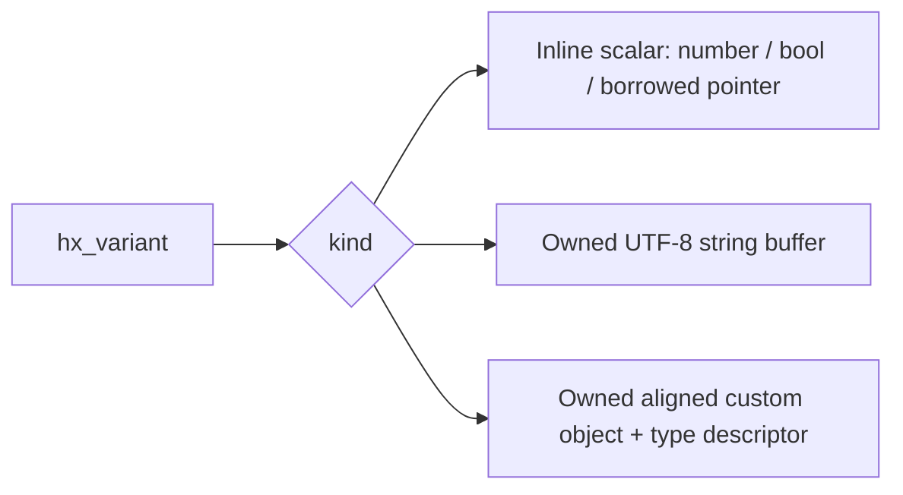

# Variant values: one variable, different types

[简体中文](VARIANT.zh-CN.md) · [Home](../README.md) · [Task tutorial](USAGE.md#variant)

When a C99 or C++11 program needs a single variable that can hold different types at different points in its lifetime—such as an integer now, a UTF-8 string later, and a custom struct after that—or when a `vector`, `queue`, or `map` needs to store heterogeneous elements side by side, use `<hx_variant.h>` (or `<hx/Variant.hpp>` in C++11). Assigning a new value automatically releases the resources owned by the previous value, and reading a value checks the active type tag before touching memory, preventing the type confusion and leaks common with raw `union` or `void *` casts.

You can build and run the [complete C/C++ tutorial](USAGE.md#variant) or enable `-DHX_OS_BUILD_EXAMPLES=ON` and build the `hx_os_variant` (C99) and `hx_os_cpp_variant` (C++11) targets. Both programs store integer `42`, replace it with `"hello"`, and then replace it with `Point(2, 5)`, producing:

```text
Integer: 42
String: hello
Point: 2.0, 5.0
```

- [1. What it does](#purpose)
- [2. Store numbers, strings and a structure in C](#c-start)
- [3. Copy, move and read values](#ownership)
- [4. Structures that own resources](#custom)
- [5. Direct C++11 calls and visitors](#cpp)
- [6. Use vector, queue and map](#containers)
- [7. Memory, allocators and module selection](#allocation)
- [8. Errors, threads and plugin lifetimes](#contracts)
- [9. Differences from C++ variant](#comparison)
- [10. Usage examples and platform limits](#verification)

<a id="purpose"></a>

## 1. What it does

`hx_variant` is a runtime-tagged value container. A single `hx_variant` instance holds at most one active value at a time: store `42`, replace it with `"hello"`, or store your own `point` struct, and the previous value is cleaned up automatically. While a sequence or map container manages multiple element slots, placing an `hx_variant` in each slot allows every element in the container to carry its own type.

Include `<hx_variant.h>` (or the C umbrella header `<hx_os.h>`) in C99, or `<hx/Variant.hpp>` in C++11. The module requires no global initialization, no configuration or settings tree, no third-party dependencies, and no C++ runtime when used from C.

| Value kind | C setter / getter (prefix `hx_variant_`) | Storage and ownership semantics |
| --- | --- | --- |
| Empty | `hx_variant_clear` / `hx_variant_kind` | Starts empty after `HX_VARIANT_INIT`; `clear` releases any active value and resets to empty |
| Boolean | `set_bool` / `get_bool` | Uses `int` in C; any non-zero input is normalized to `1` on write |
| Signed integers | `set_i32`, `set_i64` / `get_i32`, `get_i64` | Stores exact `int32_t` or `int64_t` values without implicit width conversion |
| Unsigned integers | `set_u32`, `set_u64` / `get_u32`, `get_u64` | Stores exact `uint32_t` or `uint64_t` values without signed/unsigned coercion |
| Floating point | `set_float`, `set_double` / `get_float`, `get_double` | Preserves native IEEE floating-point values, including `NaN` and infinities |
| UTF-8 string | `set_cstr`, `set_string` / `get_string_view`, `get_string` | Deep-copies and owns valid UTF-8 bytes (explicit lengths allow embedded `NUL`) |
| Raw pointer | `set_pointer` / `get_pointer` | Stores a borrowed `void *` without ever freeing the pointee |
| Custom structure | `set_custom`, `emplace_custom` / `get_custom`, `get_custom_mut` | Checks descriptor identity, allocates aligned storage, and runs custom `copy`/`drop` callbacks |

> [!NOTE]
> All abbreviated names in the table above carry the `hx_variant_` prefix—for example, `set_i32` is `hx_variant_set_i32`.



Only the representation selected by `hx_variant_kind(&value)` is active at any given moment; storing a structure replaces and releases any previously stored string or scalar.

<a id="c-start"></a>

## 2. Store numbers, strings and a structure in C

The complete C99 program below stores and prints an `int32_t`, replaces it with a UTF-8 string, and then replaces it with a `point` coordinate struct. Save it as `main.c` using the [tutorial's C99 CMake configuration](USAGE.md#c-project), or run the built `hx_os_variant` example target directly:

```c
#include <hx_variant.h>
#include <stdio.h>

typedef struct point {
	double x;
	double y;
} point;
HX_VARIANT_DEFINE_TRIVIAL_TYPE(point_type, point);

int main(void)
{
	hx_variant value = HX_VARIANT_INIT;
	point position = {2, 5};
	const void *object = NULL;
	hx_string_view text;
	int32_t count;
	hx_os_status status;

	if (!(hx_os_capabilities() & HX_OS_CAP_VARIANT)) {
		puts("Variant support is disabled");

		return 0;
	}

	status = hx_variant_set_i32(&value, 42, NULL);
	if (status != HX_OS_OK)
		goto failed;

	status = hx_variant_get_i32(&value, &count, NULL);
	if (status != HX_OS_OK)
		goto failed;

	printf("Integer: %d\n", (int)count);

	status = hx_variant_set_cstr(&value, "hello", NULL);
	if (status != HX_OS_OK)
		goto failed;

	status = hx_variant_get_string_view(&value, &text, NULL);
	if (status != HX_OS_OK)
		goto failed;

	printf("String: %.*s\n", (int)text.size, text.data);

	status = hx_variant_set_custom(&value, &point_type, &position, NULL);
	if (status != HX_OS_OK)
		goto failed;

	status = hx_variant_get_custom(&value, &point_type, &object, NULL);
	if (status != HX_OS_OK)
		goto failed;

	printf("Point: %.1f, %.1f\n", ((const point *)object)->x,
		((const point *)object)->y);

	hx_variant_destroy(&value);

	return 0;

failed:
	fprintf(stderr, "Variant failed: %s\n", hx_os_status_name(status));
	hx_variant_destroy(&value);

	return 1;
}
```

Expected output:

```text
Integer: 42
String: hello
Point: 2.0, 5.0
```

How the lifecycle works:
1. **Initialization**: `HX_VARIANT_INIT` initializes an empty variant bound to the default allocator (or call `hx_variant_init(&value, context)` to bind a custom allocator). Initialize each object only once.
2. **String copy and borrowed view**: `hx_variant_set_cstr` allocates and copies `"hello"`, replacing the integer `42`. `hx_variant_get_string_view` lends a non-owning view (`text`) into that internal buffer—never free `text.data` or use `text` after `value` is overwritten, cleared, or destroyed.
3. **Trivial struct descriptor**: Because `point` contains only plain `double` fields and owns no external handles or heap pointers, `HX_VARIANT_DEFINE_TRIVIAL_TYPE(point_type, point)` is all that is needed to declare its size and alignment for bytewise copying.
4. **Custom value storage and lookup**: `hx_variant_set_custom` copies `position` into aligned storage owned by `value`, so later changes to the local `position` variable do not affect the stored copy. `hx_variant_get_custom` verifies that the active descriptor matches `&point_type` before setting `object` to a borrowed `const void *` pointer.
5. **Cleanup**: `hx_variant_destroy(&value)` releases the active payload on both the normal exit path and the `failed` branch.

> [!WARNING]
> **Never duplicate an owning `hx_variant` with plain struct assignment (`b = a;`)**: A raw C struct copy aliases the internal string or custom-object pointer, causing a double-free when both variables are destroyed. Always use `hx_variant_copy` or `hx_variant_move` (Section 3).

<a id="ownership"></a>

## 3. Copy, move and read values

| Operation | Behavior on success | Behavior on failure |
| --- | --- | --- |
| `hx_variant_copy(out, source, error)` | Deep-copies `source` using `out`'s allocator context; `source` is unchanged | Previous value of `out` is preserved |
| `hx_variant_move(out, source)` | Releases `out`'s old value, transfers value and context from `source`, and resets `source` to default empty | Cannot fail between valid initialized objects; zero allocation |
| `hx_variant_swap(a, b)` | Exchanges both the active values and allocator contexts | Cannot fail; zero allocation |
| `hx_variant_clear(value)` | Releases the active value while retaining `value`'s allocator context lease | Cannot fail |
| `hx_variant_destroy(value)` | Releases the active value and context lease, resetting `value` to default empty | Cannot fail; safe to call repeatedly on the same object |
| Scalar getters (`get_i32`, etc.) | Copies the numeric value into the caller's output variable | Output variable is unchanged |
| `hx_variant_get_string_view` | Outputs a borrowed `hx_string_view` pointing to the internal buffer | Output variable is unchanged |
| `hx_variant_get_string` | Deep-copies the string into the caller's initialized `hx_string` | Target `hx_string` is unchanged |
| `get_custom` / `get_custom_mut` | Outputs a borrowed `const void *` or `void *` to the stored custom object | Output pointer is unchanged |

Important ownership and type-checking rules:
- **Zero-copy string transfer**: While `hx_variant_set_string` and `hx_variant_set_cstr` copy input bytes, `hx_variant_take_string(&value, &str, error)` transfers ownership of an existing `hx_string` directly into `value` without allocating, leaving `str` empty. When `value` is later cleared or destroyed, that buffer is returned to the allocator that originally created `str`.
- **Exact type matching**: Reading an `int32_t` variant through `hx_variant_get_i64` returns `HX_OS_TYPE_MISMATCH` (C++ `get<T>()` enforces the same rule). There is no silent integer widening or string-to-number coercion. Never read an output variable or call `result.value()` after a failed getter.
- **Strict UTF-8 and borrow lifetimes**: String setters validate UTF-8 and reject malformed byte sequences with `HX_OS_INVALID_ENCODING` (`hx_string_view` setters preserve embedded `NUL` bytes within the explicit length, whereas `set_cstr` stops at the first `NUL`). Borrowed string views expire when the variant is overwritten, cleared, or destroyed. Because custom structures are stored in their own heap allocation, moving an `hx_variant` or growing a container of `hx_variant` elements does not relocate the custom structure itself—though any pointer to the `hx_variant` element inside a resized `vector` or `deque` must be re-fetched.

<a id="custom"></a>

## 4. Structures that own resources

When a custom struct owns an `hx_string`, heap memory, or an OS handle, a shallow byte copy would cause two instances to free the same resource. For these types, populate an `hx_variant_type` descriptor with `copy` and `drop` callbacks: `hx_variant_set_custom` and `hx_variant_copy` invoke `copy`, while replacement, `clear`, and `destroy` invoke `drop`.

The complete C99 program below defines `record_copy` and `record_drop` for a `user_record` containing an `hx_string`. It stores `"Alice", 18`, mutates the original `input.name` variable to `"Bob"`, and verifies that the stored variant still holds `"Alice"`:

```c
#include <hx_variant.h>
#include <stdio.h>

typedef struct user_record {
	hx_string name;
	int32_t age;
} user_record;

static hx_os_status HX_OS_CALL record_copy(void *destination,
	const void *source, hx_os_context *context, void *user,
	hx_os_error *error)
{
	user_record *out = destination;
	const user_record *input = source;
	hx_os_status status;

	(void)user;
	hx_string_init(&out->name, context);

	status = hx_string_copy(&out->name, &input->name, error);
	if (status != HX_OS_OK) {
		hx_string_destroy(&out->name);

		return status;
	}

	out->age = input->age;

	return HX_OS_OK;
}

static void HX_OS_CALL record_drop(void *object, void *user)
{
	(void)user;

	hx_string_destroy(&((user_record *)object)->name);
}

static const hx_variant_type record_type = {
	sizeof(user_record), 0, record_copy, record_drop, NULL, 0};

int main(void)
{
	user_record input = {HX_STRING_INIT, 18};
	hx_variant value = HX_VARIANT_INIT;
	const void *object = NULL;

	hx_os_status status = hx_string_assign_cstr(&input.name, "Alice", NULL);
	if (status == HX_OS_OK)
		status = hx_variant_set_custom(
			&value, &record_type, &input, NULL);

	if (status == HX_OS_OK)
		status = hx_string_assign_cstr(&input.name, "Bob", NULL);

	if (status == HX_OS_OK)
		status = hx_variant_get_custom(
			&value, &record_type, &object, NULL);

	if (status == HX_OS_OK) {
		const user_record *saved = object;

		printf("Record: %s, %d\n", hx_string_c_str(&saved->name),
			(int)saved->age);
	}
	else
		fprintf(stderr, "%s\n", hx_os_status_name(status));

	hx_variant_destroy(&value);
	hx_string_destroy(&input.name);

	return status == HX_OS_OK ? 0 : 1;
}
```

Expected output: `Record: Alice, 18`.

Contract details for custom type descriptors:
1. **`copy` callback and failure cleanup**: `record_copy` receives aligned, uninitialized storage in `destination`. It initializes and copies nested fields using the supplied destination `context`. If a nested allocation fails, `record_copy` must clean up any fields it already initialized before returning the error status. The library frees the raw outer `destination` block without calling `drop` on failed constructions, leaving the destination `hx_variant`'s previous value intact.
2. **`drop` callback scope**: `record_drop` releases only the nested resources inside the struct (here, `hx_string_destroy(&record->name)`). The library frees the outer struct allocation itself, so `record_drop` must never call `free(object)`. Every successfully constructed object is dropped exactly once.
3. **Descriptor address as type identity**: Type identity is determined by the pointer address of `const hx_variant_type *`—two distinct descriptor variables with identical field values are treated as different types (`HX_OS_TYPE_MISMATCH`). To share a type across translation units, declare `extern const hx_variant_type point_type;` in a common header and define it in a single `.c` file. The descriptor, callback code, and borrowed `user` pointer must remain valid until all variants using that descriptor are destroyed.
4. **In-place construction and move-only types**: Use `hx_variant_emplace_custom(value, type, construct, user, error)` to construct an object directly in aligned variant storage; the previous value of `value` is replaced only after `construct` returns `HX_OS_OK`. Setting `copy = NULL` with `drop != NULL`, or setting the `HX_VARIANT_TYPE_NO_COPY` flag, marks the type as move/construct-only: `emplace_custom` and `hx_variant_move` succeed, whereas `set_custom` and `hx_variant_copy` return `HX_OS_NOT_SUPPORTED` (`HX_VARIANT_TYPE_NO_COPY` cannot be combined with a non-`NULL` `copy` callback). Descriptor `size` must be non-zero and `alignment` must be `0` or a power of two (otherwise `HX_OS_INVALID` is returned; size-calculation overflow returns `HX_OS_RANGE`).

<a id="cpp"></a>

## 5. Direct C++11 calls and visitors

In C++11, `<hx/Variant.hpp>` provides two exception-free wrapper classes over `hx_variant`:
- `hx::Variant`: An open variant that can hold any supported scalar, string, or custom C++ type chosen at runtime.
- `hx::TypedVariant<Ts...>`: A compile-time constrained variant that restricts writes and visits to the listed types `Ts...`, rejecting unlisted types at compile time. Neither class requires C++17 or `<variant>`.

Save the complete program below as `main.cpp` and build it with the [C++ CMake configuration with exceptions disabled](USAGE.md#cpp-project), or run the `hx_os_cpp_variant` target:

```cpp
#include <hx/Variant.hpp>
#include <cstdio>

struct Point {
	double x;
	double y;
};

int main()
{
	if (!(hx_os_capabilities() & HX_OS_CAP_VARIANT)) {
		std::puts("Variant support is disabled");

		return 0;
	}

	hx::TypedVariant<int32_t, double, hx::StringView, Point> value;

	if (!value.set(int32_t(42)))
		return 1;

	auto count = value.get<int32_t>();

	if (!count)
		return 1;

	std::printf("Integer: %d\n", static_cast<int>(count.value()));

	if (!value.set("hello"))
		return 1;

	auto text = value.get<hx::StringView>();

	if (!text)
		return 1;

	std::printf("String: %.*s\n", static_cast<int>(text.value().size()),
		text.value().data());

	if (!value.set(Point{2, 5}))
		return 1;

	auto position = value.get<Point>();

	if (!position)
		return 1;

	std::printf(
		"Point: %.1f, %.1f\n", position.value().x, position.value().y);
}
```

The output matches Section 2. Calling `value.set(Point{2, 5})` automatically synthesizes the type descriptor for `Point`, and `value.get<Point>()` returns a checked reference wrapper.

> [!TIP]
> **Why is `hx::StringView` used in the `TypedVariant` parameter list?**
> In `hx::TypedVariant<..., hx::StringView, ...>`, `hx::StringView` serves as the canonical type tag for the string alternative: `value.set("hello")` still **deep-copies and owns** the UTF-8 string bytes inside the variant, while `value.get<hx::StringView>()` returns a borrowed view without allocating a second copy.

| C++11 operation | Usage |
| --- | --- |
| Store integer | `value.set(int32_t(42))` |
| Store floating point | `value.set(3.5)` |
| Store UTF-8 string | `value.set("hello")` |
| Transfer an existing `hx::String` | `value.takeString(std::move(text))` (on open `hx::Variant`) |
| Store copyable struct | `value.set(Point{2, 5})` |
| Construct custom type in place | `value.emplace<MyType>(arguments...)` |
| Check active type | `value.holds<Point>()` |
| Read value | `auto result = value.get<Point>();` (check `if (result)` before `result.value()`) |
| Explicit deep copy | `auto copied = value.clone(context);` (`context` defaults to `NULL`) |
| Move | `hx::Variant moved(std::move(value));` |
| Clear / destroy | `value.clear()` (destructor also releases automatically) |

Key rules for C++ custom types and visitors:
- **Return types of `get<T>()`**: Scalar types (`bool`, `int32_t`/`uint32_t`, `int64_t`/`uint64_t`, `float`, `double`, `void *`) return a value copy; `hx::StringView` returns a borrowed view; custom structs return a reference (`const` reference on a `const` variant). Borrowing a view or reference from a temporary rvalue variant is rejected at compile time.
- **`noexcept` and fallible copies**: Custom C++ types passed to `set<T>` or `emplace<T>` must have `noexcept` copy/in-place constructors and destructors. For move-only or non-copyable resource types, construct them in place with `emplace<T>`; calling `clone()` on a variant holding a non-copyable object returns `HX_OS_NOT_SUPPORTED`. If a type performs fallible heap allocations during copying or needs to allocate from the destination `hx_os_context`, register a C `hx_variant_type` descriptor (Section 4) and use `value.native()` rather than wrapping exception-throwing types like `std::string`.
- **Synchronous `visit`**: A visitor dispatches to the overload matching the active alternative:

```cpp
#include <hx/Variant.hpp>
#include <cstdio>

struct PrintValue {
	void operator()(int32_t value) const noexcept
	{
		std::printf("Integer: %d\n", static_cast<int>(value));
	}

	void operator()(hx::StringView value) const noexcept
	{
		std::printf("String: %.*s\n", static_cast<int>(value.size()),
			value.data());
	}
};

int main()
{
	hx::TypedVariant<int32_t, hx::StringView> value;

	if (!value.set("hello"))
		return 1;

	auto printed = value.visit(PrintValue{});

	return printed ? 0 : 1;
}
```

This prints `String: hello`. Visitor overloads execute synchronously without heap allocation, must be marked `noexcept`, and may return `void`, `hx_os_status`, or `hx::Result<void>`.
- On `hx::TypedVariant`, `value.visit(visitor)` automatically checks all declared alternatives. On an open `hx::Variant`, specify the candidate list explicitly with `value.visit<int32_t, hx::StringView>(visitor)` (1 to 64 unique, unqualified object types, checked in `O(N)` worst-case time).
- If the active value does not match any listed type—or if the variant is currently empty and `hx::EmptyValue` is not in the list—`visit` returns `HX_OS_TYPE_MISMATCH`. Include `hx::EmptyValue` in the type list and add an `operator()(hx::EmptyValue) const noexcept` overload when you want the visitor to handle empty variants explicitly.

<a id="containers"></a>

## 6. Use vector, queue and map

Call `hx_variant_container_options_init(&options, context)` to configure `copy` and `drop` callbacks for [C containers](CONTAINERS.md) (`vector`, `deque`/`queue`, and `map` values). The complete C99 program below pushes an integer `42` and a string `"hello"` into the same `hx_os_vector`, then reads both back and prints `Values: 42, hello`:

```c
#include <hx_variant.h>
#include <hx_container.h>
#include <stdio.h>

int main(void)
{
	hx_os_container_options options;
	hx_os_vector *values = NULL;
	hx_variant value = HX_VARIANT_INIT;
	const hx_variant *saved;
	hx_string_view text;
	int32_t number;
	hx_os_status status;

	hx_variant_container_options_init(&options, NULL);
	options.max_items = 16;

	status = hx_os_vector_create(NULL, &options, &values, NULL);
	if (status == HX_OS_OK)
		status = hx_variant_set_i32(&value, 42, NULL);

	if (status == HX_OS_OK)
		status = hx_os_vector_push_back(values, &value, NULL);

	if (status == HX_OS_OK)
		status = hx_variant_set_cstr(&value, "hello", NULL);

	if (status == HX_OS_OK)
		status = hx_os_vector_push_back(values, &value, NULL);

	if (status == HX_OS_OK) {
		saved = hx_os_sequence_at(values, 0);

		status = hx_variant_get_i32(saved, &number, NULL);
	}

	if (status == HX_OS_OK) {
		saved = hx_os_sequence_at(values, 1);

		status = hx_variant_get_string_view(saved, &text, NULL);
	}

	if (status == HX_OS_OK)
		printf("Values: %d, %.*s\n", (int)number, (int)text.size,
			text.data);

	hx_variant_destroy(&value);
	hx_os_status closed = hx_os_sequence_destroy(&values, NULL);
	if (status == HX_OS_OK)
		status = closed;

	if (status != HX_OS_OK)
		fprintf(stderr, "%s\n", hx_os_status_name(status));

	return status == HX_OS_OK ? 0 : 1;
}
```

Container integration notes:
- `hx_os_vector_push_back` deep-copies `value`, so reusing or destroying the local `value` variable afterward does not affect stored elements. Sorting, heap operations, and ordered maps still require an application-supplied `compare` or `key_compare` callback because heterogeneous types have no single universal ordering.
- **Avoid POD container macros and raw C++ wrapper copies**: Never store owning `hx_variant` instances in `HX_OS_DECLARE_VECTOR` POD macros, and never pass a C++ `hx::Variant` object to a raw byte-copy C container API. When calling C container APIs from C++, store `hx_variant` elements and pass `value.native()` rather than `&value`.
- **Popping and `_take` transfers**: Passing a non-`NULL` destination to `pop` or `erase` transfers ownership into that uninitialized `hx_variant` struct (call `hx_variant_destroy` on it when done); passing `NULL` drops the element immediately. After a successful `_take` insertion (such as `hx_os_sequence_push_back_take`), reset the source struct to `HX_VARIANT_INIT` without calling `hx_variant_destroy` on the transferred payload.

<a id="allocation"></a>

## 7. Memory, allocators and module selection

| Operation path | Allocation and runtime cost |
| --- | --- |
| Default empty initialization / scalar getter / `visit` | Zero heap allocation; no locks, worker threads, or system calls |
| Scalar set or copy (`bool`, integers, floats, raw pointers) | Zero heap allocation (retiring a previous string/custom value may free storage) |
| UTF-8 string set | `O(bytes)` validation and copy; non-empty strings allocate one buffer |
| Custom struct set | One aligned allocation of `type->size` bytes plus the `copy` callback cost |
| `hx_variant_move` / `hx_variant_swap` | Zero heap allocation; `move` releases the destination's previous value |
| Custom struct clone | Allocates independent storage and runs the `copy` callback |

Allocator leases, struct layout, and CMake feature switches:
- **Context lease lifecycle**: Calling `hx_variant_init(&value, context)` with a non-default `context` acquires a lease on that context immediately—even while `value` is empty—so `hx_os_context_destroy` will return `HX_OS_BUSY`. Calling `hx_variant_clear` releases only the value while keeping the context lease; `hx_variant_destroy` releases both the value and the context lease. `hx_variant_copy` allocates from the destination variant's context, whereas `hx_variant_move` and `hx_variant_swap` transfer the context alongside the value.
- **Measured ABI sizes**: On Windows MSVC, 64-bit `hx_variant` and `hx_variant_type` are 48 bytes each (8-byte aligned), and 32-bit `hx_variant` and `hx_variant_type` are 24 bytes each (8-byte aligned). `hx::Variant` adds zero bytes of overhead. Consult the generated layout report when targeting other ABIs.
- **Module trimming (`HX_OS_ENABLE_VARIANT`)**: `HX_OS_ENABLE_VARIANT` defaults to `ON`. When set to `OFF`, public declarations and exports remain present, `HX_OS_CAP_VARIANT` is cleared, active operations return `HX_OS_NOT_SUPPORTED`, and initialization, `hx_variant_kind`, and `hx_variant_destroy` remain safe to call. Because `cmake/minimal.cmake` disables optional modules for small embedded builds, you can re-enable `HX_OS_ENABLE_VARIANT` on its own without enabling `HX_OS_ENABLE_CONFIG`, `HX_OS_ENABLE_SETTINGS`, or `HX_OS_ENABLE_CONTAINERS`:

```sh
cmake -S . -B build-variant -C cmake/minimal.cmake \
  -DHX_OS_ENABLE_VARIANT=ON \
  -DHX_OS_BUILD_EXAMPLES=ON -DBUILD_SHARED_LIBS=ON
cmake --build build-variant --config Release
build-variant/bin/hx_os_variant
```

(On multi-configuration generators such as Visual Studio, the binary is placed in `build-variant/bin/Release/hx_os_variant.exe`.)

> [!NOTE]
> Container integration (`hx_variant_container_options_init`) additionally requires `HX_OS_ENABLE_CONTAINERS=ON`. While a container's `max_items` and `max_bytes` bound the container's own node/array storage, the string buffers and custom struct allocations owned inside each `hx_variant` are outside the container's `max_bytes` counter. Always bound string lengths and custom payload sizes when accepting untrusted input.

<a id="contracts"></a>

## 8. Errors, threads and plugin lifetimes

All errors are reported through the returned `hx_os_status` and an optional caller-supplied `hx_os_error *error`, with no thread-local last-error state or logger dependency. Custom `copy` and `construct` callbacks receive a cleared, non-`NULL` `hx_os_error` pointer; any non-`HX_OS_OK` status returned by a callback is normalized into `error->status` while preserving native domain, code, and cause fields.

| Status code | Meaning and state guarantee |
| --- | --- |
| `HX_OS_OK` | Set, copy, in-place construction, or read completed |
| `HX_OS_TYPE_MISMATCH` | Active kind or custom descriptor address does not match the requested type |
| `HX_OS_INVALID_ENCODING` | Input string is not valid UTF-8 |
| `HX_OS_INVALID` | Required pointer argument is `NULL`, or custom descriptor fields (`size`/`alignment`/`flags`) are invalid |
| `HX_OS_RANGE` | Integer overflow when computing custom object allocation size or alignment |
| `HX_OS_NO_MEMORY` | Heap allocation for a string or custom object failed (previous variant value is preserved) |
| `HX_OS_NOT_SUPPORTED` | `HX_OS_ENABLE_VARIANT` is disabled, or copy was requested on a `HX_VARIANT_TYPE_NO_COPY` type |
| User callback status | Propagated verbatim with native error details; failed writes/replacements preserve the old value |

**Concurrency and plugin/DLL lifetime rules:**
- **Thread safety**: Individual `hx_variant` objects have no internal locks. Concurrent reads are safe while the variant and its nested resources remain immutable; synchronize any mutation, move, or destruction externally against all other readers and writers.
- **Plugin unloading**: Descriptors have a fixed layout, are immutable once published, and borrow their `user` pointer. Before unloading a plugin or shared library that defines a custom `hx_variant_type` or its callbacks, destroy or clear every `hx_variant` holding that type and ensure no `copy`, `drop`, or `visit` calls remain in flight.
- **Type identity across DLL boundaries**: Automatic C++ descriptors (`hx::Variant` / `hx::TypedVariant`) share a single function-local static descriptor across translation units linked into the same module. Across separately linked DLLs or plugins, do not rely on identically named C++ structs to merge static addresses—define and export a shared C `hx_variant_type` descriptor from a common library instead.

<a id="comparison"></a>

## 9. Differences from C++ variant

| Aspect | `hx_variant` / `hx::Variant` / `hx::TypedVariant` | C++17 `std::variant` |
| --- | --- | --- |
| Language baseline | C99 core implementation + C++11 exception-free facade | Requires C++17 |
| Set of alternatives | Runtime descriptors in `hx_variant` / `hx::Variant`; compile-time list in `hx::TypedVariant<Ts...>` | Compile-time template parameter list only |
| Initial state | Always starts empty (`HX_VARIANT_EMPTY`) without constructing a default alternative | Default-constructs the first template alternative (unless `std::monostate` is used) |
| Storage model | Inline scalars, owned heap UTF-8 strings, separately allocated aligned custom structs | Inline union storage sized to the largest alternative |
| Failure handling | Explicit `hx_os_status` / `hx::Result<T>`; failed replacement preserves the old value; never `valueless_by_exception` | Reports construction/assignment failures via C++ exceptions |
| Copying and move-only types | `hx_variant_copy` in C and fallible `clone()` in C++; supports construct/move-only custom types | Copy constructor is deleted if any alternative is non-copyable |
| Visitor dispatch | Synchronous single-variant visit returning `void`, `hx_os_status`, or `hx::Result<void>`; `O(N)` type check | Multi-variant `std::visit` (see the [variant definition](https://eel.is/c++draft/variant.general) and [visit contract](https://eel.is/c++draft/variant.visit)) |
| Serialization | In-memory value container only; no automatic JSON/config conversion or pointer serialization | No built-in serialization in the standard library either |

<a id="verification"></a>

## 10. Usage examples and platform limits

Configure with `-DHX_OS_BUILD_EXAMPLES=ON` to build and run the public example and benchmark targets:
- `hx_os_variant`: Complete C99 walkthrough covering scalars, strings, trivial structs, resource-owning structs, and container integration.
- `hx_os_cpp_variant`: Complete C++11 walkthrough covering `hx::Variant`, `hx::TypedVariant`, and `visit`.
- `hx_os_portable_baseline`: Includes timing observations for integer and struct `set`/`get` operations; see the [Android baseline](ANDROID.md) and [build reference](REFERENCE.md#section-30) for benchmark commands.

See [platform support](PLATFORMS.md) for compiler baselines, target OS requirements, and deployment details.
