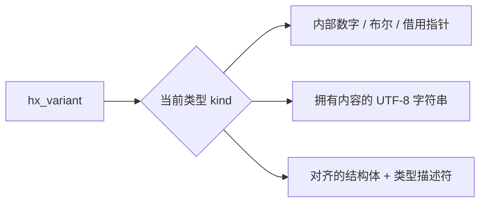

# variant：同一个变量保存不同类型

[English](VARIANT.md) · [首页](../README.zh-CN.md) · [常用任务教程](USAGE.zh-CN.md#variant)

- [1. 它解决什么问题](#purpose)
- [2. 用 C 保存整数、字符串和结构体](#c-start)
- [3. 复制、移动和取值](#ownership)
- [4. 结构体内部还持有资源时](#custom)
- [5. C++11 的直接调用与访问器](#cpp)
- [6. 放进 vector、queue 和 map](#containers)
- [7. 内存、分配器和模块裁剪](#allocation)
- [8. 错误、线程和插件生命周期](#contracts)
- [9. 与 C++ variant 的具体差异](#comparison)
- [10. 使用示例与平台限制](#verification)

<a id="purpose"></a>

## 1. 它解决什么问题

`hx_variant` 是一个“带类型标记的值”：今天可以存 `42`，下一次可以存 `"hello"`，也可以存你定义的 `point`。一个对象每次只保存一个值；重新设置时会自动释放旧值。vector/queue 保存多个元素，variant 负责让其中每个元素可以有不同类型。

包含 `<hx_variant.h>`；已有 `<hx_os.h>` 也包含它。C++11 便利层使用 `<hx/Variant.hpp>`。不需要全局初始化，不依赖配置树或设置模块，没有新增第三方依赖。

| 类型 | C 的设置 / 获取入口 | 行为 |
| --- | --- | --- |
| 空值 | `hx_variant_clear` / `hx_variant_kind` | 初始化后为空，清空时释放当前值 |
| 布尔值 | `set_bool` / `get_bool` | C 使用 int；设置时将非零规范成 1 |
| 有符号整数 | `set_i32/i64` / `get_i32/i64` | int32_t / int64_t，不隐式转换 |
| 无符号整数 | `set_u32/u64` / `get_u32/u64` | uint32_t / uint64_t，不隐式转换 |
| 浮点数 | `set_float/double` / `get_float/double` | 保留本机数值，包括 NaN 和无穷大 |
| 字符串 | `set_cstr/string` / `get_string_view/string` | 复制 UTF-8 字节，允许显式长度中的 NUL |
| 原始指针 | `set_pointer` / `get_pointer` | 借用，不释放指向的对象 |
| 自定义结构体 | `set_custom/emplace_custom` / `get_custom` | 类型检查、对齐存储和自定义复制/清理 |

表中缩写入口的完整前缀都是 `hx_variant_`。例如 `set_i32` 就是 `hx_variant_set_i32`。



图中表示可选的存储形式，实际只有 `kind` 指定的一种处于活动状态。保存结构体不会同时留下之前的整数或字符串。

<a id="c-start"></a>

## 2. 用 C 保存整数、字符串和结构体

任务：先保存并显示整数，再改成字符串，最后改成坐标结构体。保存为 `main.c`，使用[教程中的 C99 CMake 配置](USAGE.zh-CN.md#c-project)，无需输入文件。也可直接运行项目构建出的 `hx_os_variant` 示例。

```c
#include <hx_variant.h>
#include <stdio.h>

typedef struct point {
	double x;
	double y;
} point;
HX_VARIANT_DEFINE_TRIVIAL_TYPE(point_type, point);

int main(void)
{
	hx_variant value = HX_VARIANT_INIT;
	point position = {2, 5};
	const void *object = NULL;
	hx_string_view text;
	int32_t count;
	hx_os_status status;

	if (!(hx_os_capabilities() & HX_OS_CAP_VARIANT)) {
		puts("Variant support is disabled");

		return 0;
	}

	status = hx_variant_set_i32(&value, 42, NULL);
	if (status != HX_OS_OK)
		goto failed;

	status = hx_variant_get_i32(&value, &count, NULL);
	if (status != HX_OS_OK)
		goto failed;

	printf("Integer: %d\n", (int)count);

	status = hx_variant_set_cstr(&value, "hello", NULL);
	if (status != HX_OS_OK)
		goto failed;

	status = hx_variant_get_string_view(&value, &text, NULL);
	if (status != HX_OS_OK)
		goto failed;

	printf("String: %.*s\n", (int)text.size, text.data);

	status = hx_variant_set_custom(&value, &point_type, &position, NULL);
	if (status != HX_OS_OK)
		goto failed;

	status = hx_variant_get_custom(&value, &point_type, &object, NULL);
	if (status != HX_OS_OK)
		goto failed;

	printf("Point: %.1f, %.1f\n", ((const point *)object)->x,
		((const point *)object)->y);

	hx_variant_destroy(&value);

	return 0;

failed:
	fprintf(stderr, "Variant failed: %s\n", hx_os_status_name(status));
	hx_variant_destroy(&value);

	return 1;
}
```

正常输出：

```text
Integer: 42
String: hello
Point: 2.0, 5.0
```

1. `HX_VARIANT_INIT` 建立空值，使用默认分配器。每个对象只初始化一次。
2. `set_i32` 保存 32 位整数；`get_i32` 检查当前类型，再把值写入 `count`。
3. `set_cstr` 复制字符串并替换整数。`get_string_view` 借出当前文本；不需要释放 `text`，它不能超过所属 variant 的有效使用期。
4. `HX_VARIANT_DEFINE_TRIVIAL_TYPE(point_type, point)` 告诉库结构体的尺寸和对齐。普通坐标没有需要单独释放的成员，可以按字节复制。
5. `set_custom` 复制 `position`，之后修改原来的坐标不会影响已保存的值。`get_custom` 检查同一个 `point_type` 后给出借用指针；`const void *` 转成 `const point *` 读取成员。
6. 最后 `destroy` 释放当前值。示例的 `failed` 分支也会清理对象。

不能用普通结构体赋值复制拥有资源的 variant。需要复制整个值时，使用下一节的 `copy`。

<a id="ownership"></a>

## 3. 复制、移动和取值

| 操作 | 成功时 | 失败时 |
| --- | --- | --- |
| `hx_variant_copy(out, source, error)` | 深复制到 out 的 context；源不变 | out 的旧值保留 |
| `hx_variant_move(out, source)` | 释放 out 旧值，接管源的值/context；源恢复默认空值 | 有效已初始化对象之间不失败，不分配 |
| `hx_variant_swap(a, b)` | 值和 context 一起交换 | 不失败，不分配 |
| `hx_variant_clear(value)` | 释放值，保留 context | 不失败 |
| `hx_variant_destroy(value)` | 释放值和 context 持有，恢复默认空值 | 不失败；可重复调用 |
| `get_i32` 等数字接口 | 输出数字副本 | 输出参数保持原值 |
| `get_string_view` | 输出借用文本视图 | 输出参数保持原值 |
| `get_string` | 复制到调用方 hx_string 的 context | 输出字符串保持原值 |
| `get_custom/get_custom_mut` | 返回对应结构体的借用指针 | 输出指针保持原值 |

复制函数不会把字符串当成指针复制。`set_string` 和 `set_cstr` 在内部保留文本，因此输入只需在调用期间有效。`hx_variant_take_string` 可以接管现成的 hx_string，成功后原字符串变为空，不新增分配；所接管的缓冲区继续由其原分配器负责释放。

取值采用精确类型检查：保存 i32 后调用 get_i64 会返回 `HX_OS_TYPE_MISMATCH`，不会偷偷扩大整数或从文本解析数字。C++ 的 `get<T>()` 同样如此。不要检查失败后仍然使用输出参数或 `result.value()`。

文本使用严格 UTF-8。无效字节返回 `HX_OS_INVALID_ENCODING`；用 hx_string_view 的长度表示含 NUL 的字符串，set_cstr 则读到首个 NUL。UTF-8 不等于终端显示编码，也不会在此模块中自动转换其他编码。

字符串视图在替换、清空、销毁后失效。结构体指针在该结构体被释放后失效；variant 移动或容器扩容不会移动其单独的对象存储，但所属容器中的 variant 指针可能失效，需要重新获取。两个不同对象不能形成相互拥有的循环；不得将外层 owner 移入它自己拥有的子对象。复制/构造/清理回调不能修改参与操作的对象。

<a id="custom"></a>

## 4. 结构体内部还持有资源时

如果结构体内有 hx_string、堆内存或文件句柄，普通字节复制可能造成两个对象重复释放同一资源。此时提供 `copy` 和 `drop`，库在保存/复制时调用 copy，在替换/清空/销毁时调用 drop。只读借用指针也可以做普通字节复制，但不能因此认为库接管了指向资源的所有权。

下面是完整 C 程序：保存一份 `Alice, 18`，把原输入改成 Bob，读取已保存记录仍然得到 Alice。

```c
#include <hx_variant.h>
#include <stdio.h>

typedef struct user_record {
	hx_string name;
	int32_t age;
} user_record;

static hx_os_status HX_OS_CALL record_copy(void *destination,
	const void *source, hx_os_context *context, void *user,
	hx_os_error *error)
{
	user_record *out = destination;
	const user_record *input = source;
	hx_os_status status;

	(void)user;
	hx_string_init(&out->name, context);

	status = hx_string_copy(&out->name, &input->name, error);
	if (status != HX_OS_OK) {
		hx_string_destroy(&out->name);

		return status;
	}

	out->age = input->age;

	return HX_OS_OK;
}

static void HX_OS_CALL record_drop(void *object, void *user)
{
	(void)user;

	hx_string_destroy(&((user_record *)object)->name);
}

static const hx_variant_type record_type = {
	sizeof(user_record), 0, record_copy, record_drop, NULL, 0};

int main(void)
{
	user_record input = {HX_STRING_INIT, 18};
	hx_variant value = HX_VARIANT_INIT;
	const void *object = NULL;

	hx_os_status status = hx_string_assign_cstr(&input.name, "Alice", NULL);
	if (status == HX_OS_OK)
		status = hx_variant_set_custom(
			&value, &record_type, &input, NULL);

	if (status == HX_OS_OK)
		status = hx_string_assign_cstr(&input.name, "Bob", NULL);

	if (status == HX_OS_OK)
		status = hx_variant_get_custom(
			&value, &record_type, &object, NULL);

	if (status == HX_OS_OK) {
		const user_record *saved = object;

		printf("Record: %s, %d\n", hx_string_c_str(&saved->name),
			(int)saved->age);
	}
	else
		fprintf(stderr, "%s\n", hx_os_status_name(status));

	hx_variant_destroy(&value);
	hx_string_destroy(&input.name);

	return status == HX_OS_OK ? 0 : 1;
}
```

正常输出：`Record: Alice, 18`。

`record_copy` 收到已对齐但尚未初始化的存储，在目标 context 中初始化、复制 name，再复制 age。name 分配失败时，回调先清理自己的部分初始化，再返回失败。库只释放这一份原始存储，不会对构造失败的对象调用 drop。这样既保留旧 variant，也避免清理未初始化成员。

`record_drop` 释放结构体内部的 name；结构体外层存储由库释放，回调不能再次 free 它。drop 必须正常返回。每次成功构造的对象只清理一次；描述符无需注册到全局表。

描述符的地址就是类型身份，尺寸和内容相同的两个描述符仍然是不同类型。多个 C 文件共享类型时，在头文件声明 `extern const hx_variant_type point_type;`，在一个 .c 文件中使用宏定义一次。描述符、回调代码和借用的 user 数据要活到所有相应的值释放之后。

需要失败可恢复的原地构造时，用 `hx_variant_emplace_custom(value, type, construct, user, error)`。构造成功后才替换旧值。`copy=NULL, drop!=NULL` 或 `HX_VARIANT_TYPE_NO_COPY` 表示只允许构造/移动，不允许复制；set_custom 和 copy 返回不支持。copy 和 drop 都为 NULL 时默认按字节复制，所以非平凡类型必须声明自己的操作。NO_COPY 不能同时配置 copy。size 必须非零，alignment 为零或 2 的幂；非法描述符返回 INVALID，尺寸计算溢出返回 RANGE。

<a id="cpp"></a>

## 5. C++11 的直接调用与访问器

`hx::Variant` 可以保存本次传入的类型；`hx::TypedVariant<Ts...>` 先列出允许类型，写入未声明类型会在编译时失败。使用标准 C++11，不需要 C++17 或 `<variant>`。C++ 包装复用相同的 C 实现，无异常，不隐式复制拥有资源的对象。

下面是完整程序，保存为 `main.cpp`，使用[关闭异常的 C++ CMake 配置](USAGE.zh-CN.md#cpp-project)，也可运行 `hx_os_cpp_variant`：

```cpp
#include <hx/Variant.hpp>
#include <cstdio>

struct Point {
	double x;
	double y;
};

int main()
{
	if (!(hx_os_capabilities() & HX_OS_CAP_VARIANT)) {
		std::puts("Variant support is disabled");

		return 0;
	}

	hx::TypedVariant<int32_t, double, hx::StringView, Point> value;

	if (!value.set(int32_t(42)))
		return 1;

	auto count = value.get<int32_t>();

	if (!count)
		return 1;

	std::printf("Integer: %d\n", static_cast<int>(count.value()));

	if (!value.set("hello"))
		return 1;

	auto text = value.get<hx::StringView>();

	if (!text)
		return 1;

	std::printf("String: %.*s\n", static_cast<int>(text.value().size()),
		text.value().data());

	if (!value.set(Point{2, 5}))
		return 1;

	auto position = value.get<Point>();

	if (!position)
		return 1;

	std::printf(
		"Point: %.1f, %.1f\n", position.value().x, position.value().y);
}
```

输出与第 2 节的 C 程序相同。`set(Point{2, 5})` 为普通结构体自动提供类型描述，不需要手工填写 C 描述符；`get<Point>()` 返回受类型检查的结构体引用。`StringView` 在允许类型列表中表示字符串这一种类型，保存时复制字节，读取时借用视图。它的名字不表示 variant 仅保存外部指针。

| C++ 操作 | 用法 |
| --- | --- |
| 保存整数 | `value.set(int32_t(42))` |
| 保存浮点 | `value.set(3.5)` |
| 保存字符串 | `value.set("hello")` |
| 接管已有 String | 开放 Variant 的 `value.takeString(std::move(text))` |
| 保存普通结构体 | `value.set(Point{2, 5})` |
| 原地构造自定义类型 | `value.emplace<MyType>(arguments...)` |
| 先检查类型 | `value.holds<Point>()` |
| 取值 | `auto result = value.get<Point>();`，成功后访问 value() |
| 显式复制 | `auto copied = value.clone(context);` |
| 移动 | `hx::Variant moved(std::move(value));` |
| 清空 | `value.clear()`；析构自动释放 |

标量 get 返回副本，StringView 返回视图，自定义结构体返回引用；const owner 只提供 const 结构体引用。不能从临时 variant 取得借用结果。默认标量类型为 bool、int32_t/uint32_t、int64_t/uint64_t、float、double、void*；其他 C++ 类型走自定义对象路径。clone 的默认 context=NULL 使用默认分配器，要复制到自定义分配器时显式传入它。

复制构造/析构必须满足 noexcept；原地构造也必须满足 noexcept。可移动资源使用 emplace；只允许构造、不允许复制的类型，其 clone 返回 NOT_SUPPORTED。内部需要分配且会失败的复杂类型，可通过 C 描述符显式返回错误并使用 native() 操作；不能把 std::string 等依赖异常报告分配失败的复制构造包装成“不会失败”。C++ 自动复制构造不会把 context 注入任意用户类，其内部资源遵循该类自己的策略；需要目标 context 感知复制时使用 C copy 回调。

访问器根据当前类型选择一个对应的重载。完整 C++11 程序：

```cpp
#include <hx/Variant.hpp>
#include <cstdio>

struct PrintValue {
	void operator()(int32_t value) const noexcept
	{
		std::printf("Integer: %d\n", static_cast<int>(value));
	}

	void operator()(hx::StringView value) const noexcept
	{
		std::printf("String: %.*s\n", static_cast<int>(value.size()),
			value.data());
	}
};

int main()
{
	hx::TypedVariant<int32_t, hx::StringView> value;

	if (!value.set("hello"))
		return 1;

	auto printed = value.visit(PrintValue{});

	return printed ? 0 : 1;
}
```

输出：`String: hello`。访问器同步执行，可以返回 void、hx_os_status 或 Result<void>，不保存回调也不分配存储。函数对象各个重载必须为 noexcept；C++11 函数指针由调用方保证不通过异常退出。

TypedVariant 的 visit 覆盖声明的类型。开放 Variant 使用 `value.visit<int32_t, hx::StringView>(PrintValue{})` 指定访问范围。不匹配返回 TYPE_MISMATCH，不做隐式转换。TypedVariant 初始化和 clear 后仍为空；希望访问器处理空值时，将 `hx::EmptyValue` 加入类型列表并提供对应重载。类型列表限定 1..64 个互不重复、无 cv/ref 修饰的对象类型；访问器按列表检查类型，最坏 O(N)。

<a id="containers"></a>

## 6. 放进 vector、queue 和 map

使用 `hx_variant_container_options_init`，容器就会为每个元素复制/销毁 variant。下面是完整 C 程序；保存整数和字符串两个元素，输出 `Values: 42, hello`：

```c
#include <hx_variant.h>
#include <hx_container.h>
#include <stdio.h>

int main(void)
{
	hx_os_container_options options;
	hx_os_vector *values = NULL;
	hx_variant value = HX_VARIANT_INIT;
	const hx_variant *saved;
	hx_string_view text;
	int32_t number;
	hx_os_status status;

	hx_variant_container_options_init(&options, NULL);
	options.max_items = 16;

	status = hx_os_vector_create(NULL, &options, &values, NULL);
	if (status == HX_OS_OK)
		status = hx_variant_set_i32(&value, 42, NULL);

	if (status == HX_OS_OK)
		status = hx_os_vector_push_back(values, &value, NULL);

	if (status == HX_OS_OK)
		status = hx_variant_set_cstr(&value, "hello", NULL);

	if (status == HX_OS_OK)
		status = hx_os_vector_push_back(values, &value, NULL);

	if (status == HX_OS_OK) {
		saved = hx_os_sequence_at(values, 0);

		status = hx_variant_get_i32(saved, &number, NULL);
	}

	if (status == HX_OS_OK) {
		saved = hx_os_sequence_at(values, 1);

		status = hx_variant_get_string_view(saved, &text, NULL);
	}

	if (status == HX_OS_OK)
		printf("Values: %d, %.*s\n", (int)number, (int)text.size,
			text.data);

	hx_variant_destroy(&value);
	hx_os_status closed = hx_os_sequence_destroy(&values, NULL);
	if (status == HX_OS_OK)
		status = closed;

	if (status != HX_OS_OK)
		fprintf(stderr, "%s\n", hx_os_status_name(status));

	return status == HX_OS_OK ? 0 : 1;
}
```

push_back 复制独立的值，因此之后修改或销毁临时 value 不影响容器。queue/deque 和 map 的 value 也可以用同一个选项预设；排序、heap、ordered map 等需要的 compare/key_compare 仍由调用方定义，因为不同业务没有唯一的跨类型排序。

不要使用为 POD 定义的 `HX_OS_DECLARE_VECTOR` 等宏保存 owning variant，也不要按字节复制 `hx::Variant` 对象。C++ 使用底层 C 容器时，保存的是 hx_variant；传入 `value.native()`，不是 `&value`。

pop/erase 的非 NULL 输出接管值，输出存储必须未初始化，不要提前持有 context 或旧值；成功后调用 hx_variant_destroy 释放。传 NULL 输出则由容器直接销毁。`_take` 插入成功后，源字节仍在原处，要直接重置为 `HX_VARIANT_INIT`，不能先 destroy 已转移资源；失败时源仍归调用方所有。普通复制插入更容易使用，除确需转移资源外优先用它。

<a id="allocation"></a>

## 7. 内存、分配器和模块裁剪

| 路径 | 本模块的成本 |
| --- | --- |
| 创建默认空值 / 读取标量 / visit | 不分配，不新增锁、线程、系统调用 |
| 设置/复制标量 | 不分配；释放旧资源可能调用分配器或用户 drop |
| 设置 UTF-8 字符串 | 校验和复制 O(字节数)，非空字符串需要分配 |
| 设置自定义结构体 | 一份按 size/alignment 分配的存储，加 copy 的内部成本 |
| move / swap | 不分配，转移所有权；move 会释放目标旧值 |
| clone 自定义结构体 | 新存储加回调复制，不会共享原对象 |

非默认 context 的持有/释放沿用已有原子计数；自定义分配器和回调可能有自己的锁、分配及系统调用。库没有增加全局类型注册或进程级可变配置。类的类型描述符首次初始化采用 C++11 的函数局部 static 规则；这部分由编译器提供。

`hx_variant_init(value, context)` 持有 context，即使空值也会让 context_destroy 返回 BUSY。clear 不释放这份持有，destroy 才释放。复制用目标对象的 context；移动和交换连同 context 转移。take_string 可持有不同来源的字符串分配器，原分配器在全部资源释放前不能销毁。分配器必须支持使用线程上的调用与跨线程释放。

Windows MSVC 实测：64 位 hx_variant 为 48 字节、对齐 8，描述符 48 字节；32 位 hx_variant 为 24 字节、对齐 8，描述符 24 字节。hx::Variant 不增加存储。其他 ABI 用布局报告重新测量，不将该数值作为通用结构体尺寸。不是“小字段排前”就能省空间，也不使用 packing 降低合法对齐。

`HX_OS_ENABLE_VARIANT=ON` 默认启用，OFF 保留公共声明和导出，活动操作返回 NOT_SUPPORTED，清空能力位 HX_OS_CAP_VARIANT；初始化、查询 kind 和清理仍可安全使用。嵌入式最小配置关闭该模块，可独立重新开启：

```sh
cmake -S . -B build-variant -C cmake/minimal.cmake \
  -DHX_OS_ENABLE_VARIANT=ON \
  -DHX_OS_BUILD_EXAMPLES=ON -DBUILD_SHARED_LIBS=ON
cmake --build build-variant --config Release
build-variant/bin/hx_os_variant
```

Windows 多配置构建的程序在对应 `bin/Release/` 目录，带 `.exe` 后缀。

该配置保持 CONFIG、SETTINGS、CONTAINERS 等关闭，variant 本身仍可使用；容器组合入口需要 CONTAINERS 支持。容器的 max_items/max_bytes 限制容器存储，copy 回调中的结构体和字符串分配不在 max_bytes 内。面对不可信输入时，调用方仍需限制值尺寸、文本长度和回调资源消耗。

<a id="contracts"></a>

## 8. 错误、线程和插件生命周期

错误沿用 hx_os_status 与调用方持有的 hx_os_error。没有全局最后错误，也不调用日志器。可省略 error 参数；自定义回调收到已清空的非 NULL 错误记录，返回值被规范到 error.status，原生域、码和 cause 保留。

| 状态 | 含义 |
| --- | --- |
| OK | 完成设置、复制或获取 |
| TYPE_MISMATCH | 活动类型或自定义描述符不匹配 |
| INVALID_ENCODING | 输入不是合法 UTF-8 |
| INVALID | 必填参数或描述符非法 |
| RANGE | 计算对象分配尺寸时溢出 |
| NO_MEMORY | 原始对象或字符串分配失败 |
| NOT_SUPPORTED | 模块关闭，或该类型禁止复制 |
| 用户回调返回的状态 | 原样传播，包括原生错误；失败不替换旧值 |

除用户回调可能阻塞外，模块没有等待、超时、后台工作或自动 I/O。visit 的错误不改变值，但用户回调自己的外部副作用不会回滚。所有回调正常返回，不能 longjmp 或修改参与对象/容器。

同一值不带锁：修改、销毁、移动需要外部互斥，并排除并发读者；多个读者只读稳定值时可以使用，但结构体内部资源、user 状态及回调也要满足线程安全要求。跨线程交接所有权需用已有互斥、队列或原子发布关系，自身不是同步工具。

描述符固定布局且不可变，user 按借用处理。插件卸载前先释放全部关联值，排除在途 copy/drop/visit。C++ 自动描述符可在同一链接模块的多个翻译单元中共享；DLL/plugin 边界不要依赖“同名类型”自动匹配，使用显式共享的 C 描述符、同一库实例和明确的释放边界。字符串/结构体视图不会延长 owner、模块或外部指针的寿命。

<a id="comparison"></a>

## 9. 与 C++ variant 的具体差异

| 方面 | 本库 |
| --- | --- |
| 语言基线 | C99 核心，C++11 便利层 |
| 类型集合 | C/open Variant 使用运行时描述符；TypedVariant 在编译时限制类型 |
| 初始状态 | 总为空，不默认构造列表中的第一个类型 |
| 存储 | 基本数字内置，字符串拥有字节，自定义对象单独分配 |
| 失败 | 显式状态/Result，失败替换保留旧值，不使用异常 |
| 复制 | C 用 copy，C++ 用显式可失败 clone，支持只构造不复制的类型 |
| 访问器 | 同步单值，返回 void/状态/Result<void>；类型检查最坏 O(N) |
| 类型身份 | 自定义值依赖描述符地址，不能仅凭名称或尺寸匹配 |
| 持久化 | 不自动转 JSON/配置树，不序列化任意结构体/指针 |

标准 std::variant 从 C++17 提供，类型在模板中列出，活动对象位于自身存储中；std::visit 有不同的返回值和复杂度契约。本库接近它的“一次保存一种类型、受检查取值、按类型访问”体验，具体内存和 API 契约按本文执行，并非标准接口的替换实现。参考 [C++ variant 定义](https://eel.is/c++draft/variant.general) 与 [visit 契约](https://eel.is/c++draft/variant.visit)。

<a id="verification"></a>

## 10. 使用示例与平台限制

variant 与 cpp_variant 测试覆盖类型切换、精确类型、UTF-8/NUL、别名输入、跨翻译单元描述符、深复制、移动/交换、过度对齐、只构造类型、原生错误传播、分配失败保持旧值、结构体析构次数及 context 回收。容器测试覆盖增长后的结构体地址、pop 接管及失败复制清理；禁用模块的测试检查不支持和输出保持。C++ 测试编译时拒绝开启异常的配置。

目标平台的编译、部署要求及限制见[平台支持](PLATFORMS.zh-CN.md)。公开示例独立于维护者的本地回归。

portable_baseline 增加整数 set/get 和普通结构体 set/get 的时间观察值，不设性能通过阈值、不与 std::variant 推导速度比。性能测试命令见[Android 基准](ANDROID.zh-CN.md)和[构建参考](REFERENCE.zh-CN.md#section-30)。macOS、Win7、Android 5.0、真实 ARM 板卡和其他 libc 仍需对应环境验证。
