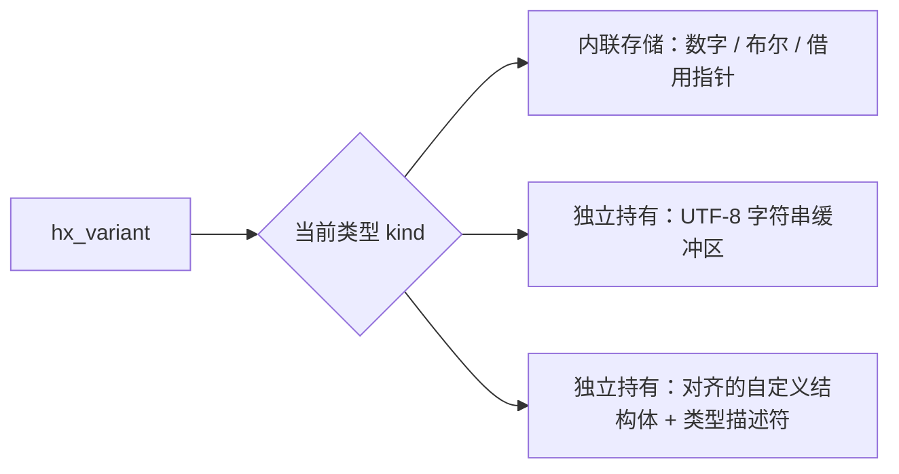

# variant：同一个变量保存不同类型

[English](VARIANT.md) · [首页](../README.zh-CN.md) · [常用任务教程](USAGE.zh-CN.md#variant)

当你的 C99 或 C++11 程序需要用同一个变量在不同阶段保存不同类型的值（例如先存整数、再存 UTF-8 字符串、最后存自定义结构体），或者需要在同一个 `vector`、`queue`、`map` 容器中混合存放多种类型的数据时，可以使用 `<hx_variant.h>`（C++11 对应 `<hx/Variant.hpp>`）。每次赋入新值时，`hx_variant` 会自动释放旧值持有的资源；读取时则执行严格的运行时类型匹配检查，避免裸 `union` 或 `void *` 强制转换带来的类型混淆与内存泄漏。

你可以直接参考[入门教程的完整 C／C++ 程序](USAGE.zh-CN.md#variant)，或在开启 `-DHX_OS_BUILD_EXAMPLES=ON` 后构建并运行 `hx_os_variant`（C99）与 `hx_os_cpp_variant`（C++11）目标。示例依次保存整数 `42`、字符串 `"hello"` 和坐标结构体 `Point(2, 5)`，运行后输出：

```text
Integer: 42
String: hello
Point: 2.0, 5.0
```

- [1. 它解决什么问题](#purpose)
- [2. 用 C 保存整数、字符串和结构体](#c-start)
- [3. 复制、移动和取值](#ownership)
- [4. 结构体内部还持有资源时](#custom)
- [5. C++11 的直接调用与访问器](#cpp)
- [6. 放进 vector、queue 和 map](#containers)
- [7. 内存、分配器和模块裁剪](#allocation)
- [8. 错误、线程和插件生命周期](#contracts)
- [9. 与 C++ variant 的具体差异](#comparison)
- [10. 使用示例与平台限制](#verification)

<a id="purpose"></a>

## 1. 它解决什么问题

`hx_variant` 是一个带运行时类型标记的值容器（Tagged Value）。单个 `hx_variant` 对象每次只处于一种活动类型状态：今天可以存 `42`，下一步替换为 `"hello"`，或者存入自定义的 `point` 结构体，切换类型时旧值会自动清理。当配合 `vector`、`queue` 或 `map` 使用时，容器负责管理多个元素槽位，而每个槽位内的 `hx_variant` 让不同元素可以各自持有不同类型。

在 C99 中只需包含 `<hx_variant.h>`（或总头文件 `<hx_os.h>`），在 C++11 中包含 `<hx/Variant.hpp>`。该模块无需全局初始化，不依赖配置树或设置模块，也不引入任何第三方依赖。

| 支持的值类型 | C 语言写入／读取入口（统一前缀 `hx_variant_`） | 存储与所有权语义 |
| --- | --- | --- |
| 空值（Empty） | `hx_variant_clear` / `hx_variant_kind` | `HX_VARIANT_INIT` 初始化后默认为空；调用 `clear` 会释放当前值并恢复为空 |
| 布尔值 | `set_bool` / `get_bool` | C 接口使用 `int`，写入时任何非零值都会规范化为 `1` |
| 有符号整数 | `set_i32`、`set_i64` / `get_i32`、`get_i64` | 精确保存 `int32_t` 或 `int64_t`，不做跨位宽隐式转换 |
| 无符号整数 | `set_u32`、`set_u64` / `get_u32`、`get_u64` | 精确保存 `uint32_t` 或 `uint64_t`，不做有符号／无符号隐式转换 |
| 浮点数 | `set_float`、`set_double` / `get_float`、`get_double` | 原样保存本机 IEEE 浮点数（包括 `NaN` 和正负无穷大） |
| UTF-8 字符串 | `set_cstr`、`set_string` / `get_string_view`、`get_string` | 深拷贝并独立持有 UTF-8 字节（显式长度接口允许包含内嵌 `NUL`） |
| 原始指针 | `set_pointer` / `get_pointer` | 仅保存借用指针（Borrowed Pointer），销毁时不会 `free` 指向的外部对象 |
| 自定义结构体 | `set_custom`、`emplace_custom` / `get_custom`、`get_custom_mut` | 按描述符校验类型身份、分配对齐存储，并调用自定义的复制与析构回调 |

> [!NOTE]
> 上表中的简写函数名均以 `hx_variant_` 开头，例如 `set_i32` 对应 `hx_variant_set_i32`。



如上图所示，这三种存储形态是互斥的分支，任意时刻只有 `hx_variant_kind(&value)` 所指示的那一种处于活动状态。

<a id="c-start"></a>

## 2. 用 C 保存整数、字符串和结构体

下面的完整 C99 程序展示了如何用同一个 `hx_variant` 依次保存 `int32_t`、UTF-8 字符串以及自定义的 `point` 结构体。你可以将其保存为 `main.c` 并配合[教程中的 C99 CMake 配置](USAGE.zh-CN.md#c-project)编译，或直接运行示例目标 `hx_os_variant`：

```c
#include <hx_variant.h>
#include <stdio.h>

typedef struct point {
	double x;
	double y;
} point;
HX_VARIANT_DEFINE_TRIVIAL_TYPE(point_type, point);

int main(void)
{
	hx_variant value = HX_VARIANT_INIT;
	point position = {2, 5};
	const void *object = NULL;
	hx_string_view text;
	int32_t count;
	hx_os_status status;

	if (!(hx_os_capabilities() & HX_OS_CAP_VARIANT)) {
		puts("Variant support is disabled");

		return 0;
	}

	status = hx_variant_set_i32(&value, 42, NULL);
	if (status != HX_OS_OK)
		goto failed;

	status = hx_variant_get_i32(&value, &count, NULL);
	if (status != HX_OS_OK)
		goto failed;

	printf("Integer: %d\n", (int)count);

	status = hx_variant_set_cstr(&value, "hello", NULL);
	if (status != HX_OS_OK)
		goto failed;

	status = hx_variant_get_string_view(&value, &text, NULL);
	if (status != HX_OS_OK)
		goto failed;

	printf("String: %.*s\n", (int)text.size, text.data);

	status = hx_variant_set_custom(&value, &point_type, &position, NULL);
	if (status != HX_OS_OK)
		goto failed;

	status = hx_variant_get_custom(&value, &point_type, &object, NULL);
	if (status != HX_OS_OK)
		goto failed;

	printf("Point: %.1f, %.1f\n", ((const point *)object)->x,
		((const point *)object)->y);

	hx_variant_destroy(&value);

	return 0;

failed:
	fprintf(stderr, "Variant failed: %s\n", hx_os_status_name(status));
	hx_variant_destroy(&value);

	return 1;
}
```

运行输出：

```text
Integer: 42
String: hello
Point: 2.0, 5.0
```

代码关键点解析：
1. **初始化**：`HX_VARIANT_INIT` 将变量初始化为空值并绑定默认分配器（也可以使用 `hx_variant_init(&value, context)` 绑定自定义分配器）。每个对象只应初始化一次。
2. **字符串深拷贝与借用视图**：`hx_variant_set_cstr` 会在内部深拷贝 `"hello"` 并替换原有的整数 `42`。随后 `hx_variant_get_string_view` 返回指向内部缓冲区的借用视图 `text`——无需也不能释放 `text.data`，且不能在 `value` 被重新赋值、清空或销毁后继续使用该视图。
3. **平凡结构体定义**：`point` 仅包含两个 `double` 数值，不持有外部资源，因此直接用宏 `HX_VARIANT_DEFINE_TRIVIAL_TYPE(point_type, point)` 生成静态类型描述符即可。
4. **自定义类型的存取**：`hx_variant_set_custom` 按 `point_type` 分配对齐存储并复制 `position`（后续修改局部的 `position` 不会影响已存入的值）。`hx_variant_get_custom` 校验传入的描述符地址仍为 `&point_type` 后，输出内部结构体的只读借用指针 `object`。
5. **销毁释放**：退出前调用 `hx_variant_destroy(&value)` 释放当前持有的内存（包括错误跳转分支 `failed`）。

> [!WARNING]
> **切勿使用 `=` 直接赋值 `hx_variant` 结构体**：对持有字符串或自定义结构体的 `hx_variant` 执行普通 C 结构体赋值（`b = a;`）会导致两个变量共享同一块底层堆内存，销毁时触发双重释放（Double Free）。如需复制或转移，请使用第 3 节的 `hx_variant_copy` 或 `hx_variant_move`。

<a id="ownership"></a>

## 3. 复制、移动和取值

| 函数签名／操作 | 成功时的行为 | 失败时的状态保持 |
| --- | --- | --- |
| `hx_variant_copy(out, source, error)` | 使用 `out` 绑定的 `context` 深拷贝一份独立值，源对象不变 | `out` 原有的值完整保留 |
| `hx_variant_move(out, source)` | 释放 `out` 的旧值，接管 `source` 的值与 `context`；`source` 变为空值 | 已初始化的有效对象之间不会失败，且零堆内存分配 |
| `hx_variant_swap(a, b)` | 原地交换两个对象的值与 `context` | 不会失败，零堆内存分配 |
| `hx_variant_clear(value)` | 释放当前持有的值并变为空，但保留已绑定的 `context` | 不会失败 |
| `hx_variant_destroy(value)` | 释放当前值与 `context` 租约，恢复为默认空状态 | 不会失败，支持对同一对象重复调用 |
| `get_i32` 等标量读取接口 | 将数值复制到调用方的输出变量 | 输出变量保持原值不变 |
| `get_string_view` | 输出指向内部 UTF-8 缓冲区的借用视图 `hx_string_view` | 输出变量保持原值不变 |
| `get_string` | 将字符串深拷贝到调用方已初始化的 `hx_string` 中 | 目标 `hx_string` 保持原值不变 |
| `get_custom` / `get_custom_mut` | 输出指向内部自定义结构体的只读／可写借用指针 | 输出指针保持原值不变 |

在日常使用中，请特别留意以下三条规则：
- **零拷贝接管现成字符串**：除了会复制字节的 `hx_variant_set_string` / `hx_variant_set_cstr` 外，你还可以调用 `hx_variant_take_string(&value, &str, error)` 直接接管一个已有的 `hx_string`。成功后原 `str` 变为空字符串，全程不发生新的内存分配，该字符缓冲区在后续释放时仍交还给创建它的原分配器。
- **严格的精确类型匹配**：存入 `int32_t` 后如果调用 `hx_variant_get_i64`，函数会返回 `HX_OS_TYPE_MISMATCH`（C++ 的 `get<T>()` 同样遵循精确类型匹配）。库不会暗中将 32 位整数拓宽为 64 位，也不会自动把字符串解析成数字。任何读取调用返回非 `HX_OS_OK` 时，都不要使用输出变量。
- **UTF-8 编码校验与借用指针生命周期**：所有字符串写入都会校验严格 UTF-8 编码，遇到非法字节序列返回 `HX_OS_INVALID_ENCODING`（`hx_string_view` 允许包含内嵌 `NUL`，而 `set_cstr` 在首个 `NUL` 处结束）。`get_string_view` 返回的视图在 `variant` 重新赋值、`clear` 或 `destroy` 后立即失效；`get_custom` 返回的结构体指针在对该 `variant` 执行 `hx_variant_move`（或外层容器扩容搬移 `hx_variant` 本体）时**不会**失效（因为自定义结构体存储在独立的堆块中），但指向容器内 `hx_variant` 元素本身的指针在容器扩容后会失效，需重新获取。

<a id="custom"></a>

## 4. 结构体内部还持有资源时

如果自定义结构体内部包含了 `hx_string`、动态分配的指针或文件句柄，就不能使用 `HX_VARIANT_DEFINE_TRIVIAL_TYPE` 按字节浅拷贝——否则两个副本在销毁时会重复释放同一份内部资源。此时需要为 `hx_variant_type` 提供自定义的 `copy` 和 `drop` 回调函数：库在写入（`set_custom`）或克隆（`hx_variant_copy`）时调用 `copy`，在替换、清空（`clear`）或销毁（`destroy`）时调用 `drop`。

下面的完整 C99 程序展示了如何为包含 `hx_string name` 的 `user_record` 结构体编写 `record_copy` 与 `record_drop`。程序先存入 `"Alice", 18`，接着把外部输入变量 `input.name` 修改为 `"Bob"`，再从 `variant` 中读取已保存的记录，验证内部拥有的是完全独立的深拷贝：

```c
#include <hx_variant.h>
#include <stdio.h>

typedef struct user_record {
	hx_string name;
	int32_t age;
} user_record;

static hx_os_status HX_OS_CALL record_copy(void *destination,
	const void *source, hx_os_context *context, void *user,
	hx_os_error *error)
{
	user_record *out = destination;
	const user_record *input = source;
	hx_os_status status;

	(void)user;
	hx_string_init(&out->name, context);

	status = hx_string_copy(&out->name, &input->name, error);
	if (status != HX_OS_OK) {
		hx_string_destroy(&out->name);

		return status;
	}

	out->age = input->age;

	return HX_OS_OK;
}

static void HX_OS_CALL record_drop(void *object, void *user)
{
	(void)user;

	hx_string_destroy(&((user_record *)object)->name);
}

static const hx_variant_type record_type = {
	sizeof(user_record), 0, record_copy, record_drop, NULL, 0};

int main(void)
{
	user_record input = {HX_STRING_INIT, 18};
	hx_variant value = HX_VARIANT_INIT;
	const void *object = NULL;

	hx_os_status status = hx_string_assign_cstr(&input.name, "Alice", NULL);
	if (status == HX_OS_OK)
		status = hx_variant_set_custom(
			&value, &record_type, &input, NULL);

	if (status == HX_OS_OK)
		status = hx_string_assign_cstr(&input.name, "Bob", NULL);

	if (status == HX_OS_OK)
		status = hx_variant_get_custom(
			&value, &record_type, &object, NULL);

	if (status == HX_OS_OK) {
		const user_record *saved = object;

		printf("Record: %s, %d\n", hx_string_c_str(&saved->name),
			(int)saved->age);
	}
	else
		fprintf(stderr, "%s\n", hx_os_status_name(status));

	hx_variant_destroy(&value);
	hx_string_destroy(&input.name);

	return status == HX_OS_OK ? 0 : 1;
}
```

运行输出：`Record: Alice, 18`。

编写自定义类型描述符时，请遵循以下契约：
1. **`copy` 回调与失败回滚**：`record_copy` 收到的 `destination` 是已按结构体要求对齐、但尚未初始化的原始内存。如果内部成员（如 `out->name`）复制失败，回调必须先自行清理已经初始化的那部分子资源，然后返回错误码。库在 `copy` 返回错误时只会回收外层 `destination` 的原始内存块，**绝不会**对构造失败的半成品调用 `drop`，同时目标 `hx_variant` 原有的旧值保持不变。
2. **`drop` 回调的职责边界**：`record_drop` 只需释放结构体内部持有的子资源（如 `hx_string_destroy(&record->name)`）；结构体外层存储块本身由 `hx_variant` 负责释放，回调切勿对 `object` 指针再次调用 `free`。每个成功构造的对象最多只会调用一次 `drop`。
3. **描述符地址即类型身份（Type Identity）**：库通过比较 `const hx_variant_type *` 的**内存地址**来判断类型是否匹配——即使两个描述符的字段内容完全相同，只要地址不同就会被视为不同类型（读取时返回 `HX_OS_TYPE_MISMATCH`）。在多个 `.c` 文件之间共享同一种自定义类型时，请在公共头文件中声明 `extern const hx_variant_type point_type;`，并在某一个 `.c` 文件中定义它。描述符、回调函数代码以及借用的 `user` 数据必须活到所有关联的 `hx_variant` 实例销毁之后。
4. **原地构造与只移动（Move-Only）类型**：如果某种类型不支持复制、或者希望直接在目标内存中构造，请使用 `hx_variant_emplace_custom(value, type, construct, user, error)`（仅当 `construct` 回调返回 `HX_OS_OK` 时才会替换旧值）。将描述符设为 `copy = NULL, drop != NULL` 或在 `flags` 中设置 `HX_VARIANT_TYPE_NO_COPY`，即表示该类型仅允许 `emplace_custom` 原地构造和 `hx_variant_move` 转移，对其调用 `set_custom` 或 `hx_variant_copy` 会返回 `HX_OS_NOT_SUPPORTED`（注意 `HX_VARIANT_TYPE_NO_COPY` 不能与非空的 `copy` 回调同时设置）。描述符的 `size` 必须非零，`alignment` 必须为 `0` 或 2 的幂，否则返回 `HX_OS_INVALID`；分配尺寸计算溢出时返回 `HX_OS_RANGE`。

<a id="cpp"></a>

## 5. C++11 的直接调用与访问器

在 C++11 中，`<hx/Variant.hpp>` 提供了两种无异常封装：
- `hx::Variant`：开放类型容器，可在运行时存入任意受支持的标量、字符串或自定义类型。
- `hx::TypedVariant<Ts...>`：编译期受限容器，模板参数显式列出允许存入的类型集合，尝试写入列表之外的类型会在编译期直接报错。两者均基于标准 C++11 实现，无需 C++17 `<variant>`，底层复用同一套 C 实现并通过 `hx::Result<T>` 报告错误。

将下面的完整程序保存为 `main.cpp`，配合[关闭异常的 C++ CMake 配置](USAGE.zh-CN.md#cpp-project)即可编译，也可直接运行构建目标 `hx_os_cpp_variant`：

```cpp
#include <hx/Variant.hpp>
#include <cstdio>

struct Point {
	double x;
	double y;
};

int main()
{
	if (!(hx_os_capabilities() & HX_OS_CAP_VARIANT)) {
		std::puts("Variant support is disabled");

		return 0;
	}

	hx::TypedVariant<int32_t, double, hx::StringView, Point> value;

	if (!value.set(int32_t(42)))
		return 1;

	auto count = value.get<int32_t>();

	if (!count)
		return 1;

	std::printf("Integer: %d\n", static_cast<int>(count.value()));

	if (!value.set("hello"))
		return 1;

	auto text = value.get<hx::StringView>();

	if (!text)
		return 1;

	std::printf("String: %.*s\n", static_cast<int>(text.value().size()),
		text.value().data());

	if (!value.set(Point{2, 5}))
		return 1;

	auto position = value.get<Point>();

	if (!position)
		return 1;

	std::printf(
		"Point: %.1f, %.1f\n", position.value().x, position.value().y);
}
```

输出结果与第 2 节的 C 程序完全一致。在 C++ 中调用 `value.set(Point{2, 5})` 会自动为 `Point` 生成类型描述符，无需手动编写 C 描述符宏；`value.get<Point>()` 则返回经过类型检查的引用包装。

> [!TIP]
> **为什么模板列表里写的是 `hx::StringView`？**
> 在 `hx::TypedVariant<..., hx::StringView, ...>` 中，`hx::StringView` 是代表“UTF-8 字符串分支”的规范类型标签：当你调用 `value.set("hello")` 时，`Variant` 内部依然会**深拷贝并独立持有**这份字符串字节；而在调用 `value.get<hx::StringView>()` 时，则返回零拷贝的借用视图。

| 常见操作 | C++11 调用写法 |
| --- | --- |
| 保存定长整数 | `value.set(int32_t(42))` |
| 保存浮点数 | `value.set(3.5)` |
| 保存 UTF-8 字符串 | `value.set("hello")` |
| 零拷贝接管已有的 `hx::String` | `value.takeString(std::move(text))`（仅开放 `hx::Variant` 支持） |
| 保存可拷贝结构体 | `value.set(Point{2, 5})` |
| 原地构造自定义类型（支持不可拷贝类型） | `value.emplace<MyType>(arguments...)` |
| 检查当前是否为某类型 | `value.holds<Point>()` |
| 读取当前值 | `auto result = value.get<Point>();`（检查 `if (result)` 后访问 `result.value()`） |
| 显式深拷贝整个 Variant | `auto copied = value.clone(context);`（`context` 默认为 `NULL`） |
| 移动构造／移动赋值 | `hx::Variant moved(std::move(value));` |
| 清空与自动析构 | `value.clear()`（对象离开作用域时析构函数也会自动释放） |

关于 C++ 自定义类型与 `visit` 访问器的使用约束：
- **返回值形态**：读取标量（`bool`、`int32_t`/`uint32_t`、`int64_t`/`uint64_t`、`float`、`double`、`void *`）时返回数值副本；读取 `hx::StringView` 返回借用视图；读取自定义结构体返回对象引用（`const` 修饰的 `Variant` 返回 `const` 引用）。为防止悬空引用，禁止从右值临时 `Variant` 对象上借用视图或引用。
- **`noexcept` 与可失败拷贝**：传入 `set<T>` 或 `emplace<T>` 的 C++ 类型，其复制构造函数、原地构造函数和析构函数都必须声明为 `noexcept`。对于只允许移动／原地构造而不允许复制的资源类型，请使用 `emplace<T>` 构造；对包含此类对象的 `Variant` 调用 `clone()` 会返回 `HX_OS_NOT_SUPPORTED`。如果某个自定义类型在深拷贝时需要从目标 `hx_os_context` 分配内存并可能返回分配失败错误，请按第 4 节定义 C 语言 `hx_variant_type` 描述符并通过 `value.native()` 操作，不要包裹会抛异常的 `std::string` 等标准库容器。
- **类型安全访问器（`visit`）**：`visit` 会根据当前活动类型同步调用函数对象中匹配的重载：

```cpp
#include <hx/Variant.hpp>
#include <cstdio>

struct PrintValue {
	void operator()(int32_t value) const noexcept
	{
		std::printf("Integer: %d\n", static_cast<int>(value));
	}

	void operator()(hx::StringView value) const noexcept
	{
		std::printf("String: %.*s\n", static_cast<int>(value.size()),
			value.data());
	}
};

int main()
{
	hx::TypedVariant<int32_t, hx::StringView> value;

	if (!value.set("hello"))
		return 1;

	auto printed = value.visit(PrintValue{});

	return printed ? 0 : 1;
}
```

运行输出 `String: hello`。访问器回调同步执行，可以返回 `void`、`hx_os_status` 或 `hx::Result<void>`，且所有 `operator()` 重载必须标记为 `noexcept`。
- 在 `hx::TypedVariant` 上调用 `value.visit(visitor)` 会自动覆盖模板声明的全部类型；在开放的 `hx::Variant` 上则通过 `value.visit<int32_t, hx::StringView>(visitor)` 显式指定要匹配的类型列表（支持 1 到 64 个无 `cv`/引用修饰的不重复类型，按列表顺序匹配，最坏 `O(N)`）。
- 若当前实际保存的类型不在访问列表中（或者当前为空值且列表未包含 `hx::EmptyValue`），`visit` 会返回 `HX_OS_TYPE_MISMATCH`。如果希望访问器同时处理空状态，只需将 `hx::EmptyValue` 加入类型列表并提供 `void operator()(hx::EmptyValue) const noexcept` 重载即可。

<a id="containers"></a>

## 6. 放进 vector、queue 和 map

调用 `hx_variant_container_options_init(&options, context)` 即可为 [C 容器](CONTAINERS.zh-CN.md)（`vector`、`deque`/`queue` 以及 `map` 的值）一次性配置好 `hx_variant` 的深拷贝与自动销毁回调。下面的完整 C99 程序在同一个 `hx_os_vector` 中依次存入整数 `42` 和字符串 `"hello"`，然后按下标读取并打印 `Values: 42, hello`：

```c
#include <hx_variant.h>
#include <hx_container.h>
#include <stdio.h>

int main(void)
{
	hx_os_container_options options;
	hx_os_vector *values = NULL;
	hx_variant value = HX_VARIANT_INIT;
	const hx_variant *saved;
	hx_string_view text;
	int32_t number;
	hx_os_status status;

	hx_variant_container_options_init(&options, NULL);
	options.max_items = 16;

	status = hx_os_vector_create(NULL, &options, &values, NULL);
	if (status == HX_OS_OK)
		status = hx_variant_set_i32(&value, 42, NULL);

	if (status == HX_OS_OK)
		status = hx_os_vector_push_back(values, &value, NULL);

	if (status == HX_OS_OK)
		status = hx_variant_set_cstr(&value, "hello", NULL);

	if (status == HX_OS_OK)
		status = hx_os_vector_push_back(values, &value, NULL);

	if (status == HX_OS_OK) {
		saved = hx_os_sequence_at(values, 0);

		status = hx_variant_get_i32(saved, &number, NULL);
	}

	if (status == HX_OS_OK) {
		saved = hx_os_sequence_at(values, 1);

		status = hx_variant_get_string_view(saved, &text, NULL);
	}

	if (status == HX_OS_OK)
		printf("Values: %d, %.*s\n", (int)number, (int)text.size,
			text.data);

	hx_variant_destroy(&value);
	hx_os_status closed = hx_os_sequence_destroy(&values, NULL);
	if (status == HX_OS_OK)
		status = closed;

	if (status != HX_OS_OK)
		fprintf(stderr, "%s\n", hx_os_status_name(status));

	return status == HX_OS_OK ? 0 : 1;
}
```

将 `hx_variant` 放入容器时的注意事项：
- `hx_os_vector_push_back` 会深拷贝一份独立的 `hx_variant`，因此后续复用或销毁局部的 `value` 不会影响容器内的元素。若需要对容器执行排序、堆操作或作为有序 `map` 的键使用，仍需由业务代码提供自定义的 `compare` / `key_compare` 回调。
- **切勿混用 POD 容器宏或 C++ 包装对象地址**：不要用专为纯字节 POD 类型设计的 `HX_OS_DECLARE_VECTOR` 宏存放 `hx_variant`，也不要把 C++ `hx::Variant` 对象按字节拷贝进 C 容器。在 C++ 中向底层 C 容器传参时，容器元素类型应为 `hx_variant`，并传入 `value.native()`（而非 `&value`）。
- **弹出接管与 `_take` 转移**：调用 `pop` 或 `erase` 时若传入非 `NULL` 的 `hx_variant` 外部变量，该变量必须是尚未持有任何资源或 `context` 租约的空白存储，弹出成功后由调用方负责调用 `hx_variant_destroy`；传 `NULL` 则由容器直接销毁该元素。使用 `push_back_take` 等 `_take` 接口将 `hx_variant` 转移进容器成功后，必须直接将源变量重置为 `HX_VARIANT_INIT`，切勿再对其调用 `hx_variant_destroy`。

<a id="allocation"></a>

## 7. 内存、分配器和模块裁剪

| 操作路径 | 内存分配与运行时开销 |
| --- | --- |
| 初始化默认空值 / 读取标量 / `visit` 分发 | 零堆内存分配，不引入互斥锁、后台线程或系统调用 |
| 写入或复制标量（整数、浮点、布尔、裸指针） | 零堆内存分配（若覆盖旧的字符串或自定义结构体，会释放旧资源） |
| 写入 UTF-8 字符串 | `O(字节数)` 校验与复制；非空字符串分配一次字符缓冲区 |
| 写入自定义结构体 | 按描述符的 `size` 与 `alignment` 分配一块独立存储，并执行一次 `copy` 回调 |
| `hx_variant_move` / `hx_variant_swap` | 零堆内存分配，直接转移指针与所有权（`move` 会先释放目标对象的旧值） |
| 克隆自定义结构体 | 分配新存储块并调用 `copy` 回调，与源对象完全隔离 |

关于 `hx_os_context` 租约、结构体布局与编译裁剪：
- **分配器上下文租约**：调用 `hx_variant_init(&value, context)` 绑定非默认 `context` 后，即使 `value` 当前为空，也会持有一份 `context` 引用（此时销毁该 `context` 会返回 `HX_OS_BUSY`）。调用 `hx_variant_clear` 仅释放值而保留 `context` 绑定；只有调用 `hx_variant_destroy` 才会释放 `context` 租约。`hx_variant_copy` 始终使用目标对象已绑定的 `context` 进行分配，而 `move` 和 `swap` 会连同 `context` 一起转移。
- **ABI 尺寸参考**：在 Windows MSVC 下实测，64 位 `hx_variant` 与 `hx_variant_type` 均为 48 字节（8 字节对齐），32 位下均为 24 字节（8 字节对齐）；C++ `hx::Variant` 零额外存储开销。不同平台／ABI 请以构建生成的布局报告为准。
- **独立模块裁剪（`HX_OS_ENABLE_VARIANT`）**：`HX_OS_ENABLE_VARIANT` 默认开启（`ON`）。设为 `OFF` 时保留公共头文件声明与导出符号，清除 `HX_OS_CAP_VARIANT` 能力位，写入与复制等活动操作返回 `HX_OS_NOT_SUPPORTED`，而初始化、`hx_variant_kind` 查询与 `destroy` 仍可安全调用。在启用了 `cmake/minimal.cmake` 的嵌入式最小配置中，可以单独开启 `HX_OS_ENABLE_VARIANT`（无需开启 `HX_OS_ENABLE_CONFIG`、`HX_OS_ENABLE_SETTINGS` 或 `HX_OS_ENABLE_CONTAINERS`）：

```sh
cmake -S . -B build-variant -C cmake/minimal.cmake \
  -DHX_OS_ENABLE_VARIANT=ON \
  -DHX_OS_BUILD_EXAMPLES=ON -DBUILD_SHARED_LIBS=ON
cmake --build build-variant --config Release
build-variant/bin/hx_os_variant
```

（在 Windows Visual Studio 等多配置生成器下，可执行文件位于 `build-variant/bin/Release/hx_os_variant.exe`。）

> [!NOTE]
> 如需使用 `hx_variant_container_options_init` 将 `hx_variant` 存入容器，请同时开启 `HX_OS_ENABLE_CONTAINERS=ON`。容器的 `max_items` 和 `max_bytes` 限制容器自身的节点与数组存储，而 `hx_variant` 内部派生的字符串缓冲区与自定义结构体分配位于容器 `max_bytes` 账本之外；处理不可信外部输入时，应用层仍应主动限制单个文本长度与自定义结构体的资源消耗。

<a id="contracts"></a>

## 8. 错误、线程和插件生命周期

`hx_variant` 的所有错误均通过返回值 `hx_os_status` 及可选的调用方 `hx_os_error *error` 结构体报告，不依赖线程局部全局错误码或日志器。当自定义 `copy` / `construct` 回调被调用时，库会向其传入一个已清零的非 `NULL` `hx_os_error` 指针，回调返回的非 `HX_OS_OK` 状态码及填写的原生错误码（Domain / Code / Cause）会被原样保留并向上传播。

| 返回状态码 | 触发原因与恢复保证 |
| --- | --- |
| `HX_OS_OK` | 写入、深拷贝、原地构造或读取成功完成 |
| `HX_OS_TYPE_MISMATCH` | 读取或 `visit` 时，当前活动类型（或自定义类型的描述符地址）与请求不匹配 |
| `HX_OS_INVALID_ENCODING` | 写入的字符串不是合法的 UTF-8 字节序列 |
| `HX_OS_INVALID` | 必填指针参数为 `NULL`，或自定义类型描述符的 `size`/`alignment`/`flags` 非法 |
| `HX_OS_RANGE` | 计算自定义对象分配尺寸或对齐填充时发生整数溢出 |
| `HX_OS_NO_MEMORY` | 字符串缓冲区或自定义结构体存储块分配失败（原 `hx_variant` 的旧值保持不变） |
| `HX_OS_NOT_SUPPORTED` | `HX_OS_ENABLE_VARIANT` 模块已关闭，或对禁止复制（`HX_VARIANT_TYPE_NO_COPY`）的类型调用了复制接口 |
| 用户回调返回的其他状态码 | 自定义 `copy` / `construct` / `visit` 回调返回的错误原样传播；写入／替换失败时目标对象的旧值完整保留 |

**并发与动态库（DLL／插件）生命周期要求：**
- **线程安全边界**：单个 `hx_variant` 实例内部不含互斥锁。当值与内部资源保持不可变时，允许多个线程同时调用只读接口；任何修改、移动或销毁操作都必须由外部同步原语与所有并发读写互斥。
- **插件卸载顺序**：如果自定义类型的 `hx_variant_type` 描述符、`copy`/`drop` 回调函数代码或借用的 `user` 状态位于某个动态加载的插件（DLL / `.so`）中，宿主必须在卸载该插件之前销毁或清空所有持有该自定义类型的 `hx_variant` 实例，并确保没有在途的 `copy`、`drop` 或 `visit` 调用。
- **跨 DLL 边界的类型身份**：C++ 自动生成的模板局部静态描述符在同一链接模块（同一个可执行文件或同一个 DLL）内部的多个编译单元之间共享地址；但如果跨多个独立链接的 DLL 传递自定义类型，不要依赖同名 C++ 类自动合并静态变量，而应当在公共层显式定义并导出一个共享的 C `hx_variant_type` 描述符，确保全局使用唯一地址。

<a id="comparison"></a>

## 9. 与 C++ variant 的具体差异

| 维度 | 本库 `hx_variant` / `hx::Variant` / `hx::TypedVariant` | C++17 `std::variant` |
| --- | --- | --- |
| 语言基线 | C99 核心实现 + C++11 无异常封装 | 需要 C++17 标准库支持 |
| 可选类型集合 | `hx_variant` 与 `hx::Variant` 支持运行时任意描述符；`hx::TypedVariant<Ts...>` 在编译期限制类型集合 | 仅支持编译期模板参数列表 |
| 默认初始状态 | 始终初始化为空状态（`HX_VARIANT_EMPTY`），不会自动默认构造第一个候选类型 | 默认构造模板列表中的第一个类型（或需显式使用 `std::monostate`） |
| 内存布局 | 标量内联存储，UTF-8 字符串独立持有堆缓冲区，自定义结构体独立分配对齐堆块 | 所有候选类型以内联联合体（Inline Union）方式存放在对象自身内部 |
| 错误与异常模型 | 显式返回 `hx_os_status` / `hx::Result<T>`，替换失败时保留旧值，绝不出现因异常导致的 `valueless_by_exception` 状态 | 依赖 C++ 异常报告构造／赋值失败 |
| 复制与只移动类型 | C 使用 `hx_variant_copy`，C++ 使用显式可失败的 `clone()`；允许注册仅支持 `emplace`/移动、禁止复制的类型 | 若任一候选类型不可复制，整个 `std::variant` 的复制构造即被禁用 |
| 访问器（Visitor） | 单值同步分发，返回 `void`、`hx_os_status` 或 `hx::Result<void>`，按类型列表线性匹配 `O(N)` | 支持多参数联合分发（參考 [C++ variant 定义](https://eel.is/c++draft/variant.general) 与 [visit 契约](https://eel.is/c++draft/variant.visit)） |
| 序列化与持久化 | 仅作为内存运行时多态值容器，不自动转换为 JSON／配置树，也不序列化裸指针或任意结构体 | 标准库同样不包含内置序列化 |

<a id="verification"></a>

## 10. 使用示例与平台限制

你可以在启用 `-DHX_OS_BUILD_EXAMPLES=ON` 后构建并运行以下公开目标来验证或参考集成方式：
- `hx_os_variant`：演示 C99 下整数、字符串、平凡结构体、拥有资源的自定义结构体以及容器集成的完整用法。
- `hx_os_cpp_variant`：演示 C++11 `hx::Variant`、`hx::TypedVariant` 与 `visit` 访问器的无异常用法。
- `hx_os_portable_baseline`：包含 `hx_variant` 标量读写与结构体存取的基准耗时采样，具体运行方式可参考[Android 基准](ANDROID.zh-CN.md)和[构建参考](REFERENCE.zh-CN.md#section-30)。

各目标操作系统的编译器要求、系统版本基线与部署说明见[平台支持](PLATFORMS.zh-CN.md)。
